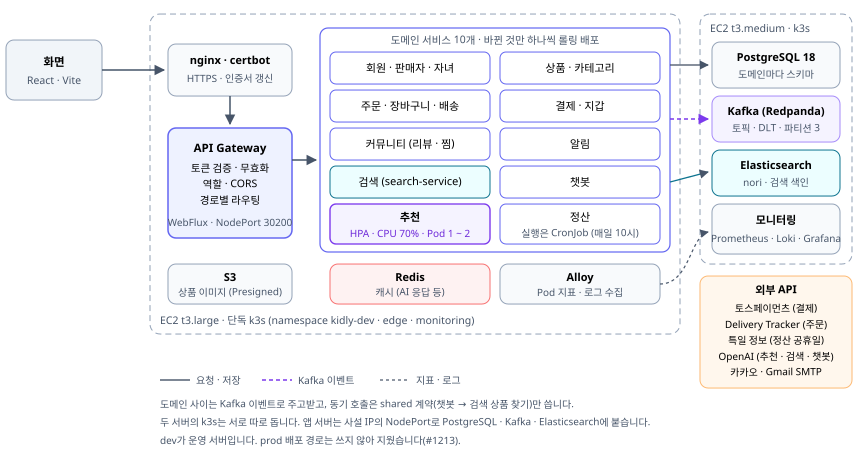
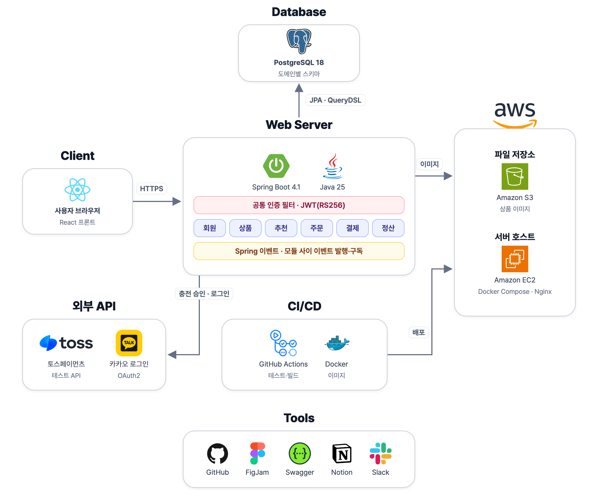
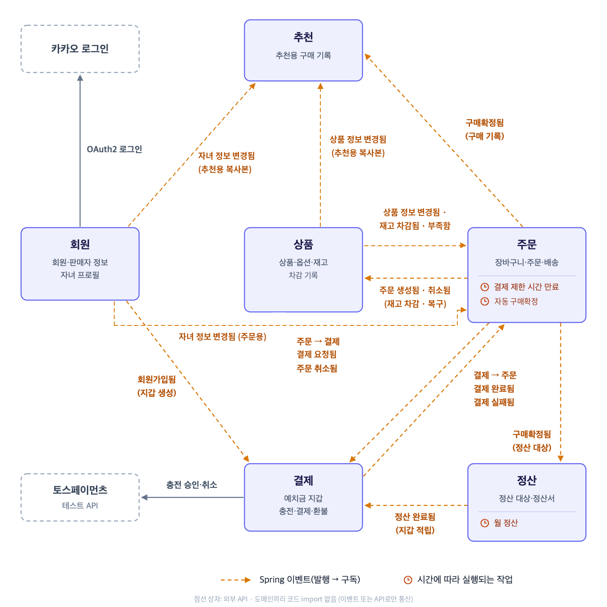
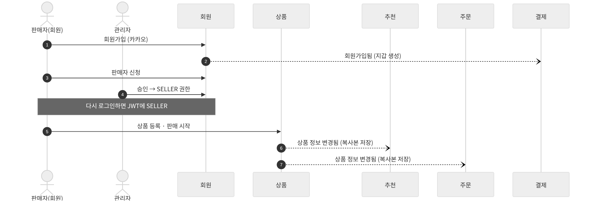
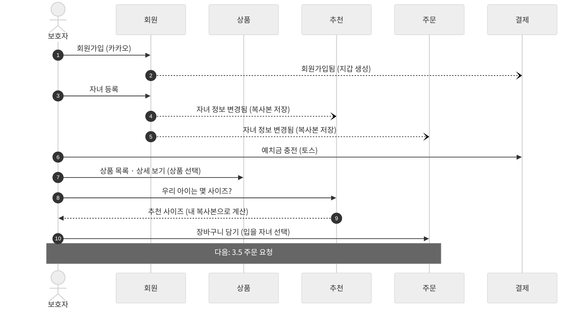
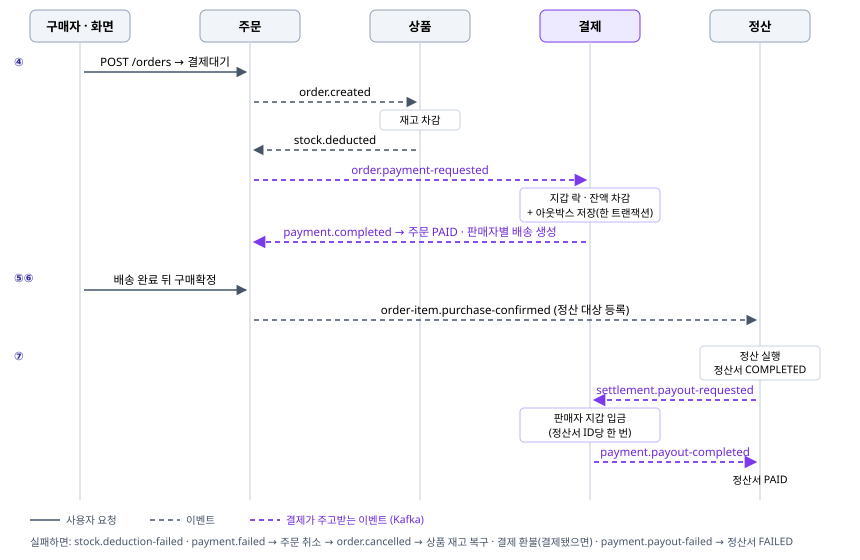
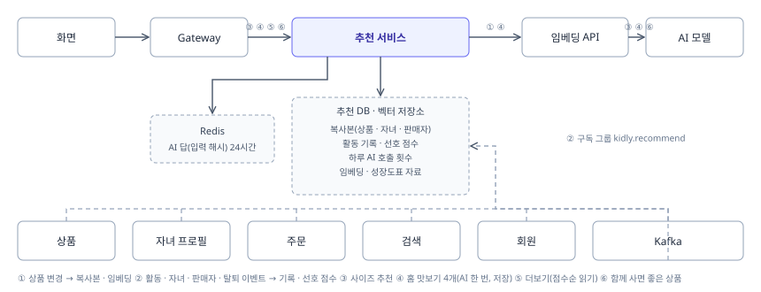
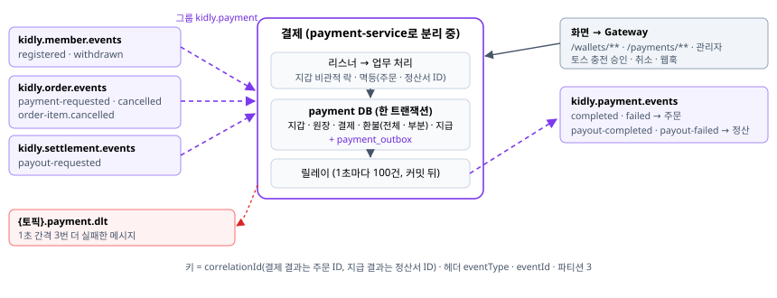
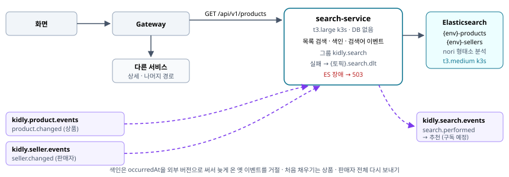

# 전체 그림

## 3.1 전체 구성

세미의 **모듈러 모놀리스**(앱 1개 · 배포 1개 · DB 1개)에서 출발해, 도메인 사이 이벤트를 **Kafka**로 옮기고 서비스를 하나씩 떼어 내고 있습니다. 모든 요청은 **API Gateway**를 거치고, 서비스끼리는 서로 부르지 않습니다.

- 요청은 화면 → **API Gateway**(dev 8083 · prod 8084) → 서비스로 갑니다. Gateway가 토큰 검증 · 무효화 확인 · 역할 검사 · CORS를 하고 검증된 회원 정보를 헤더로 넘깁니다. 서비스는 Gateway 뒤에서만 열린다는 전제입니다.
- Gateway는 경로별로 도메인 서비스에 보냅니다. `GET /api/v1/products`는 search-service가 처리합니다.
- 도메인 사이는 Kafka 이벤트로만 주고받습니다(토픽은 3.3). 다른 도메인 정보는 이벤트로 받아 둔 복사본을 씁니다 (6.3).
- 서버는 EC2 2대입니다: t3.large(Docker Compose: Gateway · 도메인 서비스 · PostgreSQL · Kafka)와 t3.medium(k3s: Elasticsearch · 모니터링). 상품 이미지는 S3, 배포는 GitHub Actions가 맡습니다.
- 검색 서비스(search-service)는 독립된 Spring Boot 앱입니다. 앱 서버 t3.large의 docker compose에서 돌고(프로필 `search`, heap 512m), 서버 안 `127.0.0.1:8082`에만 열립니다.
- Elasticsearch(공식 이미지 + nori)는 모니터링과 같은 t3.medium의 k3s에서 돕니다(namespace `search`, heap 1g, 데이터 10Gi). 검색 서비스는 VPC 안에서 NodePort 30920으로 붙고, 보안 그룹은 t3.large에서 오는 것만 받습니다.
- 지금은 dev만 켜져 있습니다. 배포는 앱 배포 워크플로가 Elasticsearch를 먼저 올린 뒤 검색 서비스를 올립니다. Elasticsearch 설정이나 이미지가 바뀌면 다시 뜨는 동안 2분쯤 검색이 끊깁니다.

아래는 세미 때 구성(앱 1개 · EC2 1대)입니다. 참고로 남깁니다.

## 3.2 모듈 구성

| 모듈 | 담당 | 한 줄 책임 |
|---|---|---|
| 회원 | maruhxn | 로그인 · 가입 · 탈퇴 · 정지, 자녀 프로필, 판매자 승인, 가입 환영 메일 — member · childprofile · seller · notification 모듈. 자녀 프로필은 childprofile-service로 분리(dev), 인증은 auth 도메인으로 분리 중(#686) |
| 상품 | heojungseok | 상품 · 옵션 · 재고, 상품 상세, 카테고리 · 상품 유형 · 항목 · 실측 항목 기준 데이터, 이미지 업로드 주소 (목록 · 검색은 검색 모듈로) |
| 추천 | heojungseok | 사이즈 추천 · AI 상품 추천 · 함께 사면 좋은 상품, 활동 기록 · 선호 점수, 기준 옷 비교(2순위). recommend-service로 분리 중(#704) |
| 주문 | L2J92 | 장바구니 · 공용 장바구니(조르기), 주문, 배송(택배 조회), 구매확정, 판매자 부분 취소 — order · cart · delivery · wish 4개 컨텍스트(포트로만 연결, ArchUnit으로 고정) |
| 결제 | codes-gy | 지갑(동결 포함), 충전 · 충전 취소, 주문 결제 · 환불, 정산금 입금, 토스 웹훅. payment-service로 분리 중 |
| 검색 | codes-gy | 상품 목록 검색(Elasticsearch), 상품 · 판매자 이벤트로 색인, 검색어 이벤트 발행. search-service로 따로 뜸 |
| 정산 | baiees | 정산 대상, 영업일 일정산(Spring Batch), 지급 요청 · 결과 반영 (지갑 적립은 결제) |
| 커뮤니티 | L2J92 | 리뷰(작성 자격 · 작성 · 목록 · 요약 · 사이즈 핏 · 사진) · 찜 · 부적절 리뷰 검사 · 쓰이지 않는 사진 정리 · 운영 조회(MCP) — review · favorite 컨텍스트. 상품 · 주문 · 회원 이벤트만 받고 보내는 이벤트는 없음 |
| 공통 | 팀 | 오류 응답, 이벤트 형식(`shared` 계약), 이벤트 발행 · Kafka 규칙, 공통 설정, 요청 로그 · 모니터링, FE 동작 설정(setting 모듈). API Gateway(apps/gateway, maruhxn) |

### 주문 모듈 구조 변경 (세미 → 최종)

주문은 다른 도메인과 Kafka 이벤트로만 연결되고, 외부 API 주소와 응답 형식은 세미 그대로입니다(필드 · 값 추가만).

| 항목 | 세미 | 최종 |
|---|---|---|
| 모듈 | 앱 안의 패키지, 공통 모듈(common)에 의존 | 독립 Gradle 모듈(`domains/order`), 공통 모듈 의존 제거 |
| 내부 구성 | 주문 한 덩어리 | 컨텍스트 4개(order 주문 · cart 장바구니 · delivery 배송 · wish 조르기), 컨텍스트끼리는 포트로만 연결 |
| 계층 구조 | app · domain · in · out | 같은 구조를 ArchUnit 테스트로 고정(계층 · 컨텍스트 경계 · 패키지 배치) |
| 도메인 간 통신 | Spring 이벤트(앱 안) | Kafka. 보내기는 아웃박스, 받기 실패는 DLT. 수신 스위치로 Spring 이벤트 경로 전환 가능 |
| 인증 | 앱의 공통 인증 필터 | API Gateway가 검증, 주문은 헤더로 로그인 회원만 받음 |
| DB 스키마 | JPA 자동 생성 | Flyway 마이그레이션 |
| 실패 복구 | 이벤트 처리 실패 · 결제 반영 실패를 관리자가 재처리 | + DLT 메시지도 관리자 화면에서 확인 · 재처리 · 종료 |

## 3.3 모듈 연결 지도

도메인 사이 이벤트는 모두 **Kafka**로 갑니다. 보내는 도메인마다 토픽이 하나이고, 받는 도메인은 자기 구독 그룹으로 필요한 종류만 받습니다. 최신 연결은 [도메인 연결 지도](https://claude.ai/artifact/SsSBBKhQsFNFJVCXrPPtGU)에서 볼 수 있습니다.

| 보내는 쪽 | 토픽 | 이벤트 → 받는 쪽 (구독 그룹 `kidly.{받는도메인}`) |
|---|---|---|
| 회원 | `kidly.member.events` | `member.registered` → 결제 · 알림 · `member.changed` → 판매자 · `member.withdrawn` → 자녀 프로필 · 결제 · 커뮤니티 (추천 예정) · `member.tokens-revoked` → Gateway |
| 판매자 | `kidly.seller.events` | `seller.changed` → 회원 · 상품 · 주문 · 추천 · 검색 |
| 자녀 프로필 | `kidly.childprofile.events` | `child.changed` → 주문 · 추천 |
| 상품 | `kidly.product.events` | `product.changed` → 주문 · 추천 · 검색 · 커뮤니티 · `stock.deducted` · `stock.deduction-failed` → 주문 |
| 주문 | `kidly.order.events` | `order.created` → 상품 · `order.payment-requested` → 결제 · `order.cancelled` → 상품 · 결제 · `order-item.purchase-confirmed` → 정산 · 추천 · 커뮤니티 · `order-item.cancelled` → 결제 · 상품 · `cart.item-added` → (추천 예정) |
| 결제 | `kidly.payment.events` | `payment.completed` · `payment.failed` → 주문 · `payment.payout-completed` · `payment.payout-failed` → 정산 |
| 정산 | `kidly.settlement.events` | `settlement.payout-requested` → 결제 (dev 켬, prod는 main 반영 때) |
| 검색 | `kidly.search.events` | `search.performed` → (추천 예정) · `search.result-clicked`(받는 도메인 없음) |

- 결제 · 주문 · 정산 · 커뮤니티에는 Spring 이벤트 수신 코드도 남아 있습니다. Kafka 수신 스위치를 끌 때 되돌아가는 길입니다. 상품은 Kafka로만 받아, 상품 수신 스위치를 끄면 주문 이벤트 수신이 멈춥니다. 판매자 부분 취소(`order-item.cancelled`)는 Kafka로만 받습니다.
- 다른 도메인 정보가 필요하면 이벤트로 받아 **자기 복사본**을 둡니다 (6.3). 예: 추천은 자녀 정보 · 상품 사이즈 정보를, 주문은 자녀 정보 · 상품 가격을 복사본으로 가집니다.
- **🕒 = 시간에 따라 실행되는 작업** (주문: 결제 제한 시간 만료 · 자동 구매확정 · 택배 조회 · 아웃박스 릴레이 / 정산: 영업일 일정산(Spring Batch) · 지급 결과 재요청 · 아웃박스 릴레이 / 결제: 충전 정리 · 주문 취소 환불 재처리 · 아웃박스 릴레이 · 정리 / 상품 · 자녀 프로필: 아웃박스 릴레이 / 알림: 메일 재발송 / 회원: 만료된 Refresh Token 정리)
- 다른 모듈의 테이블은 직접 읽지 않습니다. 도메인 사이에는 FK를 두지 않고, 다른 모듈의 ID는 값으로만 저장합니다.

아래는 세미 때 그림(Spring 이벤트)입니다. 연결은 위 표가 기준입니다.

## 3.4 주문 전까지

주문 · 추천은 회원 · 상품에 묻지 않고, 미리 받아 둔 **복사본**을 씁니다 (6.3). 실선 = 사용자 요청, 점선 = 이벤트. 그림은 세미 기준이고, 지금 점선의 이벤트는 Kafka로 갑니다(3.3).

**① 판매자가 되기까지**

**② 보호자가 장바구니에 담기까지**

## 3.5 구매에서 정산까지

결제는 주문 · 상품을 부르지 않고, 받은 이벤트로만 움직입니다. 결제 결과 · 지급 결과는 지갑을 바꾼 트랜잭션에서 아웃박스에 저장한 뒤 보내므로 「돈은 빠졌는데 알림이 사라지는」 일이 없습니다.

실선 = 사용자 요청, 점선 = 이벤트. 번호 순서대로 7장의 ④ → ⑦ 카드가 이어집니다.

## 3.6 추천 서비스 데이터 흐름

실선 = 사용자 요청, 점선 = Kafka 이벤트.

- 주문 · 결제 경로에는 추천 서비스가 없습니다. 추천 서비스가 멈추면 Gateway가 3초 뒤 끊고 화면은 추천 영역만 비웁니다.
- 계산은 이벤트가 올 때 합니다(복사본 · 임베딩 · 선호 점수). 요청이 올 때는 저장된 것을 읽고, AI 호출은 홈 맛보기와 함께 사면 좋은 상품에만, 같은 입력이면 저장된 응답을 재사용합니다.

## 3.7 결제 서비스 이벤트 흐름

실선 = 요청 · 저장, 점선 = Kafka.

결제는 다른 도메인을 부르지 않습니다. 화면 요청(충전 · 조회)과 이벤트만 받고, 결과는 이벤트로만 알립니다. 그래서 결제를 다른 서비스로 떼어도 다른 도메인의 코드는 바뀌지 않습니다.

## 3.8 검색 서비스 흐름

검색은 상품 DB를 읽지 않고 상품 · 판매자 이벤트로 색인합니다. 검색 서비스가 멈추면 상품 목록만 503이고, 상품 상세 · 장바구니 · 주문은 각 서비스가 처리합니다.
