# 프로젝트 소개

## 1.1 프로젝트 이름

**Kidly** · 팀 블루블랙치킨고양이 (TEAM04)

## 1.2 판매하는 상품

**아이 옷(키즈 패션)** 을 파는 오픈마켓입니다. 여러 판매자가 상품을 올리고, 보호자가 삽니다. 세미 프로젝트는 아이 옷만 다루고, 최종 프로젝트에서는 아기 용품까지 넓힐 가능성이 큽니다.

## 1.3 프로젝트 개요

아이 옷은 브랜드마다 사이즈 표기가 다르고 아이는 계속 자라서, 보호자가 맞는 사이즈를 고르기 어렵습니다. Kidly는 **보호자가 등록한 자녀 정보로 맞는 사이즈를 추천**합니다. 세미의 사이즈 추천은 키와 몸무게를 쓰고, 체형과 선호 핏은 보호자가 입력했을 때 함께 씁니다 (2.1).

- **한 줄 소개:** 우리 아이에게 맞는 사이즈를 알려 주는 키즈 패션 마켓
- **차별점:** 상품 상세에서 자녀를 고르면 추천 사이즈와 적합도를 보여 줌

최종 프로젝트에서는 규칙 추천 위에 **AI 추천**을 더합니다. 자녀 프로필 · 장바구니 · 활동 내역(상세 진입 · 검색어 · 장바구니 담기와 빼기)으로 사이즈와 상품을 고르고 근거를 함께 보여 주며, AI가 멈춰도 구매는 그대로 됩니다. 자녀가 고른 상품을 보호자가 승인해 사는 **조르기**와 리뷰 · 찜도 생겼습니다.

## 1.4 타겟 고객

| 구분 | 주요 고객 | 겪는 문제 | 원하는 것 |
|---|---|---|---|
| 구매자 | 영유아 · 초등 자녀를 둔 보호자 | 브랜드마다 다른 사이즈, 빨리 크는 아이 | 우리 아이에게 맞는 사이즈를 바로 알기 |
| 판매자 | 아동복 판매자 | 사이즈 실패로 인한 반품 · 문의 | 사이즈 정보를 잘 보여 주는 판매처 |

## 1.5 주요 기능

| 대상 | 기능 | 설명 | 범위 |
|---|---|---|---|
| 회원 | 카카오 로그인 | 처음 로그인하면 가입, JWT 발급 | 세미 |
| 회원 | 자녀 프로필 | 필수: 이름 · 생년월일 · 성별 · 키 · 몸무게 / 선택: 체형 · 선호 핏 등록, 키 · 체형이 바뀌면 성장 이력 저장 | 세미 |
| 회원 | 판매자 등록 | 신청 → 관리자 승인 | 세미 |
| 회원 | 배송지 | 여러 개 등록, 배송지가 있으면 기본 배송지는 1개 | 세미 |
| 회원 | 토큰 재발급 · 로그아웃 | Refresh Token으로 재발급, 로그아웃하면 Refresh Token 폐기 | 세미 |
| 회원 | 탈퇴 · 정지 | 회원 탈퇴(신청 즉시), 관리자의 회원 · 판매자 정지 | 세미 (보완) |
| 상품 | 상품 등록 | 카테고리의 상품 유형이 정한 옵션 항목(예: 색상 × 사이즈)별 재고, 사이즈별 권장 키 · 실측, 이미지는 S3에 직접 업로드 | 세미 |
| 추천 | 사이즈 추천 | 자녀 키 · 몸무게로 추천 사이즈 · 적합도 (체형 · 선호 핏은 입력했을 때) | 세미 |
| 추천 | 자녀 맞춤 상품 목록 | 맞는 사이즈가 판매 중인 상품만 | 세미 |
| 주문 | 장바구니 · 주문 | 입을 자녀를 골라 담고 주문, 판매자별로 나눔 | 세미 |
| 결제 | 예치금 | 토스페이먼츠 테스트 결제로 충전, 주문 결제 | 세미 |
| 결제 | 충전 취소 | 완료된 충전을 전액 취소(토스 취소). 그 충전 금액만큼 잔액이 남아 있을 때만 | 세미 |
| 결제 | 입출금 · 결제 내역 | 예치금 원장(충전 · 충전 취소 · 결제 · 환불 · 정산 입금), 주문 결제 · 환불 내역 | 세미 |
| 주문 | 배송 · 구매확정 | 송장 등록, 배송 완료, 직접 · 자동 구매확정 | 세미 |
| 정산 | 정산 | 수수료를 빼고 판매자 지갑에 적립. 세미는 월 정산, 최종은 영업일마다 하루 1회(일정산) | 세미 · 최종 |
| 주문 | 구매자 주문 취소 | 발송 전까지 주문 전체 취소 (2.1) | 세미 |
| 회원 | 가입 환영 메일 | 가입하면 환영 메일을 보냄 (알림 모듈) | 세미 |
| 공통 | 관리자 운영 | 회원 · 판매자 관리, 상품 기준 데이터 관리, 주문 점검(멈춘 주문 · 처리 실패 재처리), 정산 재처리 | 세미 |
| 공통 | 시연 설정 | FE 목 데이터 · 시연 역할 전환을 관리자가 켜고 끔 | 세미 |
|  |  |  |  |
| 회원 | 자녀 계정 | 자녀가 자녀 계정으로 직접 로그인(#781). 조르기 · 자녀 구매 내역과 연동 | 최종 |
| 공통 | API Gateway | 토큰 검증 · 무효화 확인 · 역할 검사 · CORS · 경로별 서비스 라우팅을 한 곳에서. 서비스는 헤더로 로그인 회원을 앎 | 최종(완료) |
| 주문 | 장바구니 · 조르기 | 장바구니는 하나, 주인은 회원 또는 자녀(자녀 로그인). 자녀가 자기 장바구니 칸을 골라 조르기(구매 요청)를 보내면 칸이 예약되고, 보호자가 그 칸으로 주문해 결제하면 승인(결제 완료, 일부 · 수량 조정 가능). 거절(사유) · 철회 · 기한(7일) 만료 | 최종(완료) |
| 추천 | 미션 쇼핑 | 자녀가 고르고 보호자가 승인. 조르기(주문)와 겹쳐 Kids Mode에서 범위를 정함 | 최종(미정) |
| 주문 | 판매자 발송 전 부분 취소 | 판매자가 발송 전에 자기 몫(배송 한 건)만 취소. 주문상품 단위 취소 이벤트로 결제가 환불하고 상품이 재고를 되돌림 | 최종(완료, 스위치 기본 켜짐 #924) |
| 주문 | 택배 조회 자동 배송 완료 | Delivery Tracker를 주기적으로 조회해 배송 완료 처리. 택배사 완료 시각이 발송보다 늦을 때만 인정(재사용 송장 차단). 판매자 수동 완료는 그대로 | 최종(완료) |
| 주문 | 활동 이벤트 | 장바구니 담기 · 빼기(`cart.item-added` · `cart.item-removed`, 추천의 활동 재료) · 결제로 산 칸(`cart.item-purchased`), 조르기 `wish.sent` · `wish.paid` · `wish.rejected` · `wish.cancelled` · `wish.expired` | 최종(완료) |
| 주문 | 판매자 탈퇴 대응 | 판매자의 남은 주문 수 내부 조회(#1120) · 판매할 수 없게 된 판매자의 결제 전 주문 취소와 발송 전 몫 취소(#1121) | 최종(완료) |
| 주문 | 운영 · AI | 멈춘 주문 AI 진단 메모(#926) · 주문 운영 조회 MCP(#925, 읽기 전용) · 운영 지표(#1067) | 최종(완료) |
| 결제 | 탈퇴 회원 지갑 동결 | 탈퇴하면 지갑을 지우지 않고 동결. 돈이 나가는 요청(충전 · 결제)은 막고, 들어오는 돈(환불 · 정산금)은 받음. 관리자가 잔액이 남은 동결 지갑을 조회해 환급 | 최종(완료) |
| 결제 | 판매자 부분 취소 환불 | 판매자가 발송 전 자기 몫을 취소하면 그 주문상품 금액만큼 예치금 환불 (P23, #711) | 최종(완료, 주문 스위치를 켜면 동작) |
| 결제 | 결제 이벤트 Kafka 전환 | 결제가 받는 이벤트(가입 · 탈퇴 · 결제 요청 · 주문 취소 · 판매자 부분 취소 · 지급 요청)와 보내는 이벤트(결제 · 지급 결과)를 Kafka로. 보내는 쪽은 아웃박스로 유실을 막음 | 최종(완료, 정산 수신은 dev만) |
| 검색 | 상품 검색 (Elasticsearch) | 상품 목록 검색을 검색 서비스로 분리. 한글 형태소 분석(nori)으로 띄어쓰기 · 조사 · 어순이 달라도 찾음(「원피스 여아용」 → 「여아 원피스」). 카테고리 · 항목 값 필터, 최신 · 가격순. 경로가 같아 FE 변경 없음 | 최종(완료) |
| 검색 | 검색어 활동 이벤트 | 로그인 회원의 검색어를 `search.performed`로 추천에 알림. 보내기가 실패해도 검색 응답은 그대로 | 최종(완료) |
| 공통 | 서비스 분리 | 검색(search-service) 분리 완료, 결제(payment-service) 분리 진행 중(#525). 모듈 사이 이벤트는 Kafka로. Gateway가 경로별로 서비스에 넘겨 FE는 바뀌지 않음 | 최종 |
| 추천 | AI 사이즈 추천 | 자녀 프로필 · 상품 실측 · 성장도표 자료로 AI가 상품의 실제 사이즈 목록 안에서 사이즈를 고르고 근거를 함께 응답. 규칙 계산 결과는 AI 입력으로 주고, AI가 실패하면 규칙 결과로 응답 | 최종(명세) |
| 추천 | AI 상품 추천 | 홈 「자녀 맞춤 상품」 맛보기 4개를 자녀 프로필 · 장바구니 · 최근 활동(상세 진입 · 검색어 · 장바구니 담기와 빼기 · 구매자 취소)으로 AI가 고르고 이유를 붙임. 더보기 목록은 활동으로 계산한 선호 점수 순서 | 최종(명세) |
| 추천 | 함께 사면 좋은 상품 | 상품 상세에서 자녀를 고르면 그 상품과 어울리는 다른 카테고리 상품 4개를 이유와 함께 보여 줌 | 최종(명세) |
| 추천 | AI가 멈춰도 구매 가능 | 주문 · 결제 경로는 추천 서비스를 호출하지 않음. 추천 조회가 실패하면 규칙 결과 또는 빈 목록으로 응답하고 상품 상세 · 장바구니 · 주문은 그대로 동작 | 최종(명세) |
| 추천 | 기준 옷 등록 | 자녀마다 지금 잘 맞게 입는 옷을 상의 · 바지 · 아우터 · 원피스 · 치마 칸에 한 벌씩, 실측(상의 · 아우터 · 원피스: 총장 · 가슴단면, 바지 · 치마: 총장 · 허리단면)을 cm로 등록. Kidly에서 산 옷을 고르면 실측을 자동으로 채움 | 최종(2순위) |
| 추천 | Fit Passport(기준 옷 비교) | 기준 옷 실측과 상품 사이즈별 실측의 cm 차이로 사이즈와 핏을 보여 줌(예: 「지금 잘 맞는 맨투맨보다 가슴 +2cm, 총장 +3cm」). 기준 옷이 없으면 자녀 프로필로 추천 | 최종(2순위) |
| 커뮤니티 | 리뷰 | 구매확정한 주문상품마다 리뷰 1개(별점 1~5 · 본문 · 사이즈 핏(선택) · 사진 최대 5장). 작성 · 수정 · 삭제, 상품별 목록 · 요약(리뷰 수 · 평균 별점 · 핏 분포), 내 리뷰 (체형 리뷰를 대신함) | 최종(완료) |
| 커뮤니티 | 찜 | 회원 × 상품마다 1개. 찜 · 취소, 내 찜 목록, 상품별 찜 수. 판매 종료 상품도 목록에 남기고 표시만 바꿈 | 최종(완료) |
| 커뮤니티 | 부적절 리뷰 검사 | 리뷰는 저장하면 바로 공개하고, 주기마다 금칙어 · AI로 검사해 걸리면 숨김. 관리자가 숨김 확정 · 다시 공개 | 최종(완료) |
| 커뮤니티 | 쓰이지 않는 사진 정리 | 리뷰 수정 · 삭제로 빠진 사진과 올리고 붙이지 않은 사진을 저장소에서 지움(기본 꺼짐) | 최종(완료) |
| 커뮤니티 | 운영 조회 | 리뷰 요약 · DLT · 검사 현황 · 상품 복사본을 조회하는 읽기 전용 MCP 창구(관리자만, 기본 꺼짐) | 최종(완료) |

## 1.6 최종 프로젝트 목표

| 목표 | 무엇을 | 확인 방법 |
|---|---|---|
| **서비스 분리** | 도메인별 서비스를 Kafka로 잇는다. Gateway가 경로를 그대로 넘겨 화면은 바뀌지 않는다 | 서비스 하나를 멈췄다 다시 띄워도 그동안 쌓인 이벤트가 처리된다 |
| **AI 추천** | 장바구니에 담은 사용자에게 자녀 정보와 활동 내역으로 사이즈 · 상품을 추천하고 근거를 보여 준다 | 추천 응답에 근거(reasons · reason)와 출처(source)가 나온다 |
| **장애 격리** | 추천이 멈춰도 상품 상세 · 장바구니 · 주문 · 결제가 된다. 주문 · 결제 경로는 추천을 부르지 않는다 | 추천 서비스를 내린 채 주문 · 결제가 끝까지 된다 |
| **이벤트 유실 · 중복 없음** | 보내는 쪽은 아웃박스, 받는 쪽은 멱등 처리와 DLT로 같은 이벤트가 두 번 와도 한 번만 반영한다 | 같은 메시지를 두 번 보내도 결과가 한 번분이다 (도메인별 통합 테스트) |
