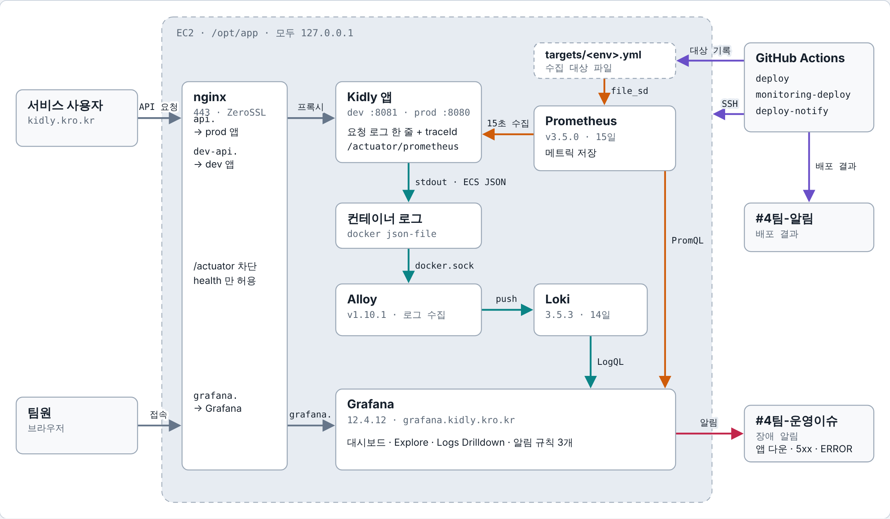

# 운영 · 모니터링

앱이 도는 EC2 한 대(dev · prod 공통) 안에 Prometheus · Loki · Alloy · Grafana 네 컨테이너가 함께 돕니다. 모두 127.0.0.1에만 열려 있고, 밖에서 볼 수 있는 모니터링 화면은 Nginx를 거친 Grafana(`grafana.kidly.kro.kr`) 하나입니다 (앱 API도 같은 Nginx를 거침). 장애는 `#4팀-운영이슈`, 배포 결과는 `#4팀-알림`으로 갑니다.

최종: 모니터링(Prometheus · Loki · Alloy · Grafana)은 Elasticsearch와 함께 t3.medium의 k3s로 옮겼습니다. 아래 그림과 10.1의 서버 배치는 세미 기준이고 인프라 담당(maruhxn)이 갱신합니다. 받는 쪽이 이벤트를 DLT로 보낼 때도 ERROR 로그를 남겨 ERROR 알림으로 알 수 있습니다.

실선 색 = 흐름 (회색 요청 · 주황 메트릭 · 청록 로그 · 빨강 알림 · 보라 배포). nginx는 서버에 직접 설치하고, 밖에서 `/actuator`는 막고 `/actuator/health`만 엽니다.

## 10.1 흐름 네 가지

| 흐름 | 내용 |
|---|---|
| 메트릭 | 앱이 `/actuator/prometheus`에 JVM · HikariCP · HTTP 요청 · 로그 건수를 내놓고, Prometheus가 15초마다 가져가 15일 보관. 앱 배포가 성공하면 수집 대상 주소를 갱신. Grafana의 JVM · Spring Boot 대시보드와 알림 규칙이 씀 |
| 로그 | 앱은 콘솔(stdout)에 ECS JSON을 한 줄씩 쓰고, 요청마다 끝에 한 줄을 남김. Alloy가 docker에서 dev · prod 앱 로그를 읽어 env · level · service_name 라벨과 traceId · memberId를 붙이고, Loki가 14일 보관. Grafana Explore · Logs Drilldown에서 찾음 |
| 알림 | Grafana가 알림 규칙 3개를 1분마다 확인. 걸리면 30초 동안 모아 보내고, 계속되면 4시간마다 다시 보냄. 풀리면 해결 메시지. 메시지에 규칙 보기 · 일시정지 링크, 5xx · ERROR에는 로그 보기 링크 |
| 배포 | develop에 머지되면 앱은 `deploy`, `deploy/monitoring/**` 변경은 `monitoring-deploy` 워크플로가 돎. 앱 배포는 CI와 이미지 빌드가 모두 성공해야 서버에 올리고, 앱과 무관한 변경은 건너뜀. 둘 다 SSH로 서버의 `deploy.sh`를 실행하고, 비밀값은 Environment `dev` Secret에서 매번 새로 씀. `deploy-notify`가 결과를 `#4팀-알림`으로 보내고, 앱이 못 뜨면 로그에서 원인(Flyway 등)을 뽑아 붙임 |

## 10.2 오는 알림

| 알림 | 언제 | 채널 |
|---|---|---|
| 앱 다운 | 앱 메트릭을 2분 넘게 못 읽음 | `#4팀-운영이슈` |
| 5xx 증가 | 최근 5분 5xx 비율이 5% 넘음 (actuator 제외) | `#4팀-운영이슈` |
| ERROR 로그 | 최근 5분 ERROR 로그가 1건 이상 | `#4팀-운영이슈` |
| 배포 결과 | 앱 · 모니터링 배포가 끝날 때 (실패면 원인 로그 포함, GitHub Actions가 보냄) | `#4팀-알림` |

## 10.3 이럴 땐 여기서

| 알고 싶은 것 | 볼 곳 (모두 Grafana 안) |
|---|---|
| 메모리 · GC · 스레드 | 대시보드 → Kidly → JVM |
| DB 커넥션 풀 · HTTP 처리량 | 대시보드 → Kidly → Spring Boot (HikariCP) |
| 특정 URL · 상태 · 회원의 요청 | Drilldown → Logs → kidly → Fields 칸에서 거르고 Table |
| 한 요청의 로그 전부 | 표의 traceId → 같은 요청 로그 보기 (프론트는 응답 헤더 `X-Request-Id`로 찾음) |
| 알림이 왜 왔나 | Slack 메시지의 로그 보기 |
| 배포가 왜 실패했나 | `#4팀-알림` 메시지의 원인, 없으면 Actions 로그 |
| 검색 서비스 메트릭 · 로그 | Grafana에서 job `kidly-search`, 로그 `service_name=kidly-search`. 앱 대시보드 · 알림(job `kidly`)과 섞이지 않음 |
| Elasticsearch 상태 | t3.medium에서 `kubectl -n search get pods`, `/_cluster/health`(yellow · green), `/_cat/indices`(`dev-products` · `dev-sellers`) |
| 색인이 비었을 때 | Elasticsearch를 새로 만들었거나 데이터를 지운 경우. 상품 · 판매자 전체 다시 보내기 API로 채움(#577) |
| 검색이 503일 때 | Elasticsearch 연결 · 과부하 · 색인 없음. 검색 서비스를 복구 |
| 이벤트가 처리되지 않을 때 | Slack ERROR 알림 · 로그에서 `eventType` · `eventId` · 키로 찾기 → `{토픽}.{받는도메인}.dlt` 확인. 주문은 관리자 화면에서 DLT 재처리, 나머지는 K23 |

## 10.4 운영 규칙 · 아직 볼 수 없는 것

- **운영 규칙**: 대시보드 · 알림 규칙은 레포(`deploy/monitoring`)에서만 고칩니다. Grafana 화면에서 고친 대시보드 · 알림 · 기본 열은 다음 배포 때 레포 파일 내용으로 돌아갑니다.
- **로컬**: 로컬 compose에도 Prometheus · Grafana가 있어 bootRun 앱 메트릭을 `env=local`로 봅니다 (대시보드는 운영과 같은 파일).
- **아직 볼 수 없는 것**: 로컬 앱 로그(텍스트 콘솔이라 Loki로 가지 않음), 스케줄러 · 비동기 작업의 traceId(요청이 아닌 작업에는 아직 없음), 14일보다 오래된 로그 · 15일보다 오래된 메트릭.
