# 단계별 카드

**한 흐름을 7단계로 나누고, 각자 맡은 단계를 개발합니다.**

v2.0: ③ 카드를 AI 추천 기준으로 바꾸고, ⑦ 카드에 정산 상세(⑦ 상세 1 ~ 10)를 더하고, 구매확정 뒤의 **⑧ 리뷰 · 찜** 카드를 새로 넣었습니다. 다른 카드에는 최종에서 더한 API · 이벤트를 노란 바탕으로 적었습니다. 단계 사이 이벤트는 모두 Kafka로 갑니다.

v1.1: 단계 연결이 끝나 v1.0의 「혼자 시작하기」 칸과 7.1 「카드별 추가 데이터」는 뺐습니다. 시연은 7.1 초기 데이터로 ①부터 차례로 진행합니다.

**카드 읽는 법** — 모든 카드가 같은 순서입니다. 카드 그림의 자녀 정보 칸과 추천 규칙은 **2.1이 기준**입니다 (그림은 ERD 확정 뒤 갱신). v1.1에서 카드 그림은 대부분 고치지 않았습니다. 그림과 표가 다르면 표 · 2.1 · 8장이 기준입니다. ERD를 다시 그릴 때 상품은 표 18개, 추천은 표 4개(+ 사이즈 줄 2개) 기준입니다 (상품 기획서 v6 10쪽, 추천 기획서 v3 9쪽).

| 칸 | 뜻 |
|---|---|
| 목적 | 이 단계가 끝나면 무엇이 되는가 |
| 흐름 · 데이터 그림 | 누가 요청하고 어떤 이벤트를 보내는가, 무엇을 저장하는가 |
| 받는 것 · 넘기는 것 | 앞 단계와 다음 단계 사이의 약속 (**이것만 지키면 각자 개발해도 맞물림**) |
| 만들 API | 이 단계의 화면이 부르는 API |
| 완료 기준 | 시연으로 확인할 것 |

## 7.1 공통 초기 데이터

**모두 같은 데이터로 시작해야 나중에 단계를 이었을 때 ID와 값이 맞습니다.** 각 담당은 자기 도메인 데이터만 넣되, 값은 이 표를 따릅니다 (프로필 `local` · `dev`, 비어 있을 때만 넣음).

| 데이터 | ID | 값 | 넣는 담당 | 쓰는 카드 |
|---|---|---|---|---|
| 보호자 | 회원 `1` | 테스트보호자 · 역할 `BUYER` · 지갑 잔액 0원 (가입 때 생김, 시연 전에 충전 — 확인 K7) | 회원 · 결제 | ①~⑥ |
| 판매자 | 회원 `2` | 테스트판매자 · 역할 `BUYER` `SELLER` · 지갑 잔액 0원 · 상호명 테스트상점 (관리자 회원 3이 승인) | 회원 · 판매자 | ②⑤⑦ |
| 관리자 | 회원 `3` | 테스트관리자 · 역할 `ADMIN` (가입 뒤 관리자 권한 부여) | 회원 | ②⑦ |
| 화면 확인용 회원 | 회원 `4` · `5` · `6` | 4 정지회원 (이용 정지) · 5 신청대기회원 (판매자 신청 대기, 대기상점) · 6 신청거절회원 (신청 거절, 거절상점) · 이메일은 모두 `@kidly.test`라 메일을 보내지 않음 | 회원 · 판매자 | 관리자 화면 |
| 자녀 | 자녀 `1` | 회원 1의 자녀 · 이름 테스트 · 생년월일 2019-01-01 (이벤트도 생년월일) · 성별 남 · 키 115.0cm · 몸무게 20.0kg · 체형 보통 · 선호 핏 여유 (성장 이력 1건) | 회원 | ③④ |
| 배송지 | 배송지 `1` (회원 1 · 기본) | 홍길동 · 010-0000-0000 · 우편번호 00000 · 서울시 테스트로 1 | 회원 | ④ |
| 상품 기준 데이터 | - | 카테고리: 의류 > 상의 · 하의 · 아우터 · 원피스, 잡화 > 모자 · 양말 · 상품 유형(입력 양식): 의류 · 모자 · 양말 · 항목(옵션 항목 색상 · 사이즈, 정보 항목 주요소재 · 혼용률) · 실측 항목. 카테고리 ID는 넣는 순서로 정해져 v1.0의 1 · 2와 다를 수 있음 | 상품 | ② |
| 상품 A | 상품 `1` | 네이비 데일리 맨투맨 · 판매자 2 · 의류 > 상의 · 브랜드 BBCC · 소재 면(정보 항목) · 판매 중 · 옵션 `1` 네이비/110 · 옵션 `2` 네이비/120 (색상 × 사이즈) · 각 25,000원 · 재고 각 10 | 상품 | ②~④ |
| 상품 A 사이즈 | - | 110: 권장 키 105~115cm · 120: 115~125cm · 실측(총장 · 어깨너비 · 가슴단면 · 소매길이)도 넣음 | 상품 | ③ |
| 상품 B | 상품 `2` | 그레이 조거 팬츠 · 판매자 2 · 의류 > 하의 · 소재 면 · 판매 중 · 옵션 `3` 그레이/120 · 30,000원 · 재고 5 · 120: 권장 키 115~125cm | 상품 | ②~④ |

> 자녀 키 115cm는 상품 A의 110과 120 **두 사이즈에 모두 걸치도록** 골랐습니다 → 선호 핏으로 고르는 경우까지 시연할 수 있습니다.

## ① 회원 · 자녀 프로필 등록

> **담당** maruhxn(회원) · codes-gy(결제: 지갑 생성) **목적** 보호자가 카카오로 가입하고, 자녀 프로필을 등록한다. 가입하면 지갑이 생긴다.

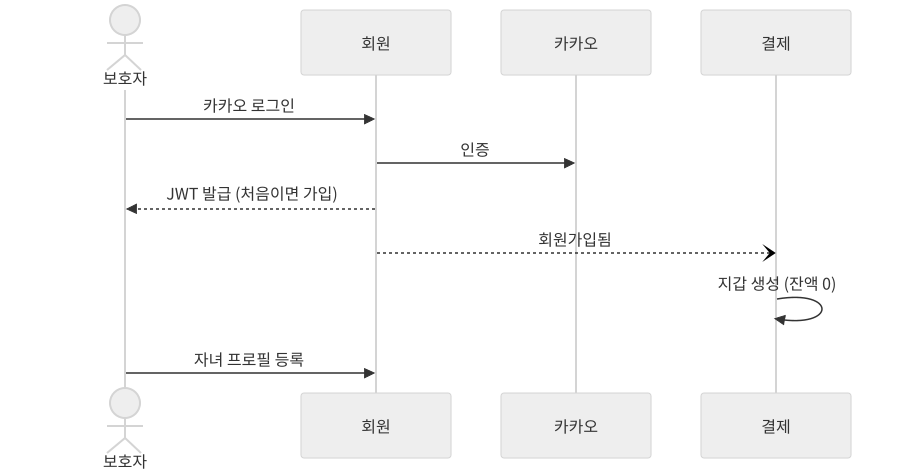


| 받는 것 | 넘기는 것 |
|---|---|
| - (첫 단계) | ③ 추천 · ④ 주문: **자녀 정보 변경됨** (키 · 몸무게 · 체형 · 선호 핏) · 결제 · 알림: **회원가입됨** · 화면: 배송지 목록에서 고른 배송지 (주문 요청에 담김) · 모든 단계: JWT의 `memberId` · `roles` |

| 만들 API |  |
|---|---|
| `POST /api/v1/auth/login/kakao` | 카카오 로그인 (본문: 인가 코드) |
| `GET /api/v1/members/me` | 내 정보 |
| `POST /api/v1/children` | 자녀 등록 |
| `GET /api/v1/children` | 내 자녀 목록 |
| `POST /api/v1/auth/reissue` | 토큰 재발급 |
| `POST /api/v1/auth/logout` | 로그아웃 |
| `POST · GET /api/v1/members/me/addresses` | 배송지 등록 · 목록 |
| `PATCH · DELETE /api/v1/members/me/addresses/{addressId}` | 배송지 수정 · 삭제 |
| `PATCH /api/v1/members/me/addresses/{addressId}/default` | 기본 배송지 변경 |

- **완료 기준** 카카오로 로그인하면 회원과 지갑이 생기고, 자녀를 등록해 목록에서 볼 수 있다. 배송지를 등록하고 기본 배송지를 바꿀 수 있고, Refresh Token으로 재발급 · 로그아웃할 수 있다.
- **최종** 결제가 `member.withdrawn`을 받아 지갑을 동결한다(잔액은 운영자가 환급). 로그인 회원 확인은 Gateway가 하고, 판매자 자격을 잃으면 `member.tokens-revoked`로 토큰이 무효화된다.
- **최종(2순위) 기준 옷** 넘기는 것에 「③ 추천: 기준 옷 변경됨」. 만들 API `POST · GET /api/v1/children/{childId}/reference-garments` · `PATCH · DELETE .../reference-garments/{garmentId}`(자녀 프로필 서비스). 완료 기준: 자녀마다 상의 · 하의 기준 옷을 등록하고 고칠 수 있다.

## ② 상품 등록

> **담당** maruhxn(판매자 승인) · heojungseok(상품) **목적** 판매자가 되어 옵션별 재고와 사이즈별 권장 키를 넣은 상품을 판매 시작한다.

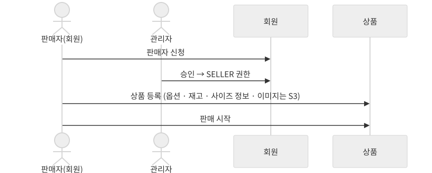


| 받는 것 | 넘기는 것 |
|---|---|
| ① JWT의 `SELLER` 권한 · ④ **주문 생성됨**(재고 차감) · **주문 취소됨**(재고 복구) · 판매자: 판매자 정보 변경됨 | ③ 추천 · ④ 주문: **상품 정보 변경됨** (옵션 · 단가 · 사이즈별 권장 키 · 판매 상태 · 썸네일 · 품절 여부 · 옵션 이름 · 옵션 판매 상태 · 사이즈 무관 여부) · ④ 주문: **재고 차감됨** / 재고 부족함 |

| 만들 API |  |
|---|---|
| `POST /api/v1/members/me/seller-application` | 판매자 신청 |
| `POST /api/v1/admin/seller-applications/{applicationId}/approve` | 판매자 승인 |
| `POST /api/v1/seller/products` | 상품 등록 |
| `PUT /api/v1/seller/products/{productId}/sale-status` | 판매 시작 (`{"status":"ON_SALE"}`) |
| `GET /api/v1/categories` · `/{categoryId}/attributes` | 카테고리 · 등록 입력 항목 |
| `POST /api/v1/seller/product-images/upload-urls` | 이미지 업로드 주소 발급 |
| `GET /api/v1/products` · `/{productId}` | 상품 목록 · 상세 |

- **완료 기준** 승인받은 판매자가 상품을 등록하고 판매 시작하면, 상품 목록과 상세에 보인다.
- **판매 시작 조건** 옵션이 쓰는 사이즈마다 실측과 권장 키가 있어야 한다 (FREE는 권장 키 선택). 빠진 항목을 모아 한 번에 알려 준다.
- **최종** 넘기는 것에 「검색: 상품 정보 변경됨 · 판매자 정보 변경됨(색인)」. `GET /api/v1/products` 상품 목록은 담당이 검색(codes-gy, search-service)으로 바뀌고, 상세는 상품 그대로다.

## ③ 사이즈 · 상품 추천 (최종: AI 추천)

> **담당** heojungseok(추천) **목적** 상품 상세에서 자녀를 고르면 추천 사이즈 · 적합도 · 근거를 보여 주고, 홈의 자녀 맞춤 상품과 상품 상세의 함께 사면 좋은 상품을 자녀 · 장바구니 · 활동 내역으로 추천한다.

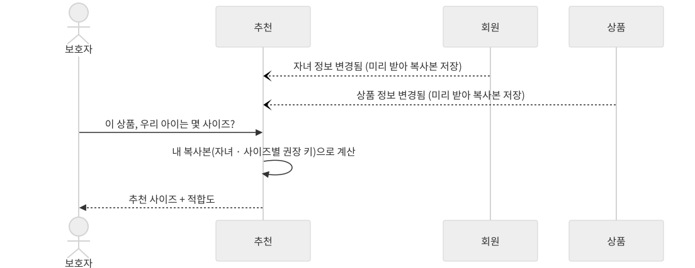


카드 그림은 세미의 규칙 추천 기준입니다. 받는 것 · API · 완료 기준은 아래 표가 기준입니다(경로가 `/api/v1/recommendations/...`로 바뀜).

| 받는 것 | 넘기는 것 |
|---|---|
| ① **자녀 정보 변경됨** · ② **상품 정보 변경됨**(브랜드 · 설명 · 사이즈별 실측 포함) · ⑥ **구매확정됨**(구매 기록) · 판매자: 판매자 정보 변경됨 · ④ 주문: **장바구니 담김 · 빠짐**, 주문 취소됨(구매자 취소) · 검색: **검색어 기록됨** · 회원: 회원탈퇴됨 · 화면: **상품 상세 진입 기록** · ①(2순위) 기준 옷 변경됨 | ④ 주문: 보호자가 고른 **상품 · 옵션 · 자녀** (화면을 거쳐 장바구니로) |

| 만들 API |  |
|---|---|
| `GET /api/v1/recommendations/size?productId=&childId=` | 사이즈 추천(기존 7칸 + `reasons` + `source`) |
| `GET /api/v1/recommendations/products?childId=&categoryId=&page=&size=&asOf=` | 자녀 맞춤 상품 목록(기존 6칸 + `reason` + `source`). 홈 맛보기 4개는 AI, 더보기는 선호 점수 순 |
| `GET /api/v1/recommendations/companions?productId=&childId=` | 함께 사면 좋은 상품 4개(새 API) |
| `POST /api/v1/recommendations/product-views` | 상품 상세 진입 기록(화면이 호출, 본문: productId와 선택 칸 childId(고른 자녀). 같은 회원 · 자녀 · 상품 · 날짜는 한 번만 기록) |

- **완료 기준** 자녀를 고르면 상품 상세에 추천 사이즈 · 적합도 · 근거가 나오고 아래에 함께 사면 좋은 상품 4개가 나온다. 홈 자녀 맞춤 상품 4개는 장바구니 · 최근 활동이 반영된 AI 선택과 이유로 나오고, 더보기 목록은 활동 선호 순서로 나오며 넘기는 동안 순서가 바뀌지 않는다. 추천 서비스를 멈춰도 상품 상세 · 장바구니 담기 · 주문이 된다. 기준 옷이 있으면 기준 옷과의 cm 차이가 함께 나온다(2순위).
- **응답** 사이즈 추천: 추천 사이즈 · 적합도 · 안내(code · message) · 후보 사이즈 목록 · 지난번 산 사이즈 · 근거 목록(`reasons`) · 출처(`source`). 상품 추천 한 줄: productId · name · thumbnailUrl · businessName · minPrice · recommendedSize · 이유(`reason`) · 출처(`source`). 맞춤 목록 1쪽 응답에 기준 시각(`asOf`).

## ④ 주문과 결제

> **담당** L2J92(주문) · codes-gy(결제) **목적** 장바구니에 담은 상품을 주문하고 예치금으로 결제한다.

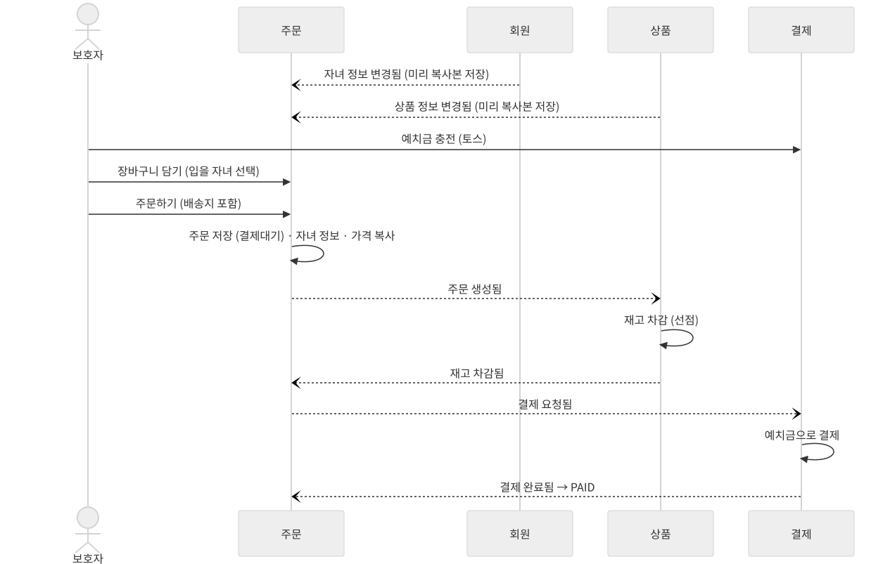


| 받는 것 | 넘기는 것 |
|---|---|
| ① **자녀 정보 변경됨** · ② **상품 정보 변경됨** · **재고 차감됨** · ③ 고른 상품 · 옵션 · 자녀 · 화면: 배송지 · 결제: **결제 완료됨** · 판매자: 판매자 정보 변경됨 | ⑤ 배송: **결제완료된 판매자별 주문** |

| 만들 API |  |
|---|---|
| `POST /api/v1/wallets/me/charges` · `/confirm` | 충전 요청 · 승인 |
| `GET /api/v1/wallets/me` | 잔액 |
| `POST /api/v1/cart/items` · `GET /api/v1/cart` | 장바구니 담기 · 조회 |
| `POST /api/v1/orders` | 주문하기 |
| `GET /api/v1/orders/{orderId}` | 주문 상세 |
| `POST /api/v1/orders/{orderId}/cancel` · `GET .../timeline` | 주문 취소 (발송 전) · 처리 타임라인 |

- **완료 기준** 충전하고 주문하면 재고가 줄고, 지갑 잔액이 줄고, 주문이 `PAID`가 된다. 주문상품에 당시 자녀 정보와 사이즈가 남는다.
- **처리 순서** 가격 확인 → 주문 저장(결제대기) → 재고 차감 → 결제. 화면이 본 단가를 주문 요청에 담아 보내고, 주문 복사본의 현재 단가와 다르면 저장 전에 거절(409)한다. 주문하기 응답은 201 + 주문 상세(결제대기)이고, 결과(`PAID` · `CANCELLED`)는 주문 상세나 타임라인으로 확인한다 (P5). 같은 주문을 두 번 만들지 않게 `Idempotency-Key` 헤더를 보낼 수 있다.
- **최종 · 받는 것 · 넘기는 것** 결제가 주고받는 이벤트는 Kafka(`kidly.order.events` → 결제 → `kidly.payment.events`). 판매자 주문상품 취소됨(`order-item.cancelled`) → 결제: 주문상품 금액만큼 부분 환불 · 상품: 재고 복구. 장바구니 담김(`cart.item-added`) → (추천 예정)
- **최종 · 만들 API** 공용 장바구니 `/api/v1/wishes` · 조르기 `/api/v1/wish-requests`(보내기 · 승인 · 거절, 주문) · 충전 취소 `POST /api/v1/wallets/me/charges/{chargeId}/cancel` · 입출금 내역 `GET /api/v1/wallets/me/ledgers`(결제)
- **최종 · 완료 기준** 결제 서비스를 멈췄다 다시 띄워도 그동안 쌓인 결제 요청이 처리되고 주문이 `PAID`가 된다(Kafka가 메시지를 보관). 자녀가 조르기를 보내면 부모가 승인해 바로 결제할 수 있다.

## ⑤ 배송

> **담당** L2J92(주문) **목적** 판매자가 자기 몫의 주문에 송장을 등록하고, 배송 완료로 바꾼다.

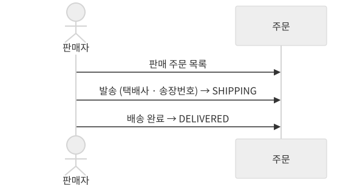


| 받는 것 | 넘기는 것 |
|---|---|
| ④ 결제완료된 판매자별 주문 | ⑥ 구매확정: **배송완료된 주문상품** |

| 만들 API |  |
|---|---|
| `GET /api/v1/seller/orders` | 판매 주문 목록 |
| `POST /api/v1/seller/orders/{sellerOrderId}/ship` | 발송 (송장 등록) |
| `POST /api/v1/seller/orders/{sellerOrderId}/deliver` | 배송 완료 |

- **완료 기준** 판매자가 송장을 넣고 배송 완료를 누르면, 구매자 주문 상세에 배송완료로 보인다.
- **최종** 판매자가 발송 전에 자기 몫을 취소한다(`POST /api/v1/seller/orders/{sellerOrderId}/cancel`, 결제 · 상품 배포 뒤 스위치를 켬). 발송한 배송은 택배 조회(Delivery Tracker)로 자동 배송 완료되고, 판매자가 직접 완료할 수도 있다.

## ⑥ 구매확정

> **담당** L2J92(주문) **목적** 구매자가 직접, 또는 배송 완료 후 정해진 기간이 지나면 자동으로 구매확정한다. 이때부터 정산 대상이 된다.

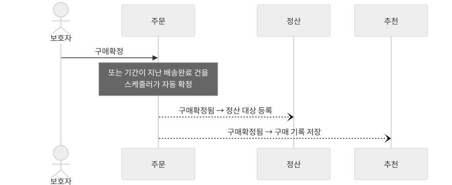

| 받는 것 | 넘기는 것 |
|---|---|
| ⑤ 배송완료된 주문상품 | ⑦ 정산 · ③ 추천: **구매확정됨** (주문상품 · 판매자 · 금액 · 상품 · 옵션 · 사이즈 · 자녀 · 확정 시각) |

| 만들 API |  |
|---|---|
| `POST /api/v1/orders/{orderId}/items/{orderItemId}/confirm` | 구매확정 |

- **완료 기준** 구매확정하면 주문상품이 `CONFIRMED`가 되고, 정산 대상에 나타난다. 자동 확정은 설정값을 짧게 해 시연한다.
- **최종** 구매확정됨은 정산 · 추천에 더해 커뮤니티도 받아 리뷰 작성 자격을 만든다(⑧).

## ⑦ 정산

> **담당** baiees(정산) · codes-gy(결제: 지갑 적립) **목적** 구매확정된 금액을 판매자별 정산서로 묶어 수수료를 빼고, 결제에 지급을 요청해 판매자 지갑에 적립한다.

v2.0: 정산 담당 보강본으로 바꿨습니다. 월 정산 → **영업일 일정산**(Spring Batch · 공휴일 API), 지급 요청은 아웃박스로 Kafka에 보냅니다. 아래 ⑦ 상세 1 ~ 10이 정산 설계의 기준입니다.

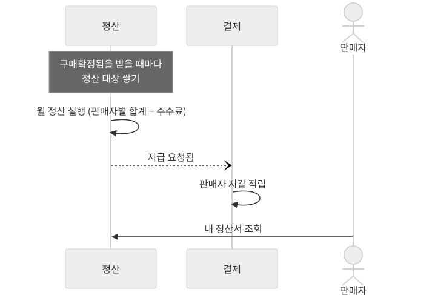


| 받는 것 | 넘기는 것 |
|---|---|
| ⑥ **구매확정됨** · 결제: **지급 완료됨** · **지급 실패됨** | 결제: **지급 요청됨** → 판매자 지갑 적립 |

| 만들 API |  |
|---|---|
| `GET /api/v1/seller/settlement-targets` | 정산 대상 |
| `GET /api/v1/seller/settlements` · `/{settlementId}` | 내 정산서 목록 · 상세 |
| `POST /api/v1/admin/settlements/run` | 정산 수동 실행 (시연용) |

- **완료 기준** 정산을 실행하면 판매자 정산서가 생기고(`COMPLETED`), 판매자 지갑 잔액이 늘고, 정산서가 `PAID`가 된다. 같은 기준일로 다시 실행해도 정산서가 늘지 않는다.
- **처리 순서** 구매확정 수신 → 정산 대상 저장(`PENDING`, 같은 주문상품은 건너뜀) → 정산 실행(`settlementJob`) → 판매자별 합계 → 정산서 저장(`COMPLETED`) · 대상 `SETTLED` · 지급 요청 발행 → 결제 적립 → 지급 결과 반영(`PAID` · `FAILED`). 규칙은 2.1 ⑦과 아래 상세.

카드 그림은 세미 때 그림입니다. 이벤트 이름 · 필드는 8장 표와 아래 상세가 기준입니다.

### ⑦ 상세 1. 한눈에 (Rough)

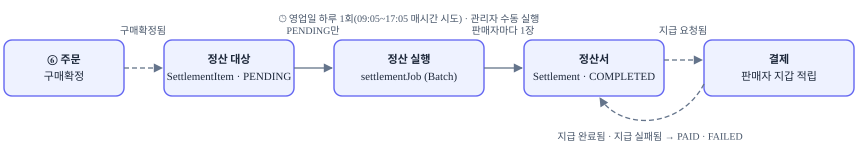

1. 주문상품이 구매확정되면 정산 대상 1건이 쌓입니다 (`PENDING`). 같은 주문상품은 한 번만.
2. 정산 실행(자동은 영업일 하루 1회 · 수동)이 종료 기준일(자동 = 실행일 0시) 전에 확정된 대상을 판매자별로 묶어 정산서를 1장씩 만듭니다. 대상이 없는 판매자는 정산서를 만들지 않습니다. 수수료는 합계 × 수수료율, 원 미만 버림.
3. 정산서를 만든 트랜잭션에서 지급 요청을 아웃박스에 저장해 Kafka로 보내고, 결제가 판매자 지갑에 적립한 뒤 결과를 보냅니다. 정산은 결과를 정산서에 반영합니다 (`PAID` · `FAILED`).

### ⑦ 상세 2. 용어 · 데이터

| 용어 | 코드 | 뜻 |
|---|---|---|
| 정산 대상 | `SettlementItem` | 구매확정된 주문상품 1건. 판매금액 = 이벤트의 amount(단가 × 수량), 다시 계산하지 않음. 정산서에 들어가면 그 정산서의 항목이 됨 (정산서는 ID로만 가리킴) |
| 정산서 | `Settlement` | 판매자 1명 · 정산 실행 1회(종료일)의 정산 결과. 판매 합계 · 적용 수수료율 · 수수료 · 지급액 · 지급 상태 |
| 종료 기준일 | `cutoffAt` | 이 시각 전에 구매확정된 대상만 정산. 자동 = 실행일(영업일) 0시, 수동 = 관리자가 지정한 날 0시 (Asia/Seoul) |
| 정산 기간 | `periodStartOn` · `periodEndOn` | 종료일 = 종료 기준일 − 1일(실행일 전날), 시작일 = 포함된 대상 중 가장 이른 구매확정일. 대상 선정에는 시작일 조건이 없음 (지난번에 빠진 건 · 늦게 도착한 확정도 포함) |
| 수수료율 | `feeRate` | 설정값 (지금 10%). 정산서를 만들 때의 값을 정산서에 저장, 바뀐 율은 다음 정산부터 |
| 정산 실행 | `settlementJob` 실행 | 정산 작업 1회. 기록은 Spring Batch 메타데이터(작업 실행 · 단계 실행 · 작업 파라미터): 기준일 · 자동/수동 · 실행한 관리자 · 상태 · 성공/건너뛴 판매자 수. 기간은 기준일에서 계산(`SettlementPeriod`) |
| 지급 요청 | `payout` | 정산서 금액을 판매자 지갑에 적립해 달라는 요청. 적립은 결제가 하고 정산은 결과만 반영 |

### ⑦ 상세 3. 규칙 · 불변식 (Detail)

| 대상 | 규칙 (어기면 저장 · 변경하지 않음) |
|---|---|
| 정산 대상 | 주문상품 1건 = 정산 대상 1건 (`order_item_id` 유니크, 이미 있으면 건너뜀) · 판매금액 ≥ 0 · ID는 0보다 큼 · 구매확정 후 기다리는 기간 없음 (⑥ 자동 구매확정 설정값이 맡음) |
| 정산 기준 | `PENDING`이고 `confirmedAt < cutoffAt`인 대상 전체. 실행 도중 들어온 확정분은 다음 정산 |
| 정산 기간 | 시작일 ≤ 종료일 · 판매자 · 종료일이 같은 정산서는 1장 (`(seller_id, period_end_on)` 유니크) |
| 수수료 | 수수료 = ⌊판매 합계 × 수수료율⌋ (원 미만 버림) · 지급액 = 판매 합계 − 수수료 · 수수료 + 지급액 = 판매 합계 · 0 ≤ 수수료율 ≤ 1, 소수 넷째 자리까지 (저장도 넷째 자리) · 주문상품별 수수료는 계산하지 않음 · 판매 합계를 더할 때 넘침이면 그 판매자는 실패 |
| 정산 대상 상태 | `PENDING` → `SETTLED`(정산서 ID 필수) 또는 `EXCLUDED`. `SETTLED`는 되돌리지 않음 · 같은 제외가 다시 와도 그대로 |
| 정산서 상태 | `COMPLETED` → `PAID`(지급 시각 필수) 또는 `FAILED`(사유 필수, 50자 이하). 같은 결과를 다시 받으면 처음 값 유지, 엇갈린 결과(`PAID` 뒤 실패 등)는 거부 |
| 지급 대조 | 결과 이벤트의 settlementId · sellerId · amount가 정산서와 같을 때만 반영. 다르면 반영하지 않고 ERROR 로그 |
| 동시성 | 정산 대상 · 정산서는 `@Version`으로 동시에 바꾸지 못함 (충돌한 쪽 실패) · 실행 중인 정산 작업이 있으면 새 실행 409 (Batch 실행 중 작업 조회) |
| 구매확정 뒤 환불 | 4장에 따라 없음. `EXCLUDED`는 부분 취소 · 반품이 생길 때를 위해 상태만 둠 |

### ⑦ 상세 4. 상태 전이

| 대상 | 전이 | 언제 |
|---|---|---|
| 정산 대상 | `PENDING` → `SETTLED` | 정산 실행이 판매자의 정산서를 만들 때 |
| 정산 대상 | `PENDING` → `EXCLUDED` | 부분 취소 · 반품 (세미 없음) |
| 정산서 | (생성) → `COMPLETED` | 계산 완료 = 지급 요청. `completedAt` 저장 |
| 정산서 | `COMPLETED` → `PAID` | `payment.payout-completed` 수신. `paidAt` = 결제가 지급 완료로 처리한 시각 (0원 포함) |
| 정산서 | `COMPLETED` → `FAILED` | `payment.payout-failed` 수신. `failReason` = reasonCode (예: `WALLET_NOT_FOUND`) |
| 정산 실행 (응답 상태) | `RUNNING` → `COMPLETED` · `PARTIAL_FAILED` · `FAILED` | Batch 작업 실행 상태로 계산: 실행 중 → `RUNNING`, 완료 + 건너뛴 판매자 없음 → `COMPLETED`, 완료 + 있음 → `PARTIAL_FAILED`, 실패 · 중지 → `FAILED` |

### ⑦ 상세 5. 테이블 (`settlement` 스키마)

| 테이블 | 컬럼 · 제약 |
|---|---|
| `settlement_item` | id · order_id · order_item_id(**유니크**) · seller_id · sales_amount · confirmed_at · status · settlement_id(정산서 ID, FK 없음) · version · created_at · updated_at · 인덱스 (seller_id, status, confirmed_at) · (settlement_id) — #78 · #81에서 추가 |
| `settlement` | id · seller_id · period_start_on · period_end_on (**seller_id · period_end_on 유니크**) · total_sales_amount · fee_rate NUMERIC(5,4) · fee_amount · settlement_amount · status · completed_at · paid_at · fail_reason(50) · version · created_at · updated_at |
| `BATCH_*` | Spring Batch 메타데이터 = 정산 실행 기록 (작업 · 실행 · 단계 · 파라미터). `settlement` 스키마에 접두어 `BATCH_`로 둠. 기준일 · 실행 방식 · 실행한 관리자는 작업 파라미터, 성공 · 건너뛴 수는 단계 실행 |

### ⑦ 상세 6. 일괄 정산 — Spring Batch

**Rough** 스케줄러 · 관리자 API → `settlementJob`(종료 기준일) → `settleSellerStep`: 판매자 ID 읽기 → 판매자마다 정산서 계산 · 저장 · 대상 정산 · 지급 요청 → 결과는 Batch 실행 기록

**왜 Spring Batch** 판매자 단위로 나눠 처리하고, 한 판매자의 실패를 건너뛰고, 끝난 작업의 재실행을 막고, 실패한 작업을 이어서 다시 돌리는 기능을 직접 만들지 않고 씁니다. 실행 기록도 Batch 메타데이터에 남습니다.

| 구성 | 내용 (Detail) |
|---|---|
| 작업 파라미터 | `cutoffAt` — 작업을 구분하는 값 (같은 기준일 = 같은 작업) · `triggerType` · `requestedBy`(자동 실행은 없음) — 구분에 쓰지 않는 값 |
| 읽기 (Reader) | 정산할 판매자 ID: `status = 'PENDING' AND confirmed_at < :cutoffAt`인 대상의 판매자를 판매자 ID 순으로 페이지 읽기 (`seller_id > 마지막 ID` 방식이라 처리 중 상태가 바뀌어도 페이지가 밀리지 않음) |
| 쓰기 (Writer) | 판매자마다: `PENDING` · 기준일 이전 대상을 읽어 판매금액을 더함(넘침 검사) → `Settlement` 계산 · 저장 → 대상마다 `settle(정산서 ID)` → `settlement.payout-requested`를 아웃박스에 저장. 대상이 없으면 건너뜀. 한 묶음이 한 트랜잭션이고, 커밋된 뒤 릴레이가 Kafka로 보내 결제가 받음 |
| Processor 없음 | Batch 6은 쓰기에 실패한 묶음을 판매자 1명씩 다시 처리할 때 Processor를 다시 부르지 않고 롤백된 결과를 다시 씀. 그래서 읽기 · 계산을 Writer 안에서 매번 새로 함 (정상 판매자가 함께 건너뛰지 않게) |
| 묶음 크기 | 설정값 (지금 판매자 100명) |
| 실패 처리 | 업무 오류(검증 실패 · 넘침 · 버전 충돌 · 유니크 위반)는 건너뜀(skip). 묶음이 실패하면 Batch가 판매자 1명씩 다시 처리해 실패한 판매자만 건너뜀. 건너뛴 판매자는 ERROR 로그 + 실행 기록 `fail_count`, 다음 실행에서 다시 대상이 됨 (`PENDING` 그대로) |
| 중복 실행 | 같은 `cutoffAt` 작업이 이미 끝났으면 409 (이미 정산한 기준일) · 실행 중이면 409 · 실행 시작 전에 Batch의 실행 중 작업을 조회해 409. 동시에 온 두 요청이 같이 통과해도 정산 대상 `@Version` · 정산서 유니크가 중복 정산을 막음 |
| 다시 실행 | 작업 자체가 실패(`FAILED`)하면 같은 기준일로 다시 실행. 건너뛴 판매자가 있어도 작업은 완료라 같은 기준일 재실행은 409이고, 남은 대상은 다음 기준일에 정산. 읽기가 `PENDING`만 고르므로 이미 정산한 판매자는 다시 처리하지 않음 (읽기 위치를 저장하지 않음) |
| 실행 기록 | 따로 저장하지 않음. 실행 결과 · 조회 API는 Batch 작업 실행(ID · 파라미터 · 상태 · 단계 쓰기/건너뛴 수)으로 만듦 |
| 자동 실행 | `@Scheduled(cron = 설정값, zone = "Asia/Seoul")` (지금 평일 09:05~17:05 매시간) → 영업일인지 확인(주말 · 공휴일이면 건너뜀, 공휴일 조회 실패면 다음 시간 재시도) → 종료 기준일 = 실행일 0시 → 작업 실행 (그날 이미 정산했으면 409로 건너뜀) |
| 수동 실행 | `POST /api/v1/admin/settlements/run` → 같은 작업을 끝날 때까지 기다려 실행 (시연용) → 201 + 실행 결과 |
| 설정값 | `settlement.fee-rate`(0.1) · `settlement.run-cron`(`0 5 9-17 * * MON-FRI`) · `settlement.payout-retry-cron`(`0 */10 * * * *`) · `settlement.chunk-size`(100) · `spring.batch.job.enabled=false`(기동 때 자동 실행 안 함) · `spring.batch.jdbc.table-prefix=settlement.BATCH_` · `spring.batch.jdbc.initialize-schema`: local `always`, 그 외 `never`(배포 전 DDL) |
| 의존성 | `build.gradle.kts`: `implementation("org.springframework.boot:spring-boot-starter-batch-jdbc")` · `testImplementation("org.springframework.boot:spring-boot-starter-batch-jdbc-test")`. 버전은 Spring Boot 4.1.1이 맞춤. DB에 실행 기록을 남겨야 재실행 방지 · 이어서 실행이 되므로 `-jdbc` 스타터를 씀 |

### ⑦ 상세 7. API

| 단계 | API | 요청 → 응답 |
|---|---|---|
| ⑦ | `POST /admin/settlements/run` | `{ "cutoffOn": "2026-11-01" }` (필수, 오늘 이후 불가) → 201 + `Location: /api/v1/admin/settlement-runs/{runId}` · runId · cutoffAt · periodStartOn · periodEndOn · triggerType · status · successCount · failCount · startedAt · finishedAt |
| ⑦ | `GET /seller/settlement-targets` | 내 `PENDING` 대상, 구매확정 시각 역순, 페이지 → `PageResponse` (orderItemId · orderId · salesAmount · confirmedAt) |
| ⑦ | `GET /seller/settlements` | 내 정산서, 기간 · 상태 필터, 페이지 → `PageResponse` (settlementId · periodStartOn · periodEndOn · totalSalesAmount · feeRate · feeAmount · settlementAmount · status · completedAt · paidAt) |
| ⑦ | `GET /seller/settlements/{settlementId}` | 정산서 + 포함된 주문상품 목록. 없거나 다른 판매자 것이면 404 |
| 보완 | `GET /admin/settlements` | 판매자 · 기간 · 상태 필터 → `PageResponse` |
| ⑦ | `GET /admin/settlement-runs/{runId}` | 정산 실행 1건 (runId = Batch 작업 실행 ID, 수동 실행 응답의 Location). 없거나 정산 작업이 아니면 404 |
| 보완 | `POST /admin/settlements/{settlementId}/retry` | 지급 결과 복구: 결과를 못 받은 `COMPLETED`만, 같은 settlementId로 지급 요청 재발행 → 결제가 저장된 결과를 다시 보냄. `PAID` · `FAILED`는 409 |

역할은 경로로 정해집니다: `/seller/**` = SELLER, `/admin/**` = ADMIN (아니면 403). 목록이 비면 `[]`.

### ⑦ 상세 8. 오류

| 코드 (`SettlementErrorCode`) | 상태 | 언제 |
|---|---|---|
| `INVALID_SETTLEMENT_CUTOFF` | 400 | 수동 실행의 종료 기준일이 없거나 오늘 이후 |
| `SETTLEMENT_RUN_IN_PROGRESS` | 409 | 실행 중인 정산이 있음 |
| `SETTLEMENT_ALREADY_RUN` | 409 | 같은 종료 기준일의 정산이 이미 끝남 |
| `SETTLEMENT_NOT_RETRYABLE` | 409 | (보완) `COMPLETED`가 아닌 정산서 재처리 |
| `NOT_FOUND` (공통) | 404 | 없거나 다른 판매자의 정산서 · 없는 실행 기록 |

이벤트 수신은 오류 응답이 없습니다: 같은 구매확정 · 같은 지급 결과는 조용히 건너뛰고, 대조가 맞지 않으면 ERROR 로그만 남깁니다.

### ⑦ 상세 9. 구현 순서 (이슈)

| 이슈 | 범위 | 완료 기준 | 상태 |
|---|---|---|---|
| #75 · #77 | 정산 모델 · 수수료 | #76에서 기획서 기준으로 다시 맞춤 | 완료 |
| #76 | 모델 정합 · 구매확정 적재 | 같은 구매확정 2번 → 대상 1건, 수수료 버림 · 지급 결과 멱등 | 완료 |
| #78 | 정산 실행 (Spring Batch) · 실행 기록 · 수동 실행 API · 설정값 | 같은 기준일 재실행 → 정산서 추가 없음 · 대상 0건 → 정산서 없음 · 한 판매자 실패 → `PARTIAL_FAILED` · 시연 데이터 1건(25,000원)으로 정산서 생성 | 진행 |
| #79 | 지급 요청 발행 · 결과 반영 | 요청 → 결제 적립 → `PAID` 통합 테스트 · 같은 결과 2번 → 변경 1번 · 대조 불일치 무시 | 예정 |
| #81 | 판매자 조회 API 3개 | 남의 정산서 404 · 빈 목록 `[]` · 페이징 기능 테스트 | 예정 |
| 보완 | 관리자 조회 · 실행 기록 조회 · 지급 결과 복구 | `COMPLETED`만 재처리 · 재처리 2번 → 입금 1번 | 예정 |
| 최종 | Kafka · 서비스 분리 | 이벤트 유실 대비(Outbox) · 여러 서버에서 작업 1번만 실행 (Batch 메타데이터 + 실행 중 1건 제약) | - |

### ⑦ 상세 10. 설계 판단 기록

| 항목 | 고른 것 | 이유 (다른 선택지) |
|---|---|---|
| 정산 대상 · 항목 테이블 | `SettlementItem` 하나 | 대상과 항목이 1:1이라 나누면 같은 값을 두 번 저장 (ERD의 target · item 분리) |
| 대상 → 정산서 참조 | `settlement_id` 값 참조 | 애그리거트 결합을 끊음. 정산서는 지우지 않아 FK 없음의 위험이 낮음 (`@ManyToOne`) |
| 수수료 계산 위치 | 정산서 합계 기준, `Settlement`가 계산 | 2.1 ⑦ 문장과 일치. 항목별 버림의 합은 최대 (항목 수 − 1)원 차이 (항목별 배분) |
| 지급 표현 | 정산서 상태 `COMPLETED` → `PAID` · `FAILED` | ERD가 상태 · 실패 사유를 정산서에 둠. 지급 시도 이력이 필요해지면 그때 분리 (별도 `Payout` 엔티티) |
| 실패 사유 타입 | 문자열(reasonCode 이름) | 정산이 결제의 enum에 묶이지 않게 (결제 `PayoutFailureCode`) |
| 재처리 의미 | 결과 유실 복구 (`COMPLETED`만) | 결제는 실패를 다시 시도하지 않고 저장된 결과만 재발행 (`FAILED` 재시도) |
| 실행 방식 | Spring Batch `settlementJob` | 판매자 단위 처리 · 건너뛰기 · 재실행 방지 · 이어서 실행을 직접 만들지 않음 (`@Scheduled` + 판매자마다 별도 트랜잭션 빈) |
| 실행 기록 | Spring Batch 메타데이터만 (`settlement_run` 없음) | 상태 · 시각 · 건수 · 파라미터가 Batch에 이미 있어 두 곳에 두면 어긋나고, 서버가 죽으면 정리할 곳이 둘이 됨 (ERD의 `settlement_run` 엔티티) |
| 동시 실행 막기 | Batch 실행 중 작업 조회 → 409 | 동시에 온 두 요청은 같이 통과할 수 있으나 정산 대상 `@Version` · 정산서 유니크가 중복 정산을 막음 (실행 기록 테이블 + 유니크 제약) |
| 수동 실행 요청 | `cutoffOn`(날짜) → 그날 0시 이전 확정분 | 기간 대신 기준일 하나만 받아 2.1 ⑦의 "종료 기준일 직접 지정"과 맞춤 |
| 스케줄러 · 설정값 위치 | `app`의 `@Component` + `@Scheduled` · `SettlementProperties` | 회원 도메인 방식(`RefreshTokenCleaner` · `RefreshTokenProperties`) |
| Spring Batch 의존성 (B1) | 정산 담당이 `build.gradle.kts`에 추가 | 배포 전 `BATCH_*` 메타데이터 DDL 공유 필요 |
| 의존성이 늦을 때 (B2) | 도메인 코드(`SettlementRun` · 판매자 1명 정산 계산) 먼저, Job · Step 조립은 의존성 뒤 | 도메인 코드는 Batch가 있든 없든 그대로 쓰임 |

## ⑧ 리뷰 · 찜 (최종)

> **담당** L2J92(커뮤니티) **목적** 구매확정한 주문상품에 리뷰를 쓰고, 상품을 찜해 두고, 상품 상세에서 평균 별점 · 리뷰 · 찜 수를 본다.

| 받는 것 | 넘기는 것 |
|---|---|
| ⑥ **구매확정됨** → 리뷰 작성 자격 · ② **상품 정보 변경됨** → 상품 복사본(이름 · 썸네일 · 표시 상태) · 회원: **회원탈퇴됨** → 찜 삭제 · 리뷰 작성자 닉네임 지움(#663) | 없음 (리뷰 작성됨 `review.created`는 받을 도메인이 정해지면, K28) |

| 만들 API |  |
|---|---|
| `GET /api/v1/reviews/eligible` | 작성할 수 있는 주문상품 (로그인, 커서 목록). 400 `INVALID_PAGE_SIZE` · `INVALID_CURSOR` |
| `POST /api/v1/reviews/images/upload-urls` | 리뷰 사진 업로드 주소(Presigned PUT) 발급 (로그인, 1~5장, jpg · png · webp 1장 10MB 이하, 5분 뒤 만료). 400 `INVALID_IMAGE_FILE` · `TOO_MANY_IMAGES` |
| `POST /api/v1/reviews` | 리뷰 작성 `{orderItemId, rating, content, fit, imageUrls}`(`fit` · `imageUrls`는 선택) → 201 + Location. 400 `INVALID_RATING` · `INVALID_CONTENT` · `INVALID_FIT` · `FIT_NOT_APPLICABLE` · `INVALID_IMAGE_URL` · `TOO_MANY_IMAGES` · `IMAGE_NOT_UPLOADED` / 403 `REVIEW_NOT_ELIGIBLE` / 409 `REVIEW_ALREADY_WRITTEN` / 503 `IMAGE_STORAGE_UNAVAILABLE` |
| `PATCH /api/v1/reviews/{reviewId}` | 리뷰 수정 (보낸 필드만, 작성자만. `fit` null은 핏 지우기, `imageUrls`는 목록 교체 · 빈 목록은 모두 삭제). 400 `NO_FIELDS_TO_UPDATE` / 403 `REVIEW_FORBIDDEN` / 404 `REVIEW_NOT_FOUND` / 503 `IMAGE_STORAGE_UNAVAILABLE` |
| `DELETE /api/v1/reviews/{reviewId}` | 리뷰 삭제 (작성자만) → 204. 403 · 404 |
| `GET /api/v1/reviews?productId=` | 상품별 리뷰 목록 (로그인 없이, 최신순, 공개 리뷰만). 400 `INVALID_PRODUCT_ID` |
| `GET /api/v1/reviews/me` | 내 리뷰 (숨겨진 리뷰는 `visibility: UNDER_REVIEW`) |
| `GET /api/v1/reviews/summary?productId=` | 리뷰 요약 `{productId, reviewCount, averageRating, fitSummary}` (로그인 없이, 공개 리뷰만) |
| `PUT /api/v1/favorites/{productId}` | 찜 (다시 해도 1건, 판매 종료 · 없는 상품 거절) |
| `DELETE /api/v1/favorites/{productId}` | 찜 취소 (없어도 204) |
| `GET /api/v1/favorites?productIds=` | 내 찜 목록. productIds를 주면 그중 내가 찜한 것만 (목록 하트 표시) |
| `GET /api/v1/favorites/summary?productId=` | 찜 요약 `{productId, favoriteCount}` (로그인 없이) |
| `GET /api/v1/admin/community/reviews?status=` | 관리자 검사 상태별 리뷰 목록(`PENDING` · `PASSED` · `HIDDEN` · `CONFIRMED_HIDDEN` · `RESTORED`). 400 `INVALID_MODERATION_STATUS` |
| `PATCH /api/v1/admin/community/reviews/{reviewId}/visibility` | 관리자 숨김 확정(`HIDDEN`) · 다시 공개(`VISIBLE`), 같은 값을 다시 보내도 200. 400 `INVALID_VISIBILITY` / 404 `REVIEW_NOT_FOUND` |
| `POST /api/v1/admin/community/mcp` | 커뮤니티 운영 조회 MCP 창구 (관리자, 읽기 전용, 기본 꺼짐). 413 `MCP_REQUEST_TOO_LARGE` |

- **완료 기준** 구매확정한 주문상품이 작성 가능 목록에 나오고, 리뷰를 쓰면 상품 상세의 리뷰 수 · 평균 별점이 바뀐다. 상품을 찜하면 찜 수가 늘고 내 찜 목록에 보인다.
- **화면** 상품 상세는 상품 API와 커뮤니티 API(리뷰 요약 · 목록 · 찜 요약 · 내 찜)를 각각 불러 합친다. 목록 화면의 하트는 `GET /favorites?productIds=`로 한 번에 확인한다.
- **운영** 처음 배포한 뒤 환경마다 한 번 상품 전체 재발행(`POST /api/v1/admin/products/changed-events`, 상품 기능)으로 복사본을 채운다(주문 · 추천 · 검색도 같은 이벤트를 다시 받으므로 팀에 알림). 배포 전에 구매확정된 주문상품은 작성 자격이 없어, 시연은 배포 뒤 구매확정한 주문으로 한다.
- **추가 예정** 리뷰 댓글(판매자 답글 포함) · `review.created` · 상품 문의 · 좋아요 · 공지 · FAQ · 챗봇(별도 모듈 검토) 순서.
