# 주요 정책

- 주문은 **결제대기로 저장**한 뒤, 상품이 **재고를 차감 (선점)**합니다.
- 재고가 **하나라도 부족하면** 아무것도 차감하지 않고 주문을 취소합니다. 모두 확보되면 결제로 넘어갑니다.
- 결제는 주문 전체를 한 번에 합니다. **결제에 실패하면 주문 전체를 취소**하고 재고를 복구합니다 (일부만 성공 없음). 예외로 판매자는 **발송 전에 자기 몫만** 취소할 수 있고, 그 주문상품 금액만 환불 · 재고 복구합니다 (2.1 ④).
- 구매자는 **발송 전까지** 주문 전체를 취소할 수 있습니다 (처리는 2.1).
- 주문내역에는 **주문 당시의 자녀 정보(키 · 몸무게 · 체형)와 사이즈**가 남습니다. 옵션 이름(예: 「색상: 네이비 / 사이즈: 110」)도 남습니다.
- 판매자는 **자기 상품을 살 수 없습니다.**
- 판매자도 같은 계정으로 구매합니다 (판매자 ID = 회원 ID).
- 구매확정은 **직접 하거나, 배송 완료 후 정해진 기간(설정값)이 지나면 자동**으로 됩니다.
- **구매확정 후에는 취소 · 환불이 없습니다.** 구매확정된 주문상품만 정산 대상입니다.
- 정산금은 **판매자의 예치금 지갑에 적립**합니다 (정산계좌 없음).
- 세미에서는 자녀 계정 없이 보호자 계정 안에 **자녀 프로필**만 둡니다. 최종의 조르기도 자녀 계정이 생기기 전까지 부모 계정 기준으로 동작합니다 (K31).
- 자녀 프로필의 키 · 체형이 바뀌면 **성장 이력**을 1건 쌓습니다 (값이 같으면 쌓지 않음, 체형이 비어 있다가 생기거나 비워져도 바뀐 것으로 봄). 자녀 삭제는 **논리 삭제**입니다. 목록 · 상세 · 추천에서 제외하고, 기존 주문에 남은 자녀 정보는 유지합니다.
- 배송지는 여러 개 둘 수 있고, **배송지가 있으면 기본 배송지는 정확히 1개**입니다. 기본 배송지는 삭제할 수 없고, 다른 배송지를 기본으로 바꾼 뒤 삭제합니다.
- **도메인끼리 서로의 코드를 import하지 않습니다.** 도메인끼리는 이벤트로만 주고받습니다 (화면이 부르는 API는 별개). 이벤트는 Kafka로 가고, 같은 이벤트가 두 번 와도 결과는 한 번분입니다. 다른 도메인 정보는 내부 조회 API 대신 **이벤트 + 복사본**으로 받습니다 (6.3).
- 기간 · 주기 · 수수료율처럼 바뀔 수 있는 값은 **코드를 고치지 않고 값만 바꿀 수 있게** 만듭니다 (지금 값은 2.1).
- 정산은 판매자별 정산서로 묶어 합계에서 수수료를 한 번 뺍니다 (원 미만 버림). 같은 주문상품은 한 번만 정산하고, 같은 정산서는 한 번만 지급합니다.
- 리뷰는 구매확정한 주문상품마다 하나, 찜은 회원 × 상품마다 하나입니다. 같은 요청이 다시 와도 결과는 한 번 한 것과 같습니다.
- 판매자 부분 취소 같은 새 기능은 받는 도메인이 준비될 때까지 스위치로 꺼 두고, 받는 쪽이 배포된 뒤 켭니다.
- 예치금 잔액은 결제만 바꿉니다. 바꿀 때는 회원 지갑을 비관적 락으로 잡아, 결제 · 환불 · 충전 · 입금이 동시에 와도 차례로 처리합니다. 바뀔 때마다 원장(입출금 기록)을 1건 남기고 고치지 않습니다.
- 결제가 받는 이벤트는 두 번 와도 한 번만 반영합니다: 주문 결제는 주문당 한 번, 주문 취소 환불은 결제당 한 번, 판매자 부분 취소 환불은 취소당 한 번, 정산 입금은 정산서당 한 번.
- 돈이 움직인 결과(결제 · 지급)는 지갑을 바꾼 트랜잭션에서 아웃박스에 함께 저장한 뒤 보냅니다. 지갑만 바뀌고 알림이 사라지는 일이 없습니다.
- 탈퇴한 회원의 지갑은 지우지 않고 동결합니다. 잔액은 실제 돈이므로 소멸시키지 않고 운영자가 돌려줍니다. 탈퇴 뒤에도 환불 · 정산금이 들어올 수 있어 들어오는 돈은 받습니다.
- 판매자 부분 취소의 환불은 `order-item.cancelled`로만 합니다. 마지막 판매자 몫이 취소돼 주문 전체가 취소돼도 `order.cancelled`는 나가지 않아 두 번 환불하지 않습니다. 환불할 수 없는 취소는 돈을 움직이지 않고 실패한 환불로 남겨 운영자가 봅니다.
- 검색은 상품 DB를 읽지 않고 이벤트로 받은 값으로만 색인합니다. 검색 장애는 상품 목록에만 영향을 줍니다.
- 검색어 이벤트는 검색 응답보다 덜 중요해, 보내지 못하면 버립니다(검색을 실패시키지 않음). 결과 목록 · 비로그인 검색은 보내지 않습니다.
- 주문 · 결제 경로는 추천 서비스를 호출하지 않습니다. 추천 서비스는 이벤트를 받아 자기 데이터를 쌓고 추천 조회 요청에만 응답합니다. 추천이 실패해도 상품 상세 · 장바구니 · 주문 API는 정상으로 동작합니다.
- AI는 상품의 실제 사이즈 목록과 후보 상품 목록 안에서만 고릅니다. AI가 없는 사이즈나 상품을 답하지 못하도록 구조화 출력으로 받습니다.
- 추천 응답에는 근거(`reasons` · `reason`)와 출처(`source`: AI 또는 규칙)가 있습니다. 화면은 출처를 보고 「AI 추천」 표시를 켜고 끕니다.
- AI가 쓰는 이유 문장은 옷 치수를 기준으로 쓰고 아이의 몸을 평가하는 표현을 쓰지 않습니다.
- 외부 AI API에는 자녀 이름 · 생년월일 · 회원 ID를 보내지 않습니다. 개월 수 · 키 · 몸무게 · 체형 · 선호 핏만 보냅니다.
- 사이즈는 이름(S · M · 110)이 아니라 cm로 비교합니다. 판매자가 적은 「사이즈별 권장 키」는 몸 기준 정보이고 「상품 실측」은 옷 기준 정보라 같은 숫자로 보지 않습니다.
- 추천 서비스는 다른 도메인의 DB나 API를 읽지 않습니다. 상품 · 자녀 · 판매자 · 활동 · 구매 정보는 모두 Kafka 이벤트로 받은 복사본이고, 임베딩 · 선호 점수 · AI 응답 같은 파생값과 벡터 저장소는 추천 서비스 안에 둡니다.

### 주문상품 상태

> 결제대기 · 결제완료 · 취소는 주문 전체, 배송중 · 배송완료는 판매자별 배송, 구매확정은 주문상품의 상태입니다 (정산 여부는 정산이 관리).

> 주문 취소 사유는 `OUT_OF_STOCK` · `PAYMENT_FAILED` · `PAYMENT_EXPIRED` · `BUYER_CANCELLED`입니다. 판매자별 배송은 `READY` → `SHIPPING` → `DELIVERED`이고, 구매자가 취소하면 `CANCELLED`가 됩니다 (그림은 v1.0).

> 최종: 판매자가 발송 전에 자기 몫을 취소하면 그 판매자 배송과 주문상품이 취소되고, 마지막 몫이면 주문도 취소됩니다(사유 `OUT_OF_STOCK` · `WRONG_PRODUCT_INFO` · `OTHER`). 발송한 배송은 택배 조회로 자동 배송 완료될 수 있습니다.
