# Kidly 최종 프로젝트 기획서 v2.0 · 2026-11-02 · develop `ef9028c5` 기준

# v2.0 안내

> **이 문서는 최종 프로젝트 기획서 v2.0입니다.** 세미 기획서 v1.1 예비판(10/19)에 각 도메인이 11/2까지 정리한 최종 프로젝트 내용(결제 · 지갑 · 검색, AI 추천, 주문, 커뮤니티, 정산)과 develop 코드(`ef9028c5`)를 합쳤습니다.

> 노란 바탕 = v1.1에서 바뀌거나 더한 곳입니다. 장별 변경 목록은 **11장**에, 팀이 확인할 항목은 아래 표에 모았습니다. 세미 때 그린 그림은 대부분 그대로 두었고, 바뀐 흐름은 새 그림(3.1 · 3.5 ~ 3.8 · ⑦)으로 넣었습니다. 그림과 표가 다르면 표와 8장이 기준입니다.

### 최종 프로젝트에서 바뀐 것

- **구성**: Gateway와 도메인별 서비스로 구성합니다. 모든 요청은 **API Gateway**를 거칩니다 (3.1).
- **통신**: 도메인 사이 이벤트를 **Kafka**로 옮겼습니다. 보내는 도메인마다 토픽 하나, 보내는 쪽은 아웃박스로 유실을 막고, 받는 쪽은 실패하면 DLT로 보냅니다. 도메인마다 수신 스위치로 Spring 이벤트로 되돌릴 수 있습니다 (6.2).
- **인증**: 토큰 검증 · 무효화 확인 · 역할 검사 · CORS는 Gateway만 합니다. 서비스는 Gateway가 붙인 헤더로 로그인 회원을 압니다 (2.1 · 6.1).
- **추천**: 자녀 프로필 · 장바구니 · 활동 내역으로 AI가 사이즈와 상품을 추천하고 근거를 붙입니다. AI가 멈춰도 구매는 됩니다 (1.5 · 3.6).
- **검색**: 상품 목록 검색을 Elasticsearch(nori) 검색 서비스로 뗐습니다 (3.8).
- **주문**: 공용 장바구니 · 조르기, 판매자 발송 전 부분 취소, 택배 조회 자동 배송 완료, 장바구니 담기 이벤트가 생겼습니다 (1.5 · 2.1).
- **결제 · 지갑**: 탈퇴하면 지갑을 동결하고, 판매자 부분 취소를 주문상품 금액만큼 환불합니다 (2.1 · 3.7).
- **정산**: 월 정산을 **영업일 일정산**(Spring Batch, 공휴일 API)으로 바꿨습니다 (⑦).
- **커뮤니티**: 리뷰(작성 · 목록 · 요약)와 찜이 새 도메인으로 생겼습니다 (⑧).

### 팀 확인 필요

코드와 기획 의도가 다를 수 있거나 아직 정하지 않은 곳입니다. 이 판에는 지금 코드대로 적었습니다. K10 ~ K17은 추천, K18 ~ K24는 결제 · 검색, K25 ~ K31은 커뮤니티 · 주문 담당이 올린 항목입니다.

| 번호 | 항목 | 지금 코드 | 확인할 것 | 관련 |
|---|---|---|---|---|
| K1 | 탈퇴 조건 | 신청하면 바로 탈퇴. 회원은 배송지, 자녀 프로필은 자녀 프로필을 지움. 결제가 `member.withdrawn`을 받아 **지갑을 동결**(#670): 잔액은 그대로, 충전 · 주문 결제는 막고 환불 · 정산 입금은 받음, 관리자가 동결 · 잔액 남은 지갑을 조회해 환급. 추천은 받는 것을 제안(P16), 커뮤니티는 예정(#663). 주문은 받지 않음 | 진행 중 주문 · 판매자 상품 처리, Access Token 즉시 무효화, 환급 처리 방법(K20) | 회원 · 결제 · 주문 · 상품 · 추천 |
| K2 | 판매자 정지 뒤 상품 | 판매자 복사본 상태만 바뀌고 상품 판매 상태는 그대로 | 정지된 판매자의 상품을 판매 중지할지 | 판매자 · 상품 |
| K3 | 개인정보 암호화 | 토스 paymentKey만 암호화 | 회원 · 배송지 · 주문 배송지 암호화 여부 | 회원 · 주문 |
| K4 | 주문의 자녀 이름 | `child.changed`에 이름이 없어 주문의 자녀 이름이 null일 수 있음 (화면은 null 허용) | `child.changed`에 이름 추가 (필드 추가만) | 자녀 프로필 · 주문 |
| K5 | 취소 뒤 늦은 재고 차감 | 상품이 두 순서 모두 처리: 취소를 먼저 받으면 그 주문상품에 「차감 안 함」 기록을 남겨 뒤에 온 차감을 막고, 먼저 차감했으면 뒤에 온 취소가 「복구됨」으로 바꾸고 수량을 되돌림 | 남는 경우는 리스너가 실패해 이벤트를 처리하지 못한 때뿐 (다시 보내는 장치 없음, K6과 같은 문제) → 최종: 상품이 주문 이벤트를 Kafka로 받아(#692) 실패하면 재시도 뒤 DLT에 남음. DLT를 다시 넣는 방법은 K23 | 주문 · 상품 |
| K6 | 이벤트 유실 대비 | 도메인 사이 이벤트는 **Kafka**. 주문 · 결제 · 상품 · 정산 · 자녀 프로필은 업무와 같은 트랜잭션에서 아웃박스 표에 저장한 뒤 릴레이가 보내고(유실 없음), 회원 · 판매자는 커밋 뒤 바로 보냄. 받다가 실패하면 1초 간격 3번 더 시도한 뒤 `{토픽}.{받는도메인}.dlt`로. Spring 이벤트 수신은 되돌리기 스위치로만 남음 | DLT 다시 넣는 방법(K23, 주문은 관리자 재처리 있음) · 회원 · 판매자 이벤트의 아웃박스 전환 | 공통 |
| K7 | 보호자 초기 잔액 | v1.0 7.1은 100,000원, 코드는 0원 (시연 전에 충전) | 초기 데이터에 넣을지 | 결제 |
| K8 | 이벤트 ID 형식 · 연락처 | Kafka 본문에서도 이벤트 ID는 `Long`(숫자), 공통 칸 `aggregateId` · `correlationId`만 문자열로 정함(6.2). `member.registered`의 email은 그대로이고, 이벤트에 개인정보 필드를 새로 넣지 않는 규칙을 둠 | email을 이벤트에서 뺄지 (알림이 받는 방법과 함께) | 공통 · 회원 · 알림 |
| K9 | 환불 결과 이벤트 | `payment.refunded` 계약은 판매자 부분 취소용으로 바뀜(`cancellationId` · 주문상품별 금액). 결제는 부분 취소 환불을 하지만(#711) 이 이벤트는 아직 보내지 않음 | 부분 취소 환불 결과를 보낼지(K18) | 결제 · 주문 · 정산 |
| K10 | 벡터 저장소 종류 | 없음 | 같은 ES 별도 색인 · pgvector · ChromaDB 중 선택(P17). pgvector면 `postgres:18`을 `pgvector/pgvector:pg18`로 바꾸고 추천 마이그레이션에서 `CREATE EXTENSION vector` | 추천 · 공통 |
| K11 | 등록 취소의 뜻 | `STOPPED`(판매 중지)만 있음. 등록 취소는 판매 중지와 다른 새 상태로 두기로 정함 | 새 상태의 이름과 구현 시점. 추천 · 검색 · 장바구니가 새 상태를 판매 중지와 같이 거를지 | 상품 · 추천 · 검색 · 주문 |
| K12 | 장바구니 빼기 이벤트 | `cart.item-added`(담기)만 발행됨. 주문이 발행하기로 정함(#709, 사용자가 뺄 때만 · 결제로 인한 정리 · 수량 변경은 제외) | 발행 시점(담당 지정 필요)과 추천의 구독 | 주문 · 추천 |
| K13 | 더보기 순서 유지의 FE 변경 | 즉시 반영 | `asOf` 전달(P15)을 FE가 언제 넣을지. 그 전에는 쪽 사이에 순서가 바뀔 수 있음 | 추천 · FE |
| K14 | 관리자 추천 로그 조회(2순위) | 로그는 DB에 저장됨 | `GET /api/v1/admin/recommendations/logs` 같은 조회 API를 둘지 | 추천 · 공통 |
| K15 | 사이즈 계산을 tool로 둘지 | AI가 숫자까지 봄 | 구현 때 계산은 코드 · AI는 판단 방식과 비교해 정함 | 추천 |
| K16 | 원피스 · 치마의 총장 비교(2순위) | - | 「같은 세부 종류일 때만」으로 충분한지 | 추천 |
| K17 | 리뷰의 크기 의견 활용(2순위) | 리뷰 기능 · 담당 없음 | 추천 입력에 쓸지와 시점 | 리뷰 |
| K18 | 부분 취소 환불 결과 | `payment.refunded` 계약만 있고 보내지 않음 | 주문이 「취소 완료」를 환불 결과로 바꿀지, 정산이 미정산 대상을 제외하는 데 쓸지. 쓴다면 부분 취소 환불과 함께 보냄 | 결제 · 주문 · 정산 |
| K19 | 부분 취소 켜는 날 | 주문 발행 · 결제 환불(#713) · 상품 재고 복구(#716) 모두 머지, 주문 스위치 꺼 둠 | dev 배포 확인 뒤 주문 스위치 켜는 날, dev에서 환불 · 재고 복구를 같이 확인할 사람. prod는 main 반영 때 | 결제 · 상품 · 주문 |
| K20 | 탈퇴 회원 잔액 환급 | 관리자가 조회만 함. 환급은 시스템 밖(계좌 이체) | 환급을 마친 지갑을 표시하는 API(잔액 0으로 만들고 원장 남기기)를 둘지, 환급 계좌를 어떻게 받을지 | 결제 · 회원 · 운영 |
| K21 | 일정산 전환 영향 | 결제는 정산서 ID로 한 번만 입금, periodStartOn · periodEndOn은 저장만 → 확인됨: 결제는 기간 칸을 쓰지 않아 일정산이어도 처리가 같음. 기간 뜻은 ⑦ 상세 2(종료일 = 실행일 전날) | 일정산(#679)으로 기간 칸의 뜻이 바뀌어도 결제 처리는 같은지(정산 담당과 확인) | 정산 · 결제 |
| K22 | 결제 서비스 분리 날 | dev에서 정산 수신을 켜고 지급 흐름 확인 중 | prod에서 정산 수신 켜기(정산 Kafka 발행이 main에 들어갈 때)와 payment-service 배포 날 | 결제 · 정산 · 인프라 |
| K23 | DLT 다시 넣기 | 결제 · 검색 모두 DLT에 쌓기만 함. DLT로 보낼 때 ERROR 로그를 남겨 Slack ERROR 알림으로는 알 수 있음 | DLT 메시지를 원래 처리로 다시 보내는 방법(관리자 API · 운영 스크립트)과 담당 | 공통 · 결제 · 검색 |
| K24 | 검색 prod 전환 · 처음 채우기 | dev만 search-service로 감 | prod 전환 날과 그날 상품 · 판매자 전체 다시 보내기. Elasticsearch 하나를 dev · prod가 색인 이름으로 나눠 쓸지, 따로 둘지(지금은 dev 배포가 Elasticsearch를 다시 띄움). 브랜드 · 설명 검색(P25)을 같이 할지 | 검색 · 상품 · 인프라 |
| K25 | 구매확정 뒤 환불 · 취소와 리뷰 | 그런 흐름이 없음 | 생기면 리뷰 작성 자격과 이미 쓴 리뷰를 어떻게 할지 | 커뮤니티 · 주문 |
| K26 | 탈퇴 회원 리뷰 표시 | 탈퇴 반영은 예정(#663). 찜은 지우고 리뷰는 남기는 안 | 작성자 표시 방식(닉네임 비우기 · 「탈퇴한 회원」 문구) | 커뮤니티 · 회원 |
| K27 | 「댓글 필수」의 대상 | 리뷰 · 찜만 있음 | 팀이 정한 댓글 필수의 대상이 리뷰 댓글 · 상품 문의 · 게시판 중 무엇인지 | 커뮤니티 |
| K28 | 리뷰 작성 이벤트 | `review.created`는 보류 | 받을 도메인(추천 · 검색)과 발행 시점. 수정 · 삭제 이벤트도 필요한지 | 커뮤니티 · 추천 · 검색 |
| K29 | DB 제약 위반 로그 | 공용 로그에 위반한 행 값이 찍힐 수 있음 | 전 도메인 공통으로 로그에서 값을 가릴지 | 공통 |
| K30 | 리뷰 작성 자격의 칸 | `review_eligibility`에 order_id · option_id를 둠 | 쓰지 않으면 뺄지 | 커뮤니티 |
| K31 | 자녀 계정 연동 | 조르기는 부모 계정 기준으로 동작 | 회원이 자녀 계정 · 보호자 · 자녀 프로필 매핑을 헤더 · 이벤트 · API 중 무엇으로 줄지 (주문이 맞춤) | 회원 · Gateway · 주문 |

# 1. 프로젝트 소개

## 1.1 프로젝트 이름

**Kidly** · 팀 블루블랙치킨고양이 (TEAM04)

## 1.2 판매하는 상품

**아이 옷(키즈 패션)** 을 파는 오픈마켓입니다. 여러 판매자가 상품을 올리고, 보호자가 삽니다. 세미 프로젝트는 아이 옷만 다루고, 최종 프로젝트에서는 아기 용품까지 넓힐 가능성이 큽니다.

## 1.3 프로젝트 개요

아이 옷은 브랜드마다 사이즈 표기가 다르고 아이는 계속 자라서, 보호자가 맞는 사이즈를 고르기 어렵습니다. Kidly는 **보호자가 등록한 자녀 정보로 맞는 사이즈를 추천**합니다. 세미의 사이즈 추천은 키와 몸무게를 쓰고, 체형과 선호 핏은 보호자가 입력했을 때 함께 씁니다 (2.1).

- **한 줄 소개:** 우리 아이에게 맞는 사이즈를 알려 주는 키즈 패션 마켓
- **차별점:** 상품 상세에서 자녀를 고르면 추천 사이즈와 적합도를 보여 줌


최종 프로젝트에서는 규칙 추천 위에 **AI 추천**을 더합니다. 자녀 프로필 · 장바구니 · 활동 내역(상세 진입 · 검색어 · 장바구니 담기와 빼기)으로 사이즈와 상품을 고르고 근거를 함께 보여 주며, AI가 멈춰도 구매는 그대로 됩니다. 자녀가 고른 상품을 보호자가 승인해 사는 **조르기**와 리뷰 · 찜도 생겼습니다.

## 1.4 타겟 고객

| 구분 | 주요 고객 | 겪는 문제 | 원하는 것 |
|---|---|---|---|
| 구매자 | 영유아 · 초등 자녀를 둔 보호자 | 브랜드마다 다른 사이즈, 빨리 크는 아이 | 우리 아이에게 맞는 사이즈를 바로 알기 |
| 판매자 | 아동복 판매자 | 사이즈 실패로 인한 반품 · 문의 | 사이즈 정보를 잘 보여 주는 판매처 |

## 1.5 주요 기능

| 대상 | 기능 | 설명 | 범위 |
|---|---|---|---|
| 회원 | 카카오 로그인 | 처음 로그인하면 가입, JWT 발급 | 세미 |
| 회원 | 자녀 프로필 | 필수: 이름 · 생년월일 · 성별 · 키 · 몸무게 / 선택: 체형 · 선호 핏 등록, 키 · 체형이 바뀌면 성장 이력 저장 | 세미 |
| 회원 | 판매자 등록 | 신청 → 관리자 승인 | 세미 |
| 회원 | 배송지 | 여러 개 등록, 배송지가 있으면 기본 배송지는 1개 | 세미 |
| 회원 | 토큰 재발급 · 로그아웃 | Refresh Token으로 재발급, 로그아웃하면 Refresh Token 폐기 | 세미 |
| 회원 | 탈퇴 · 정지 | 회원 탈퇴(신청 즉시), 관리자의 회원 · 판매자 정지 | 세미 (보완) |
| 상품 | 상품 등록 | 카테고리의 상품 유형이 정한 옵션 항목(예: 색상 × 사이즈)별 재고, 사이즈별 권장 키 · 실측, 이미지는 S3에 직접 업로드 | 세미 |
| 추천 | 사이즈 추천 | 자녀 키 · 몸무게로 추천 사이즈 · 적합도 (체형 · 선호 핏은 입력했을 때) | 세미 |
| 추천 | 자녀 맞춤 상품 목록 | 맞는 사이즈가 판매 중인 상품만 | 세미 |
| 주문 | 장바구니 · 주문 | 입을 자녀를 골라 담고 주문, 판매자별로 나눔 | 세미 |
| 결제 | 예치금 | 토스페이먼츠 테스트 결제로 충전, 주문 결제 | 세미 |
| 결제 | 충전 취소 | 완료된 충전을 전액 취소(토스 취소). 그 충전 금액만큼 잔액이 남아 있을 때만 | 세미 |
| 결제 | 입출금 · 결제 내역 | 예치금 원장(충전 · 충전 취소 · 결제 · 환불 · 정산 입금), 주문 결제 · 환불 내역 | 세미 |
| 주문 | 배송 · 구매확정 | 송장 등록, 배송 완료, 직접 · 자동 구매확정 | 세미 |
| 정산 | 정산 | 수수료를 빼고 판매자 지갑에 적립. 세미는 월 정산, 최종은 영업일마다 하루 1회(일정산) | 세미 · 최종 |
| 주문 | 구매자 주문 취소 | 발송 전까지 주문 전체 취소 (2.1) | 세미 |
| 회원 | 가입 환영 메일 | 가입하면 환영 메일을 보냄 (알림 모듈) | 세미 |
| 공통 | 관리자 운영 | 회원 · 판매자 관리, 상품 기준 데이터 관리, 주문 점검(멈춘 주문 · 처리 실패 재처리), 정산 재처리 | 세미 |
| 공통 | 시연 설정 | FE 목 데이터 · 시연 역할 전환을 관리자가 켜고 끔 | 세미 |
|  |  |  |  |
| 회원 | 자녀 계정 | 자녀가 직접 로그인. 회원의 자녀 계정 설계가 정해지면 조르기와 연동 (K31) | 최종(예정) |
| 공통 | API Gateway | 토큰 검증 · 무효화 확인 · 역할 검사 · CORS · 경로별 서비스 라우팅을 한 곳에서. 서비스는 헤더로 로그인 회원을 앎 | 최종(완료) |
| 주문 | 공용 장바구니 · 조르기 | 부모 · 자녀가 같이 보는 자녀별 장바구니. 자녀가 조르기를 보내면 부모가 승인(일부 · 수량 조정) · 거절(사유)하고 바로 결제하거나 부모 장바구니로 옮김. 동시 승인은 한 번만 | 최종(완료) |
| 추천 | 미션 쇼핑 | 자녀가 고르고 보호자가 승인. 조르기(주문)와 겹쳐 Kids Mode에서 범위를 정함 | 최종(미정) |
| 주문 | 판매자 발송 전 부분 취소 | 판매자가 발송 전에 자기 몫(배송 한 건)만 취소. 주문상품 단위 취소 이벤트로 결제가 환불하고 상품이 재고를 되돌림 | 최종(완료, 스위치를 켜면 동작) |
| 주문 | 택배 조회 자동 배송 완료 | Delivery Tracker를 주기적으로 조회해 배송 완료 처리. 택배사 완료 시각이 발송보다 늦을 때만 인정(재사용 송장 차단). 판매자 수동 완료는 그대로 | 최종(완료) |
| 주문 | 활동 이벤트 | 장바구니 담기를 `cart.item-added`로 발행(추천의 활동 재료). 빼기 · 조르기 이벤트는 예정 | 최종(진행 중) |
| 결제 | 탈퇴 회원 지갑 동결 | 탈퇴하면 지갑을 지우지 않고 동결. 돈이 나가는 요청(충전 · 결제)은 막고, 들어오는 돈(환불 · 정산금)은 받음. 관리자가 잔액이 남은 동결 지갑을 조회해 환급 | 최종(완료) |
| 결제 | 판매자 부분 취소 환불 | 판매자가 발송 전 자기 몫을 취소하면 그 주문상품 금액만큼 예치금 환불 (P23, #711) | 최종(완료, 주문 스위치를 켜면 동작) |
| 결제 | 결제 이벤트 Kafka 전환 | 결제가 받는 이벤트(가입 · 탈퇴 · 결제 요청 · 주문 취소 · 판매자 부분 취소 · 지급 요청)와 보내는 이벤트(결제 · 지급 결과)를 Kafka로. 보내는 쪽은 아웃박스로 유실을 막음 | 최종(완료, 정산 수신은 dev만) |
| 검색 | 상품 검색 (Elasticsearch) | 상품 목록 검색을 검색 서비스로 분리. 한글 형태소 분석(nori)으로 띄어쓰기 · 조사 · 어순이 달라도 찾음(「원피스 여아용」 → 「여아 원피스」). 카테고리 · 항목 값 필터, 최신 · 가격순. 경로가 같아 FE 변경 없음 | 최종(완료) |
| 검색 | 검색어 활동 이벤트 | 로그인 회원의 검색어를 `search.performed`로 추천에 알림. 보내기가 실패해도 검색 응답은 그대로 | 최종(완료) |
| 공통 | 서비스 분리 | 검색(search-service) 분리 완료, 결제(payment-service) 분리 진행 중(#525). 모듈 사이 이벤트는 Kafka로. Gateway가 경로별로 서비스에 넘겨 FE는 바뀌지 않음 | 최종 |
| 추천 | AI 사이즈 추천 | 자녀 프로필 · 상품 실측 · 성장도표 자료로 AI가 상품의 실제 사이즈 목록 안에서 사이즈를 고르고 근거를 함께 응답. 규칙 계산 결과는 AI 입력으로 주고, AI가 실패하면 규칙 결과로 응답 | 최종(명세) |
| 추천 | AI 상품 추천 | 홈 「자녀 맞춤 상품」 맛보기 4개를 자녀 프로필 · 장바구니 · 최근 활동(상세 진입 · 검색어 · 장바구니 담기와 빼기 · 구매자 취소)으로 AI가 고르고 이유를 붙임. 더보기 목록은 활동으로 계산한 선호 점수 순서 | 최종(명세) |
| 추천 | 함께 사면 좋은 상품 | 상품 상세에서 자녀를 고르면 그 상품과 어울리는 다른 카테고리 상품 4개를 이유와 함께 보여 줌 | 최종(명세) |
| 추천 | AI가 멈춰도 구매 가능 | 주문 · 결제 경로는 추천 서비스를 호출하지 않음. 추천 조회가 실패하면 규칙 결과 또는 빈 목록으로 응답하고 상품 상세 · 장바구니 · 주문은 그대로 동작 | 최종(명세) |
| 회원 | 기준 옷 등록 | 자녀마다 지금 잘 맞게 입는 상의 · 하의 한 벌씩의 실측(상의: 총장 · 가슴단면, 하의: 총장 · 허리단면)을 cm로 등록. Kidly에서 산 옷을 고르면 실측을 자동으로 채움 | 최종(2순위) |
| 추천 | Fit Passport(기준 옷 비교) | 기준 옷 실측과 상품 사이즈별 실측의 cm 차이로 사이즈와 핏을 보여 줌(예: 「지금 잘 맞는 맨투맨보다 가슴 +2cm, 총장 +3cm」). 기준 옷이 없으면 자녀 프로필로 추천 | 최종(2순위) |
| 커뮤니티 | 리뷰 | 구매확정한 주문상품마다 리뷰 1개(별점 1~5 · 본문). 작성 · 수정 · 삭제, 상품별 목록 · 요약(리뷰 수 · 평균 별점), 내 리뷰 (체형 리뷰를 대신함) | 최종(완료) |
| 커뮤니티 | 찜 | 회원 × 상품마다 1개. 찜 · 취소, 내 찜 목록, 상품별 찜 수. 판매 종료 상품도 목록에 남기고 표시만 바꿈 | 최종(진행 중) |

## 1.6 최종 프로젝트 목표

| 목표 | 무엇을 | 확인 방법 |
|---|---|---|
| **서비스 분리** | 도메인별 서비스를 Kafka로 잇는다. Gateway가 경로를 그대로 넘겨 화면은 바뀌지 않는다 | 서비스 하나를 멈췄다 다시 띄워도 그동안 쌓인 이벤트가 처리된다 |
| **AI 추천** | 장바구니에 담은 사용자에게 자녀 정보와 활동 내역으로 사이즈 · 상품을 추천하고 근거를 보여 준다 | 추천 응답에 근거(reasons · reason)와 출처(source)가 나온다 |
| **장애 격리** | 추천이 멈춰도 상품 상세 · 장바구니 · 주문 · 결제가 된다. 주문 · 결제 경로는 추천을 부르지 않는다 | 추천 서비스를 내린 채 주문 · 결제가 끝까지 된다 |
| **이벤트 유실 · 중복 없음** | 보내는 쪽은 아웃박스, 받는 쪽은 멱등 처리와 DLT로 같은 이벤트가 두 번 와도 한 번만 반영한다 | 같은 메시지를 두 번 보내도 결과가 한 번분이다 (도메인별 통합 테스트) |

# 2. 범위와 일정

## 2.1 범위 · 현재 적용값 · 미정 · 제안

**정상 흐름(①~⑦)을 먼저 완성한 뒤 보완합니다.**

| 구분 | 내용 |
|---|---|
| 취소 · 실패 (정상 흐름 다음) | 재고 부족 · 결제 실패 · 결제 제한 시간 초과 → 주문 전체 취소 · 재고 복구 · 구매자 취소(발송 전, 2.1 ④ 「결제 후 주문 취소」) |
| 세미 제외 → 최종 | 판매자 발송 전 부분 취소는 최종에서 구현(스위치). 발송 이후 반품 · 환불(하자 반품 포함), 조르기 기한 · 만료, 거절 상품 재조르기 제한, 장바구니 수량 변경 이벤트, 배송비 · 할인은 범위 밖 |
| 최종 프로젝트 | 서비스 분리(Kafka · Gateway) · AI 추천(활동 데이터) · 검색(Elasticsearch) · 공용 장바구니 · 조르기 · 판매자 부분 취소 · 택배 조회 · 리뷰 · 찜 · 탈퇴 지갑 동결 · 영업일 일정산. 자녀 계정은 회원 설계 뒤 |

### 현재 적용값 · 미정 사항

정해지면 이 표의 해당 줄만 바꿉니다. v2.0: 최종 프로젝트 줄을 카드마다 더하고, 카드 열에 「검색」 · 「커뮤니티」를 더했습니다. v1.1: 카드 순서(① → ⑦ → 보완 → 공통)로 정렬했습니다. **설정값** = 값만 바꾸면 정책이 바로 반영되는 항목 (코드 수정 없음)

| 카드 | 항목 | 지금 쓰는 값 |
|---|---|---|
| ① | 자녀 프로필 수정 · 삭제 | 수정은 자유, 삭제는 논리 삭제 (목록 · 상세 · 추천에서 제외). 주문은 당시 자녀 정보를 복사해 두어 영향 없음 |
| ① | 배송지 | 회원당 여러 개 등록, **배송지가 있으면 기본 배송지는 정확히 1개** (없으면 0개). 기본 배송지는 삭제할 수 없음 (409) — 다른 배송지를 기본으로 바꾼 뒤 삭제. 화면이 목록에서 골라 주문 요청에 넣음 (경로는 8장) |
| ① | 토큰 재발급 · 로그아웃 | Access Token(JWT, 30분, 업무 정보는 `memberId` · `nickname` · `roles`(BUYER · SELLER · ADMIN, 판매자 여부는 저장하지 않고 발급할 때 계산), 발급 · 만료 시각(`iat` · `exp`)은 기본 포함) · Refresh Token(14일, HttpOnly 쿠키). 재발급은 저장된 Refresh Token과 같을 때만, 재발급할 때마다 기존 Refresh Token 폐기. 로그아웃은 Refresh Token 폐기 (이미 발급된 Access Token은 만료까지 유효). 판매자 승인 뒤에는 재발급으로 최신 역할 반영 |
| ① | 인증 (최종) | 토큰 검증 · 무효화 확인 · 역할 검사 · CORS는 **API Gateway**만 함. Gateway가 밖에서 온 `X-Member-*`를 지우고 검증된 토큰의 `X-Member-Id` · `X-Member-Roles` · `X-Member-Nickname`을 붙임. 서비스는 Spring Security 없이 이 헤더로 로그인 회원을 앎(없거나 잘못되면 401). `/admin/**`는 ADMIN, `/seller/**`는 SELLER만 Gateway가 통과(토큰 없으면 401 · 역할 없으면 403). 토큰 무효화는 회원이 `member.tokens-revoked`로 알리고 Gateway가 받음 (판매자 자격을 잃으면 무효화) |
| ① | 로그인 | 화면이 카카오에서 받은 인가 코드를 `POST /auth/login/kakao`로 보내면, 처음이면 가입하고 토큰을 발급. 개발용 토큰 발급 `POST /dev/tokens`는 local · test · dev에서만 열림 |
| ① | 닉네임 | 회원 정보 수정은 닉네임만 (중복 불가). 바꾸면 `member.changed`를 보내 판매자 신청의 신청자 이름에 반영 |
| ① | 자녀 정보 입력 | **필수**: 이름 · 생년월일 · 성별 · 키 · 몸무게 / **선택**: 체형 · 선호 핏 (입력하지 않으면 `null`) · 키 · 몸무게는 소수 첫째 자리까지 (0.1cm · 0.1kg) · 체형은 `SLIM`(마름) · `NORMAL`(보통) · `CHUNKY`(통통), 선호 핏은 `SLIM`(딱 맞게) · `REGULAR`(보통) · `LOOSE`(여유) · 입력 범위: 이름 50자 이하, 키 40.0~200.0cm, 몸무게 2.0~150.0kg · 수정은 전체 값을 보내는 방식 |
| ① | 성장 이력에서 체형 비교 | 체형이 비어 있을 수 있으므로 `null` → 값, 값 → `null`도 바뀐 것으로 보고 1건 쌓음 |
| ①② | 이벤트 값 목록 | `child.changed` gender: MALE · FEMALE, bodyType: SLIM(마름) · NORMAL(보통) · CHUNKY(통통), preferredFit: SLIM · REGULAR · LOOSE / `product.changed` status: SALE_PENDING(판매 시작 전) · ON_SALE · STOPPED, 옵션 saleStatus: ON_SALE · STOPPED, size는 문자열 (예: "110", 사이즈 없는 상품은 null), sizeFree로 사이즈 구분 없음 표시 (세미 제안 P10 반영) |
| ② | 판매 상태 | 상품은 판매대기(`SALE_PENDING`) → 판매중(`ON_SALE`) ⇄ 판매중지(`STOPPED`). 관리자가 멈춘 상품은 관리자만 다시 열 수 있음. 옵션 상태 값(판매중지 · 보관)은 있지만 세미에서는 모든 옵션이 판매중 |
| ② | 품절 | 상태가 아니라 판매 가능 수량 0. 모든 옵션이 품절이어도 목록에 「품절」로 남고, 남은 수량은 5개 이하일 때만 보여 줌 |
| ② | 상품 수정 | 판매대기 상품만 옵션 · 가격 · 실측 · 카테고리를 바꿈. 판매를 시작한 상품은 기본 정보와 정보 값만 바꿈 |
| ② | 가격 | 옵션마다 저장하지만, 의류는 색상 · 사이즈가 달라도 상품 하나에 가격 하나 |
| ③ | 추천 규칙 | 자녀 키가 권장 키 범위 안에 드는 사이즈가 후보이고, 그런 사이즈가 없을 때만 범위 밖 2cm 이내 사이즈가 후보입니다. 후보가 둘 이상이면 범위 가운데가 키에 가장 가까운 사이즈(기준)에서 다음 순서로 고릅니다. ① 체형: 통통하면 한 단계 큰 쪽, 마르면 한 단계 작은 쪽 ② 체형이 보통이거나 키만으로 추천할 때는 선호 핏: 여유(`LOOSE`) → 한 단계 큰 쪽, 딱 맞게(`SLIM`) → 한 단계 작은 쪽, 보통(`REGULAR`) → 기준 사이즈 ③ 선호 핏을 입력하지 않았으면 후보가 둘일 때 큰 쪽, 셋 이상일 때 기준 사이즈 · 끝 사이즈에서는 더 옮기지 않음 · 사이즈 구분이 없는 상품(FREE)은 추천 없이 안내(`SIZE_FREE`) |
| ③ | 적합도 | 자녀 키가 권장 키 범위의 어디에 있는지로 정합니다. 범위 아래쪽 끝에서 2cm 이내는 여유 있음(`ROOMY`), 위쪽 끝에서 2cm 이내는 작을 가능성 있음(`TIGHT`), 그 사이는 적정(`PROPER`)입니다(두 끝 구간이 겹치면 적정). 그다음 체형으로 한 단계 옮깁니다. 통통하면 작을 가능성 있음 쪽으로, 마르면 여유 있음 쪽으로 옮깁니다. 범위 밖 후보는 범위보다 작으면 여유 있음, 크면 작을 가능성 있음입니다. 키만으로 추천할 때와 범위 밖 후보는 체형으로 옮기지 않습니다 |
| ③ | 몸무게 · 체형 사용 방식 | 추천은 몸무게로 자녀의 체형을 판정합니다. 기준은 질병관리청 2017 소아청소년 성장도표의 신장별 체중이고, 성별 · 키별 15백분위 이하는 마름, 85백분위 초과는 통통, 그 사이는 보통입니다. 표는 성별과 연령 구간(0-23개월, 24-35개월, 3-18세)으로 고릅니다. 보호자가 체형을 입력했으면 판정 결과와 비교해, 같거나 한 단계 다르면 판정 결과를 쓰고, 두 단계 다르면(마름과 통통) 체형을 쓰지 않고 키만으로 추천합니다. 체형을 입력하지 않았으면 판정 결과를 그대로 씁니다 · 연령 구간 밖이거나 표에 없는 키면 판정하지 않고 입력한 체형을 씀 · 화면 안내 코드: 판정 결과로 바꿈(`BODY_TYPE_ADJUSTED`) · 키만 씀(`HEIGHT_ONLY`) · 체형 때문에 선호 핏과 다른 사이즈(`PREFERRED_FIT_NOT_APPLIED`) |
| ③ | 맞는 사이즈 없음 | 자녀 키가 모든 사이즈의 권장 키 범위에서 2cm보다 멀 때 · 200 + `recommendedSize: null` + 안내 문구(`NO_MATCHING_SIZE`) |
| ③ | 없는 · 남의 · 삭제된 자녀 | 회원 · 추천 모두 **404** (추천은 `child.changed` 복사본의 `memberId` · `deleted`로 판단) · 사이즈 추천은 상품을 먼저 확인해 없으면 404 「상품을 찾을 수 없습니다.」, 자녀 세 경우는 같은 문구 「자녀를 찾을 수 없습니다.」 |
| ③ | 자녀 맞춤 목록 | 판매 중이고 추천 사이즈가 팔리는 상품, 최신 등록순. 사이즈 무관 상품은 팔 수 있는 옵션이 있으면 넣음. 카테고리 필터는 말단 카테고리로만 거르고, 묶음 카테고리(의류 · 잡화)로는 빈 목록. 카드에 적합도는 없음 → 최종: 홈 맛보기 4개는 AI 선택, 더보기는 활동 선호 점수 순 (아래 「홈 맛보기 4개」 · 「더보기 목록」 줄) |
| ③ | 사이즈 추천과 판매 상태 | 사이즈 추천은 판매 상태 · 품절과 관계없이 계산하고, 맞춤 목록만 살 수 있는 상품으로 거름 |
| ③ | AI 추천 입력 | 자녀 프로필(개월 수 · 키 · 몸무게 · 체형 · 선호 핏), 상품 복사본(이름 · 브랜드 · 설명 · 정보 값 · 사이즈별 실측), 활동 기록 최근 30일 50건, 구매 기록, 성장도표 · LMS 기준 데이터. 자녀 이름 · 생년월일 · 회원 ID는 외부 AI API에 보내지 않음 |
| ③ | 활동 이벤트 | 상품 상세 진입(화면이 추천 서비스에 기록, 자녀 ID 없음), 검색어(검색 서비스가 `search.performed`로 발행, 로그인 회원이 검색어로 찾은 첫 페이지만), 장바구니 담기(주문 서비스가 `cart.item-added`로 발행, 자녀 ID는 고른 경우만) · 빼기(`cart.item-removed`, 발행 요청), 주문 취소 중 구매자 취소. 노출 목록은 받지 않음 |
| ③ | 추천 순위 계산 | 활동 이벤트를 받을 때 자녀별 카테고리 · 브랜드 선호 점수를 갱신(카테고리 일치 +3, 담기 +2 추가, 브랜드 일치 +2, 등록 7일 안 +1. 숫자는 추천 규칙 문서). 더보기 목록은 그 점수로 정렬해 읽기만 함. 30일 지난 활동은 하루 한 번 제외 |
| ③ | 더보기 목록 | 연 순간의 순서를 끝까지 유지(1쪽 응답의 기준 시각을 2쪽부터 `asOf`로 보냄). 활동은 다음에 열 때 반영. 장바구니에 있는 상품과 같은 자녀에게 이미 산 상품은 뺌 |
| ③ | 홈 맛보기 4개 | 선호 점수 상위 20개를 후보로 AI가 4개와 이유를 고름. 자녀당 한 번 저장하고 입력이 바뀌거나 24시간이 지나면 다시 부름 |
| ③ | 함께 사면 좋은 상품 | 카테고리 짝 규칙(상의 ↔ 하의, 상의 · 하의 → 아우터, 의류 → 잡화) + 벡터 거리순 후보 20개 + 장바구니 판매자 가점 → AI가 4개와 이유 |
| ③ | AI가 고르는 범위 | 사이즈는 상품의 실제 사이즈 목록 안에서만, 상품은 후보 목록 ID 안에서만(구조화 출력) |
| ③ | 규칙의 역할 | 규칙 결과를 AI 입력으로 줌. AI 호출 실패 · timeout · 하루 상한 초과 때만 규칙 결과로 응답. 규칙이 AI 답을 바꾸지 않음 |
| ③ | 근거 | 응답 `reasons`(사이즈) · `reason`(상품) · `source`(AI 또는 RULE). 추천 DB에 입력 스냅샷 · 규칙 결과 · AI 결과 · 참고한 글 조각 id 저장 |
| ③ | 이유 문장 | 아이 몸을 평가하는 표현 금지, 옷 치수 기준으로만. 금지어에 걸리면 규칙 문장으로 대체 |
| ③ | 하루 호출 상한 | 서비스 전체 하루 횟수(설정값, 처음 2,000회). 넘으면 규칙 응답 |
| ③ | timeout | Gateway 3초, 추천 서비스 내부 2.5초 |
| ③ | 등록 취소 · 판매 중지 상품 | 추천 복사본의 상태만 갱신, AI 입력으로는 유지, 결과에서만 제외(판매 중 조건을 조회 계층에 공통으로) |
| ③ | 비로그인 · 자녀 없음 | 추천 목록 대신 로그인 · 자녀 등록 안내만. 상세에서 자녀를 고르지 않으면 「자녀를 고르면 추천해 드려요」 |
| ③ | 탈퇴 · 자녀 삭제 | 추천이 `member.withdrawn`을 받아 활동 기록 · AI 응답 삭제. 자녀 삭제는 `child.changed`(deleted) |
| ④ | 장바구니 수량 합치기 · 주문상품 나누기 | (회원 · 옵션 · 입을 자녀)가 같으면 한 줄로 수량을 합침 (한 줄 1~99개). 주문상품은 옵션 × 입을 자녀 1행, 배송은 판매자별 1건. 결제완료되면 주문한 장바구니 줄을 지움 |
| ④ | 결제 제한 시간 | 설정값 (지금 10분) |
| ④ | 중복 주문 방지 | `POST /orders`에 `Idempotency-Key` 헤더(UUID, 선택). 같은 키 · 같은 내용이면 처음 만든 주문을 200으로 돌려주고, 같은 키 · 다른 내용이면 409. 키가 없으면 지금처럼 매번 새 주문 |
| ④ | 결제 완료와 만료가 겹칠 때 | 주문이 결제대기일 때만 상태를 바꿔, 먼저 바꾼 쪽이 이김. 만료가 이기면 결제가 `order.cancelled`를 받아 환불하고, 취소된 주문을 기억해 그 뒤에 온 결제 요청은 차감하지 않음. 결제 완료를 반영하지 못한 주문은 결제 복구 대기 목록에 남아 관리자가 재처리 · 취소 |
| ④ | 결제 후 주문 취소 | 구매자는 **발송 전까지** 주문 전체를 취소할 수 있음 (`POST /orders/{orderId}/cancel`, 사유 `BUYER_CANCELLED`, 결제대기 주문도 가능). 판매자 배송이 하나라도 발송됐으면 409. 취소하면 배송은 `CANCELLED`, `order.cancelled`를 받아 상품이 재고를 복구하고 결제가 예치금을 환불. 발송 뒤 반품 · 부분 취소는 세미 제외 → 최종: 판매자 발송 전 부분 취소는 아래 줄, 발송 뒤 반품 · 환불은 범위 밖 |
| ④ | 판매자 발송 전 부분 취소 | 판매자가 발송 전 자기 몫(배송 한 건)을 취소(`POST /seller/orders/{sellerOrderId}/cancel`, 사유 OUT_OF_STOCK · WRONG_PRODUCT_INFO · OTHER) → `order-item.cancelled`(환불 금액 · 재고 복구 수량 포함). 마지막 몫이 취소돼 주문 전체가 취소돼도 이 이벤트만 나감(`order.cancelled`는 나가지 않아 환불 · 재고 복구가 두 번 일어나지 않음). 결제 환불(#713) · 상품 재고 복구(#716)가 머지돼, dev 배포 확인 뒤 스위치 `ORDER_PARTIAL_CANCEL_ENABLED`를 켬. 그때까지 API는 409 |
| ④ | 공용 장바구니 · 조르기 | 자녀별 공용 장바구니(`/wishes`, 개인 장바구니와 별도)를 부모 · 자녀가 같이 봄. 자녀가 조르기(`/wish-requests`)를 보내면 부모가 승인(일부 · 수량 조정) 또는 거절(사유 선택). 승인하면 바로 결제하거나 부모 장바구니로 옮김. 동시 승인은 한 번만, 현재 가격 · 판매 상태를 보여 줌. 자녀 로그인 연동 전까지 부모 계정 기준(K31). 조르기 이벤트 4종 · 타임라인은 예정 |
| ④ | 주문 멱등 · 동시성 | 상태 조건 전이 + 낙관적 잠금(`@Version`)으로 같은 요청 · 이벤트가 여러 번 와도 한 번만 반영. 상품 · 판매자 · 자녀 복사본은 이벤트 발생 시각이 더 늦을 때만 반영. 결제 이벤트가 밀려 있으면 결제 마감 만료를 미룸 |
| ④ | 삭제된 자녀가 담긴 장바구니 | 담을 때 없는 · 남의 · 삭제된 자녀면 404. 담은 뒤 자녀가 삭제되면 주문할 때 409 (선택할 수 없는 자녀) |
| ④ | 토스 승인 뒤 DB 저장 실패 | 토스를 부르기 전에 충전을 승인 중(`CONFIRMING`)으로 저장하고, 토스 호출 동안 DB 트랜잭션을 잡지 않음. 결과를 모르면 승인 중으로 두고 202. 1분마다 도는 정리 작업이 5분 넘은 승인 중 충전을 토스에 다시 조회해 입금 · 실패로 맞춤 (요청 뒤 30분 지난 충전은 만료) |
| ④ | 주문상품 단위 | 옵션 × 입을 자녀 1행. 자녀를 고르지 않으면 childId는 null이고, 추천은 childId가 null이거나 사이즈가 없는 구매확정은 구매 기록으로 저장하지 않음 (장바구니 합치기도 정해짐, 위 표) (제안 P4 반영) |
| ④ | 주문하기 응답 | 201 + Location + 주문 상세(결제대기). 결과(`PAID` · `CANCELLED`)는 주문 상세 · 타임라인으로 확인 (제안 P5 반영) |
| ④ | PG 민감 정보 | 토스 paymentKey를 AES-256-GCM으로 암호화 저장, 토스 취소를 부를 때만 복호화. 키는 환경 변수 `PAYMENT_KEY_ENCRYPTION_KEY`(없으면 앱이 뜨지 않음), 토스 시크릿 키는 `TOSS_SECRET_KEY` (커밋 제외) (제안 P6 반영) |
| ④ | 충전 취소 조건 | 완료된 충전만 전액 취소, 그 충전 금액만큼 잔액이 있을 때만 (모자라면 409). 토스 호출 전에 충전액을 먼저 빼고, 토스가 거절하면 다시 넣음 (제안 P7 반영) |
| ④ | 충전 금액 · 기한 | 한 번에 1천 원 ~ 100만 원 (밖이면 400). 충전 요청은 30분 뒤 만료. 승인 중 · 취소 중으로 5분 넘게 남은 충전은 1분마다 토스에 다시 조회해 맞춤 |
| ④ | 결제 실패 사유 | `payment.failed`의 reasonCode: INSUFFICIENT_BALANCE(잔액 부족) · AMOUNT_MISMATCH(요청 금액 ≠ 주문상품 합) · WALLET_NOT_FOUND(쓸 수 있는 지갑 없음, 동결 지갑 포함). 동결 전용 값은 받는 쪽 배포가 먼저 필요해 더하지 않음 |
| ④ | 결제 · 취소 동시 도착 | 결제 요청과 주문 취소가 같은 회원 지갑 락(비관적 락)을 먼저 잡아 차례로 처리. 취소가 먼저면 취소된 주문으로 기록해 늦은 결제 요청을 차감하지 않고, 결제가 먼저면 환불 |
| ④ | 판매자 부분 취소 환불 | `order-item.cancelled`를 Kafka로만 받아(Spring 경로 없음) 이벤트의 주문상품별 amount만큼 환불, 원장 REFUND. 취소 ID당 환불 기록 하나(cancellation_id 유니크). 결제 상태가 환불 불가 · 결제에 없는 주문상품 · 남은 금액 초과면 돈을 움직이지 않고 실패한 환불(FAILED, 사유 코드)로 남김. 동결 지갑에도 환불. 결제 · 상품 받는 쪽은 머지됐고, 주문의 스위치(`ORDER_PARTIAL_CANCEL_ENABLED`)는 dev 배포 확인 뒤 켬(K19) |
| ④⑥ | 금액 계산 | 주문 금액 = Σ(단가 × 수량), 주문상품 금액 = 단가 × 수량 (단가는 주문 때 저장한 값, 배송비 · 할인 없음). `order.payment-requested`의 amount = 주문 금액, `order-item.purchase-confirmed`의 amount = 주문상품 금액. 받는 쪽은 다시 계산하지 않음 |
| ④~⑥ | 멈춘 주문 점검 | 관리자 조회만 (상태는 바꾸지 않음). 설정값 6종: 재고 확인 대기 5분 · 만료 처리 지연 5분 · 결제 뒤 배송 생성 5분 · 결제 복구 방치 1시간 · 발송 지연 3일 · 자동 확정 지연 1시간 · 최종: 아웃박스 멈춤 같은 종류를 더해, 결제 대기 방치 · 배송 생성 누락 · 발송 지연 · 자동 구매확정 누락 · 아웃박스 멈춤처럼 사람이 확인할 것만 보여 줌 |
| ④~⑥ | 상태 이력 | 주문 · 주문상품 · 배송 · 결제 복구의 상태가 바뀔 때마다 누가(구매자 · 판매자 · 관리자 · 시스템 · 이벤트) 바꿨는지 1건씩 남김. 결제 복구 · 이벤트 실패 표는 기록이 아니라 처리 대기 목록 |
| ⑤ | 외부 택배 추적 API | Delivery Tracker를 주기적으로 조회해 배송 완료 처리(최종). 택배사 완료 시각이 발송 시각보다 늦을 때만 인정해 엉터리 · 재사용 송장을 막음. 판매자 수동 배송 완료는 그대로. 인증값이 없으면 이 기능만 꺼짐. 연속 실패에 대비한 서킷브레이커(Resilience4j, 최근 20회 중 실패 · 느린 호출 50% 이상이면 열고 1분 뒤 재시도)는 예정 (택배사는 CJ · EPOST · HANJIN · LOTTE · LOGEN) |
| ⑥ | 자동 구매확정까지 기간 | 설정값 (지금 배송 완료 후 15일) |
| ⑦ | 정산 기준 | 미정산 구매확정분 중 confirmedAt < 종료 기준일 전체 (시작일 조건 없음, 정산 시작 뒤 받은 건 다음 정산) · 종료 기준일: 자동 = 실행일 0시, 수동 = 직접 지정 · 주기: 영업일(주말 · 공휴일 제외)마다 하루 1회, 구매확정 다음 영업일에 판매자 지갑으로 지급 · 공휴일은 공공데이터포털 '한국천문연구원_특일 정보' API로 조회 · 실행 일정은 설정값 |
| ⑦ | 정산 대기 기간 | 없음. 기다리는 기간은 ⑥ 자동 구매확정 설정값이 맡고, 구매확정을 받으면 바로 정산 대상(`PENDING`) |
| ⑦ | 정산 기간 표시 | 종료일 = 종료 기준일 − 1일(실행일 전날), 시작일 = 포함된 대상 중 가장 이른 구매확정일. 실행 한 번에 판매자당 정산서 1장, 대상이 없으면 만들지 않음 (판매자 · 종료일 유니크) |
| ⑦ | 수수료 | 판매자별 정산서 amount 합계 × 수수료율(설정값, 지금 10%), 원 미만 버림 · 지급액 = 합계 − 수수료 · 적용 율은 정산서에 저장, 바뀐 율은 다음 정산부터 · 주문상품별 수수료는 계산하지 않음 · 수수료율은 0 이상 1 이하, 소수 넷째 자리까지 |
| ⑦ | 지급 요청 / 지급 완료 구분 | 정산서를 만들면 `COMPLETED`(계산 완료 = 지급 요청)이고 같은 트랜잭션에서 `settlement.payout-requested`를 아웃박스에 저장하고 Kafka(`kidly.settlement.events`)로 보냄. 결제가 적립하고 `payment.payout-completed`(→ `PAID`, paidAt 저장) 또는 `payment.payout-failed`(→ `FAILED`, reasonCode 저장)를 Kafka(`kidly.payment.events`)로 보냄. 같은 settlementId면 추가 적립 없음, 이미 처리한 요청이 다시 오면 결제가 저장된 결과를 재발행. 정산은 settlementId · sellerId · amount를 대조하고 같은 결과는 한 번만 반영 · 0원 정산서도 요청 (결제가 입금 없이 완료, ledgerId null) |
| ⑦ | 정산 실행 방식 | Spring Batch 작업 `settlementJob` 하나를 자동(cron 설정값, 지금 영업일 09:05~17:05 매시간 시도, 그날 이미 정산했으면 건너뜀) · 수동(관리자 API)이 같이 씀. 판매자 1명 단위로 처리, 실패한 판매자만 건너뜀 (실행 상태 `PARTIAL_FAILED`) · 실행 기록은 Spring Batch 메타데이터 (⑦ 상세 6) |
| ⑦ | 중복 · 동시 실행 | 같은 주문상품은 한 번만 정산 대상 · 실행 중인 정산이 있으면 새 실행 409 · 같은 종료 기준일 재실행 409 · 정산 대상 · 정산서는 `@Version`으로 동시 변경 차단 |
| ⑦ | 실패 정산 재처리 (보완) | 결과를 못 받은 `COMPLETED` 정산서에 같은 settlementId로 지급 요청 재발행 (결과 유실 복구). 자동: 결과를 30분 넘게 못 받으면 7일까지 10분마다 재요청, 그 뒤는 관리자 API · 결제는 정산서당 한 번만 입금. `FAILED`는 결제가 다시 시도하지 않으므로 대상 아님 (원인은 운영자 처리) |
| ⑦ | Spring Batch 의존성 | 정산 담당이 `build.gradle.kts`에 `spring-boot-starter-batch-jdbc` 추가 · 메타데이터 테이블(`settlement.BATCH_*`)은 배포 전 DDL · 의존성이 늦으면 도메인 코드 먼저, Job 조립은 뒤 |
| ⑦ | 지급 입금 | 정산서 ID당 한 번만 입금. 이미 처리한 요청이면 저장된 결과를 다시 보냄. 동결된 판매자 지갑에도 입금. 0원이면 원장 없이 지급 완료(ledgerId null). 지갑이 없으면 `payment.payout-failed`(WALLET_NOT_FOUND) |
| 보완 | 탈퇴 · 정지 · 알림 | 탈퇴: 신청하면 바로 탈퇴(WITHDRAWN), `member.withdrawn`을 받아 회원은 배송지, 자녀 프로필은 자녀 프로필을 지우고, 결제는 지갑을 동결(최종). 추천(P16) · 커뮤니티(#663)는 받을 예정. 진행 중 주문 · 판매자 상품 확인과 Access Token 즉시 무효화는 아직 없음 (확인 K1) / 정지: 관리자가 회원 · 판매자를 사유와 함께 정지 / 관리자 권한: 관리자가 부여 · 회수 / 알림: 가입하면 환영 메일 1통 (실패하면 30초 · 2분 · 10분 뒤 다시 보냄, 받을 수 없는 예약 도메인은 보내지 않음) |
| 보완 | 재고 조정 | 입고(+) · 불량 · 분실(−) · 실재고 맞춤(±). 판매 가능 수량보다 많이 줄이면 409와 지금 수량을 알려 줌. 조정마다 기록을 남기고 고치지 않음 |
| 보완 | 기준 데이터 삭제 | 지운 시각만 남기는 논리 삭제. 쓰는 곳이 있으면 거절하고, 지운 값은 새 상품에서 고를 수 없으며 기존 상품은 그대로 |
| 공통 | 자녀 키 · 몸무게 암호화 | 암호화하지 않음 (법정 저장 암호화 대상 아님) · 추천 · 주문 복사본도 평문 |
| 공통 | 암호화 대상 항목 | 지금 암호화하는 것은 토스 paymentKey뿐 (AES-256-GCM, P6). 회원 · 배송지 · 주문 배송지는 평문 — 확인 K3 |
| 공통 | Kafka 공통 규칙 | 보내는 도메인마다 토픽 하나 `kidly.{도메인}.events`(파티션 3 · 복제 1, 만든 뒤 바꾸지 않음). 키는 `correlationId`, 헤더는 `eventType` · `eventId`, 본문은 공통 칸 7개 + `data`(JSON). 받는 쪽 구독 그룹 `kidly.{받는도메인}`, 실패하면 1초 간격 3번 더 시도 뒤 `{토픽}.{받는도메인}.dlt`. 모르는 필드는 무시. 도메인마다 수신 스위치(`kidly.{도메인}.kafka.consumer.enabled`)를 끄면 Spring 이벤트로 받음 (6.2) |
| 공통 | 탈퇴 회원 지갑 | `member.withdrawn`을 받으면 동결 시각(frozen_at)을 남김. 동결 지갑: 충전 요청 409(「동결된 지갑입니다」) · 주문 결제는 결제 실패 · 환불과 정산 입금은 받음 · 잔액은 그대로. 관리자 조회 `GET /api/v1/admin/wallets?frozen=true&hasBalance=true`로 환급 대상을 봄 |
| 공통 | 결제 이벤트 보내기 | 아웃박스: 업무와 같은 트랜잭션에서 메시지를 표에 저장하고, 릴레이가 1초마다 최대 100건을 id 순서로 `kidly.payment.events`에 보냄. 보낸 메시지는 7일(Kafka 보존 기간과 같음) 뒤 매일 4시에 지움. 안 보낸 메시지는 지우지 않음. 모두 설정값 |
| 공통 | 결제 이벤트 받기 | 구독 그룹 `kidly.payment`. 받는 토픽 `kidly.member.events` · `kidly.order.events`(판매자 부분 취소 포함) · `kidly.settlement.events`. 실패하면 1초 간격으로 3번 더 시도하고 `{토픽}.payment.dlt`로 보냄(eventType 헤더가 없으면 바로 DLT). 스위치: 회원 · 주문 수신 `PAYMENT_KAFKA_CONSUMER_ENABLED`(켬), 정산 수신 `PAYMENT_KAFKA_SETTLEMENT_CONSUMER_ENABLED`(dev 켬, prod는 정산 Kafka 발행이 main에 들어갈 때). 끄면 Spring 이벤트로 받음 |
| 공통 | 주기 작업 · 서버 증설 (주문) | 주기 작업은 서버가 여러 대여도 한 대에서만 실행(DB advisory lock)하고, 대상이 많아도 이어서 끝까지 처리(순환 커서). 메모리 상태 · 세션이 없어 대수를 늘려도 중복 처리가 없음(Kafka 파티션 3개가 동시 처리 상한) |
| 검색 | 검색 조건 | 요청 · 응답은 v1.1의 상품 목록과 같음: categoryId · keyword(50자 이하) · attributes(`항목code:값ID`, 20개까지) · sort(NEWEST · PRICE_ASC · PRICE_DESC) · page · size(1 ~ 100). 판매 중 상품만. 검색어는 상품명에서 찾고, 검색어의 형태소가 모두 들어 있어야 맞음. 같은 항목 안의 값은 하나만 맞으면 되고 항목끼리는 모두 맞아야 함 |
| 검색 | 표시 가격 · 품절 | 표시 가격 = 판매할 수 있는 옵션 중 최저가, 없으면 전체 옵션 중 최저가. 품절 = 모든 옵션이 품절일 때만. 상호명은 판매자 색인에서 붙임(없으면 null) |
| 검색 | 페이지 한계 | 1만 건째 결과까지 보여 줌(Elasticsearch 한계). 전체 개수는 정확히 셈 |
| 검색 | 색인 반영 | `product.changed` · `seller.changed`를 Kafka로 받아 색인(그룹 `kidly.search`). 같은 상품의 늦게 온 옛 이벤트는 발생 시각(occurredAt)을 버전으로 써서 Elasticsearch가 거절. 실패는 1초 간격 3번 더 시도 뒤 `{토픽}.search.dlt`. 처음 채우기는 상품 · 판매자의 전체 다시 보내기 API로 |
| 검색 | 검색 장애 | Elasticsearch에 닿지 못하면 503 「검색을 쓸 수 없습니다」. 상품 DB로 대신 찾지 않음. 상품 목록 API는 검색 서비스가 제공하므로 서비스 복구가 필요함. 상품 상세 · 장바구니 · 주문은 영향 없음 |
| 검색 | 검색어 이벤트 | 로그인 회원이 검색어로 찾은 첫 페이지만 `search.performed`로 보냄(비로그인 · 둘러보기 · 다음 페이지 · 503은 보내지 않음). DB가 없어 아웃박스 없이 별도 스레드로 보내고, 실패하면 로그만 남기고 버림. 키는 회원 ID |
| 커뮤니티 | 리뷰 | 구매확정(`order-item.purchase-confirmed`)을 받은 주문상품만 작성(남의 것 403), 주문상품마다 1개(409). 별점 1~5 정수, 본문 공백 제외 1~1,000자. 수정 · 삭제는 작성자만, 수정은 보낸 필드만. 닉네임은 작성 때 값을 저장(공개 목록에 회원 ID는 없음). 상품별 리뷰 수 · 별점 합은 같은 트랜잭션에서 원자적으로 증감, 평균은 소수 첫째 자리 반올림(없으면 null). 판매 종료 상품의 리뷰도 남김 |
| 커뮤니티 | 찜 | 회원 × 상품마다 1개(다시 찜해도 1개, 없는 찜 취소도 성공). 판매 중 · 품절 상품은 찜 가능, 판매 종료 · 복사본에 없는 상품(판매 시작 전)은 거절. 찜한 상품이 판매 종료되면 목록에 남기고 표시만 바꿈. 상품별 찜 수는 원자적으로 증감 |
| 커뮤니티 | 판매 상태 표시 | 판매 종료 = 상품이 판매 중이 아니거나 판매 중 옵션이 0개 · 품절 = 판매 중이고 판매 중 옵션이 모두 재고 없음 · 그 밖은 판매 중. 상품 복사본 기준이라 잠깐 늦을 수 있고, 실제로 살 수 있는지는 상품 · 주문이 판단 |
| 커뮤니티 | 목록 · 탈퇴 | 목록은 커서 방식(`cursor` · `size` 1~50, 기본 20, 마지막 쪽은 `nextCursor: null`). 탈퇴(예정, #663): 찜은 지우고 찜 수를 줄임, 리뷰는 남기고 작성자를 「탈퇴한 회원」으로 표시(K26) |

### 제안 — 담당자 확인 후 채택

아직 합의되지 않은 항목의 제안입니다. **해당 기능을 구현하기 전에** 확인란의 담당이 합의하고, 채택하면 위 표로 옮기며 다른 안으로 정하면 이 줄을 고칩니다. **P6 · P8은 과제 필수**로, 구현 여부가 아니라 구현 방법 · 담당 · 기한만 합의합니다. v1.1: P4 ~ P7 · P10은 반영되어 위 표로 옮겼습니다 (P6은 2.1 「암호화 대상 항목」 줄과 함께 봄). v2.0: 최종 제안 P9 ~ P22(추천) · P23 ~ P27(결제 · 검색)을 더했습니다. 세미의 P10(이벤트 값)은 반영돼 위 표로 옮겼고, 이 표의 P10은 최종 제안(검색어 활동 이벤트 수신)입니다. P9 · P23은 채택돼 구현됐습니다.

| 번호 | 카드 | 항목 | 제안 | 확인 |
|---|---|---|---|---|
| P8 | ④ | PG 환불 범위 | 충전 취소(토스 취소)를 PG 취소 · 환불로, 주문 취소 때 예치금 환불을 서비스 환불로 정리하고 멘토 확인 | 결제 |
| P9 | ③ | 상품 이벤트 보강 **(채택 · 구현, #610 · PR #712)** | `ProductChangedEvent`에 `brand` · `description` · `sizeSpecs[{size, minHeightCm, maxHeightCm, measurements}]` 추가. 기존 칸은 그대로 | 상품 · 공통 · 검색 |
| P10 | ③ | 검색어 활동 이벤트 수신 | 검색 서비스가 이미 발행하는 `search.performed`(memberId · keyword · categoryId · attributeValueIds · resultCount)를 추천이 `kidly.search.events`에서 받아 활동 기록으로 저장. 발행 쪽 변경 없음 | 추천 |
| P11 | ③ | 장바구니 활동 이벤트 | 담기는 주문 서비스가 이미 발행하는 `cart.item-added`(cartItemId · memberId · childId · productId · optionId · quantity · cartQuantity)를 받음. 빼기 `cart.item-removed`(같은 칸)는 주문 서비스에 발행을 요청 → 주문이 예정으로 받음(#709) | 주문 |
| P12 | ③ | 추천 응답 칸 추가 | `recommendations/size`에 `reasons[]` + `source`, `recommendations/products`에 `reason` + `source`. 기존 칸은 유지 | 추천 · FE |
| P13 | ③ | 함께 사면 좋은 상품 | 새 API `GET /api/v1/recommendations/companions?productId=&childId=`. 상품 상세 아래에 4개 | 추천 · FE |
| P14 | ③ | 상세 진입 기록 | 화면이 `POST /api/v1/recommendations/product-views`(본문: productId)를 호출. 로그인 사용자만 | 추천 · FE |
| P15 | ③ | 더보기 순서 유지 | `recommendations/products` 1쪽 응답에 `asOf`를 넣고 2쪽부터 화면이 같은 값을 보냄. 없으면 즉시 반영으로 동작 | 추천 · FE |
| P16 | ③ | 탈퇴 이벤트 수신 | 추천이 `member.withdrawn`을 받아 활동 기록 · AI 응답을 지움. v1.1 K1의 「추천은 받지 않음」 수정 | 회원 · 추천 |
| P17 | ③ | 벡터 저장소 | 같은 ES 별도 색인 · 추천 DB pgvector · ChromaDB 중 추천이 선택. 임베딩은 추천이 자기 모델로 만들어 자기 저장소에 두므로 검색과 맞추지 않음. 어느 것이든 임베딩 생성은 외부 API이고 저장소 선택으로 속도가 달라지지 않음. ES 안이면 검색에 색인을 하나 더 둔다고 알리고, pgvector 안이면 공용 PostgreSQL 이미지 교체를 공통에 확인 | 추천 · 공통(pgvector 안일 때) |
| P18 | ① | 기준 옷의 단위(2순위) | 대분류 상의 · 하의 두 가지. 상의 · 아우터 · 원피스는 상의 기준 옷과, 바지 · 치마는 하의 기준 옷과 비교 | 자녀 프로필 · 추천 |
| P19 | ① | 재는 곳(2순위) | 상의는 총장 · 가슴단면, 하의는 총장 · 허리단면. 단면은 항상 비교하고 총장은 기준 옷과 같은 세부 종류일 때만 보여 줌 | 추천 · 상품 |
| P20 | ③ | 비교 대상(2순위) | 의류 4종(상의 · 아우터 · 원피스 · 하의)만. 모자 · 양말 · 사이즈 구분이 없는 상품은 비교하지 않음 | 추천 · 상품 |
| P21 | ③ | 기준 옷과 프로필이 다른 사이즈를 낼 때(2순위) | 기준 옷 비교를 따름. 프로필 추천은 기준 옷이 없을 때만 | 추천 |
| P22 | ① | 자동 채우기(2순위) | Kidly에서 산 옷을 기준 옷으로 고르면 주문 당시 사이즈의 실측을 복사해 저장(상품을 참조하지 않음) | 자녀 프로필 · 주문 · 상품 |
| P23 | ④ | 판매자 부분 취소 환불 **(채택 · 구현, #711 · PR #713)** | 결제가 `order-item.cancelled`를 Kafka로만 받아 주문상품별 금액(이벤트의 amount)을 예치금으로 환불. 취소 ID당 환불 한 번(환불 표의 cancellation_id 유니크). 결제 상태는 일부 환불이면 PARTIALLY_REFUNDED, 다 돌려주면 REFUNDED. 환불할 수 없으면 실패한 환불로 남기고 돈은 그대로. 마지막 몫이 취소돼도 `order.cancelled`는 나가지 않고(주문이 보장), 부분 취소 뒤 구매자가 나머지를 취소하면 `order.cancelled`는 남은 금액만 환불해 두 번 환불하지 않음. 상품 재고 복구(#693 · PR #716)도 머지됨 → dev 배포 뒤 주문이 스위치를 켬 | 결제 · 주문 · 상품 |
| P24 | 공통 | 결제 서비스 분리 순서 | (1) 정산 Kafka 발행 배포 — 완료 (2) dev에서 결제의 정산 수신 켜기 — 완료(#697) (3) dev에서 결제 · 지급 흐름 확인 (4) kidly-app에서 결제를 빼고 payment-service를 띄우는 것을 한 번에 배포(#525). Gateway가 `/api/v1/wallets/**` · `/api/v1/payments/**` · `/api/v1/admin/wallets` · `/api/v1/admin/payments` · `/api/v1/webhooks/toss`를 payment-service로 넘김. 결제 DB 스키마는 그대로(payment) 쓰고 Flyway 이력 표만 나눔 | 결제 · 인프라 |
| P25 | 검색 | 브랜드 · 설명 검색 | 상품이 `product.changed`에 brand · description · sizeSpecs를 더했다(#610 · PR #712 머지). 쓰기로 하면 검색어를 상품명 · 브랜드 · 설명에서 찾고 가중치는 상품명 > 브랜드 > 설명. 색인 매핑에 두 칸을 더한 새 색인을 만들고 상품 전체 다시 보내기로 채움 | 상품 · 검색 |
| P26 | 검색 | 관련도순 정렬 | 검색어가 있을 때 고를 수 있는 정렬 RELEVANCE 추가(지금은 NEWEST · 가격순만). 기본 정렬은 그대로 NEWEST | 검색 · FE |
| P27 | 공통 | 탈퇴 화면 잔액 안내 | 탈퇴 확인 화면에서 `GET /api/v1/wallets/me`로 잔액을 보여 주고 「잔액은 운영자가 환급합니다」를 안내 | 회원 · FE · 결제 |

## 2.2 일정

아래는 세미 프로젝트 일정입니다(끝남). 최종 프로젝트 일정은 팀 일정표를 따르고, 이 판은 11/3 기획서 최신화 기준입니다.

| 기간 | 내용 | 산출물 |
|---|---|---|
| 10/1 ~ 10/7 | 기획 · 설계 | 기획서 |
| 10/8 ~ 10/12 | 공통 코드 세팅, **각 단계 혼자 동작** (7.1 공통 초기 데이터로 앞 단계 대신) | 단계별 API |
| 10/13 ~ 10/16 | **단계 연결** — ①부터 ⑦까지 한 번에 동작 | 정상 흐름 시연 |
| 10/17 ~ 10/19 | 취소 · 실패 상황 보완 | - |
| 10/20 ~ 10/21 | 리팩터링, 문서, 발표 준비 | 발표 자료 |
| 10/22 | 세미 프로젝트 발표 | - |

# 3. 전체 그림

## 3.1 전체 구성

세미의 **모듈러 모놀리스**(앱 1개 · 배포 1개 · DB 1개)에서 출발해, 도메인 사이 이벤트를 **Kafka**로 옮기고 서비스를 하나씩 떼어 내고 있습니다. 모든 요청은 **API Gateway**를 거치고, 서비스끼리는 서로 부르지 않습니다.

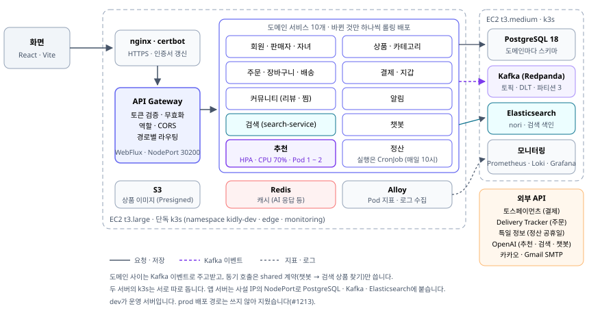

- 요청은 화면 → **API Gateway**(dev 8083 · prod 8084) → 서비스로 갑니다. Gateway가 토큰 검증 · 무효화 확인 · 역할 검사 · CORS를 하고 검증된 회원 정보를 헤더로 넘깁니다. 서비스는 Gateway 뒤에서만 열린다는 전제입니다.
- Gateway는 경로별로 도메인 서비스에 보냅니다. `GET /api/v1/products`는 search-service가 처리합니다.
- 도메인 사이는 Kafka 이벤트로만 주고받습니다(토픽은 3.3). 다른 도메인 정보는 이벤트로 받아 둔 복사본을 씁니다 (6.3).
- 서버는 EC2 2대입니다: t3.large(Docker Compose: Gateway · 도메인 서비스 · PostgreSQL · Kafka)와 t3.medium(k3s: Elasticsearch · 모니터링). 상품 이미지는 S3, 배포는 GitHub Actions가 맡습니다.
- 검색 서비스(search-service)는 독립된 Spring Boot 앱입니다. 앱 서버 t3.large의 docker compose에서 돌고(프로필 `search`, heap 512m), 서버 안 `127.0.0.1:8082`에만 열립니다.
- Elasticsearch(공식 이미지 + nori)는 모니터링과 같은 t3.medium의 k3s에서 돕니다(namespace `search`, heap 1g, 데이터 10Gi). 검색 서비스는 VPC 안에서 NodePort 30920으로 붙고, 보안 그룹은 t3.large에서 오는 것만 받습니다.
- 지금은 dev만 켜져 있습니다. 배포는 앱 배포 워크플로가 Elasticsearch를 먼저 올린 뒤 검색 서비스를 올립니다. Elasticsearch 설정이나 이미지가 바뀌면 다시 뜨는 동안 2분쯤 검색이 끊깁니다.

아래는 세미 때 구성(앱 1개 · EC2 1대)입니다. 참고로 남깁니다.

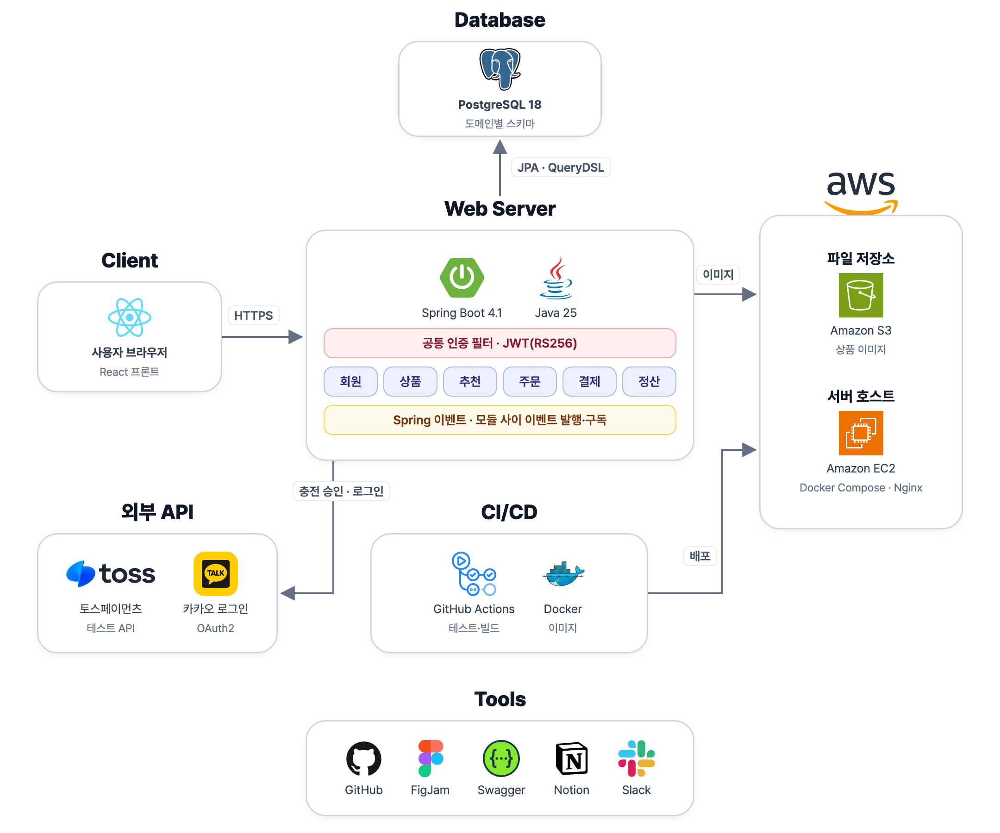

## 3.2 모듈 구성

| 모듈 | 담당 | 한 줄 책임 |
|---|---|---|
| 회원 | maruhxn | 로그인 · 가입 · 탈퇴 · 정지, 자녀 프로필, 판매자 승인, 가입 환영 메일 — member · childprofile · seller · notification 모듈. 자녀 프로필은 childprofile-service로 분리(dev), 인증은 auth 도메인으로 분리 중(#686) |
| 상품 | heojungseok | 상품 · 옵션 · 재고, 상품 상세, 카테고리 · 상품 유형 · 항목 · 실측 항목 기준 데이터, 이미지 업로드 주소 (목록 · 검색은 검색 모듈로) |
| 추천 | heojungseok | 사이즈 추천 · AI 상품 추천 · 함께 사면 좋은 상품, 활동 기록 · 선호 점수, 기준 옷 비교(2순위). recommend-service로 분리 중(#704) |
| 주문 | L2J92 | 장바구니 · 공용 장바구니(조르기), 주문, 배송(택배 조회), 구매확정, 판매자 부분 취소 — order · cart · delivery · wish 4개 컨텍스트(포트로만 연결, ArchUnit으로 고정) |
| 결제 | codes-gy | 지갑(동결 포함), 충전 · 충전 취소, 주문 결제 · 환불, 정산금 입금, 토스 웹훅. payment-service로 분리 중 |
| 검색 | codes-gy | 상품 목록 검색(Elasticsearch), 상품 · 판매자 이벤트로 색인, 검색어 이벤트 발행. search-service로 따로 뜸 |
| 정산 | baiees | 정산 대상, 영업일 일정산(Spring Batch), 지급 요청 · 결과 반영 (지갑 적립은 결제) |
| 커뮤니티 | L2J92 | 리뷰(작성 자격 · 작성 · 목록 · 요약) · 찜 — review · favorite 컨텍스트. 상품 · 주문 · 회원 이벤트만 받고 보내는 이벤트는 없음 |
| 공통 | 팀 | 오류 응답, 이벤트 형식(`shared` 계약), 이벤트 발행 · Kafka 규칙, 공통 설정, 요청 로그 · 모니터링, FE 동작 설정(setting 모듈). API Gateway(apps/gateway, maruhxn) |

### 주문 모듈 구조 변경 (세미 → 최종)

주문은 다른 도메인과 Kafka 이벤트로만 연결되고, 외부 API 주소와 응답 형식은 세미 그대로입니다(필드 · 값 추가만).

| 항목 | 세미 | 최종 |
|---|---|---|
| 모듈 | 앱 안의 패키지, 공통 모듈(common)에 의존 | 독립 Gradle 모듈(`domains/order`), 공통 모듈 의존 제거 |
| 내부 구성 | 주문 한 덩어리 | 컨텍스트 4개(order 주문 · cart 장바구니 · delivery 배송 · wish 조르기), 컨텍스트끼리는 포트로만 연결 |
| 계층 구조 | app · domain · in · out | 같은 구조를 ArchUnit 테스트로 고정(계층 · 컨텍스트 경계 · 패키지 배치) |
| 도메인 간 통신 | Spring 이벤트(앱 안) | Kafka. 보내기는 아웃박스, 받기 실패는 DLT. 수신 스위치로 Spring 이벤트 경로 전환 가능 |
| 인증 | 앱의 공통 인증 필터 | API Gateway가 검증, 주문은 헤더로 로그인 회원만 받음 |
| DB 스키마 | JPA 자동 생성 | Flyway 마이그레이션 |
| 실패 복구 | 이벤트 처리 실패 · 결제 반영 실패를 관리자가 재처리 | + DLT 메시지도 관리자 화면에서 확인 · 재처리 · 종료 |

## 3.3 모듈 연결 지도

도메인 사이 이벤트는 모두 **Kafka**로 갑니다. 보내는 도메인마다 토픽이 하나이고, 받는 도메인은 자기 구독 그룹으로 필요한 종류만 받습니다. 최신 연결은 [도메인 연결 지도](https://claude.ai/artifact/SsSBBKhQsFNFJVCXrPPtGU)에서 볼 수 있습니다.

| 보내는 쪽 | 토픽 | 이벤트 → 받는 쪽 (구독 그룹 `kidly.{받는도메인}`) |
|---|---|---|
| 회원 | `kidly.member.events` | `member.registered` → 결제 · 알림 · `member.changed` → 판매자 · `member.withdrawn` → 자녀 프로필 · 결제 (추천 · 커뮤니티 예정) · `member.tokens-revoked` → Gateway |
| 판매자 | `kidly.seller.events` | `seller.changed` → 회원 · 상품 · 주문 · 추천 · 검색 |
| 자녀 프로필 | `kidly.childprofile.events` | `child.changed` → 주문 · 추천 |
| 상품 | `kidly.product.events` | `product.changed` → 주문 · 추천 · 검색 · 커뮤니티 · `stock.deducted` · `stock.deduction-failed` → 주문 |
| 주문 | `kidly.order.events` | `order.created` → 상품 · `order.payment-requested` → 결제 · `order.cancelled` → 상품 · 결제 · `order-item.purchase-confirmed` → 정산 · 추천 · 커뮤니티 · `order-item.cancelled` → 결제 · 상품 · `cart.item-added` → (추천 예정) |
| 결제 | `kidly.payment.events` | `payment.completed` · `payment.failed` → 주문 · `payment.payout-completed` · `payment.payout-failed` → 정산 |
| 정산 | `kidly.settlement.events` | `settlement.payout-requested` → 결제 (dev 켬, prod는 main 반영 때) |
| 검색 | `kidly.search.events` | `search.performed` → (추천 예정) |

- 결제 · 주문 · 정산 · 커뮤니티에는 Spring 이벤트 수신 코드도 남아 있습니다. Kafka 수신 스위치를 끌 때 되돌아가는 길입니다. 상품은 Kafka로만 받아, 상품 수신 스위치를 끄면 주문 이벤트 수신이 멈춥니다. 판매자 부분 취소(`order-item.cancelled`)는 Kafka로만 받습니다.
- 다른 도메인 정보가 필요하면 이벤트로 받아 **자기 복사본**을 둡니다 (6.3). 예: 추천은 자녀 정보 · 상품 사이즈 정보를, 주문은 자녀 정보 · 상품 가격을 복사본으로 가집니다.
- **🕒 = 시간에 따라 실행되는 작업** (주문: 결제 제한 시간 만료 · 자동 구매확정 · 택배 조회 · 아웃박스 릴레이 / 정산: 영업일 일정산(Spring Batch) · 지급 결과 재요청 · 아웃박스 릴레이 / 결제: 충전 정리 · 주문 취소 환불 재처리 · 아웃박스 릴레이 · 정리 / 상품 · 자녀 프로필: 아웃박스 릴레이 / 알림: 메일 재발송 / 회원: 만료된 Refresh Token 정리)
- 다른 모듈의 테이블은 직접 읽지 않습니다. 도메인 사이에는 FK를 두지 않고, 다른 모듈의 ID는 값으로만 저장합니다.

아래는 세미 때 그림(Spring 이벤트)입니다. 연결은 위 표가 기준입니다.

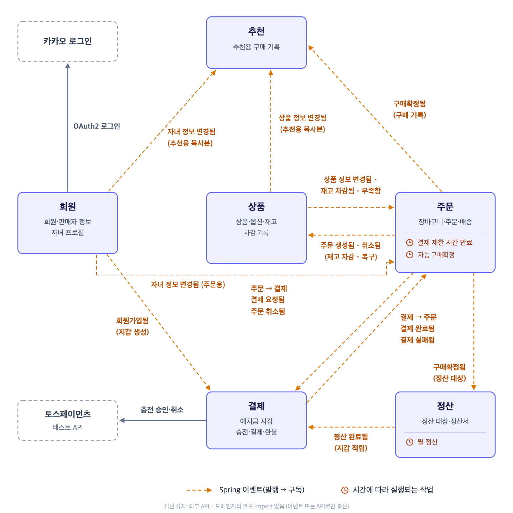

## 3.4 주문 전까지

주문 · 추천은 회원 · 상품에 묻지 않고, 미리 받아 둔 **복사본**을 씁니다 (6.3). 실선 = 사용자 요청, 점선 = 이벤트. 그림은 세미 기준이고, 지금 점선의 이벤트는 Kafka로 갑니다(3.3).

**① 판매자가 되기까지**

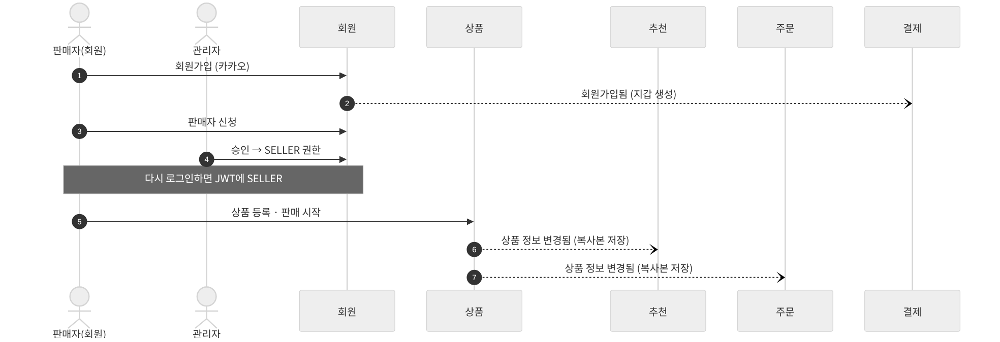

**② 보호자가 장바구니에 담기까지**

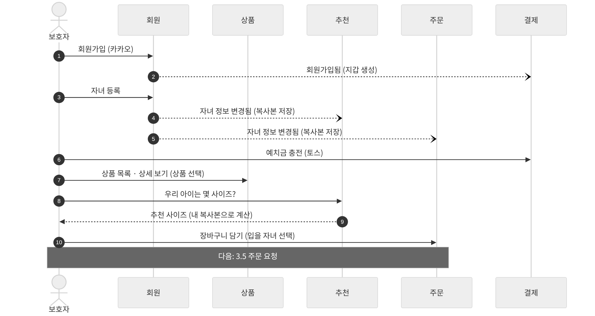

## 3.5 구매에서 정산까지

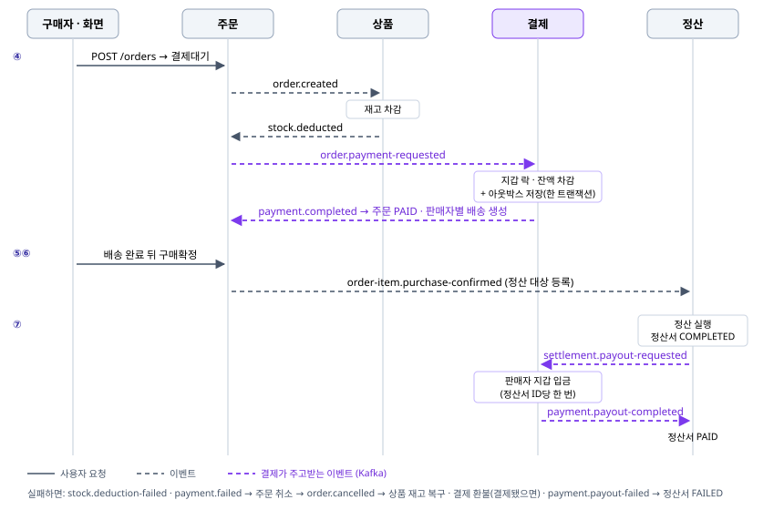

결제는 주문 · 상품을 부르지 않고, 받은 이벤트로만 움직입니다. 결제 결과 · 지급 결과는 지갑을 바꾼 트랜잭션에서 아웃박스에 저장한 뒤 보내므로 「돈은 빠졌는데 알림이 사라지는」 일이 없습니다.

실선 = 사용자 요청, 점선 = 이벤트. 번호 순서대로 7장의 ④ → ⑦ 카드가 이어집니다.

## 3.6 추천 서비스 데이터 흐름

실선 = 사용자 요청, 점선 = Kafka 이벤트.

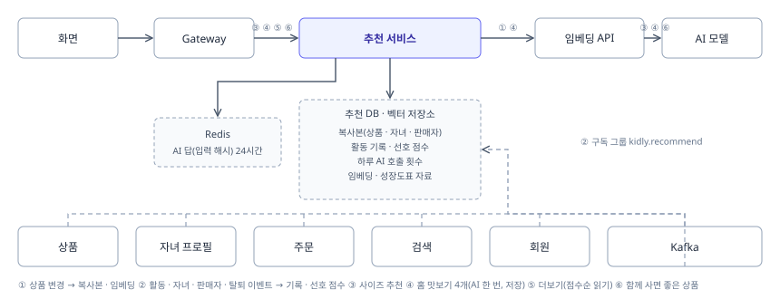

- 주문 · 결제 경로에는 추천 서비스가 없습니다. 추천 서비스가 멈추면 Gateway가 3초 뒤 끊고 화면은 추천 영역만 비웁니다.
- 계산은 이벤트가 올 때 합니다(복사본 · 임베딩 · 선호 점수). 요청이 올 때는 저장된 것을 읽고, AI 호출은 홈 맛보기와 함께 사면 좋은 상품에만, 같은 입력이면 저장된 응답을 재사용합니다.

## 3.7 결제 서비스 이벤트 흐름

실선 = 요청 · 저장, 점선 = Kafka.

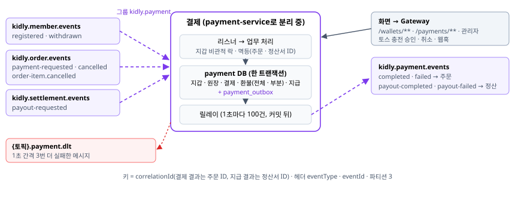

결제는 다른 도메인을 부르지 않습니다. 화면 요청(충전 · 조회)과 이벤트만 받고, 결과는 이벤트로만 알립니다. 그래서 결제를 다른 서비스로 떼어도 다른 도메인의 코드는 바뀌지 않습니다.

## 3.8 검색 서비스 흐름

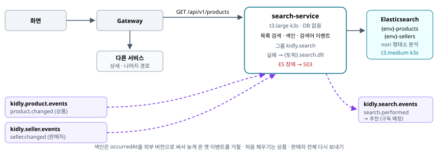

검색은 상품 DB를 읽지 않고 상품 · 판매자 이벤트로 색인합니다. 검색 서비스가 멈추면 상품 목록만 503이고, 상품 상세 · 장바구니 · 주문은 각 서비스가 처리합니다.

# 4. 주요 정책

- 주문은 **결제대기로 저장**한 뒤, 상품이 **재고를 차감 (선점)**합니다.
- 재고가 **하나라도 부족하면** 아무것도 차감하지 않고 주문을 취소합니다. 모두 확보되면 결제로 넘어갑니다.
- 결제는 주문 전체를 한 번에 합니다. **결제에 실패하면 주문 전체를 취소**하고 재고를 복구합니다 (일부만 성공 없음). 예외로 판매자는 **발송 전에 자기 몫만** 취소할 수 있고, 그 주문상품 금액만 환불 · 재고 복구합니다 (2.1 ④).
- 구매자는 **발송 전까지** 주문 전체를 취소할 수 있습니다 (처리는 2.1).
- 주문내역에는 **주문 당시의 자녀 정보(키 · 몸무게 · 체형)와 사이즈**가 남습니다. 옵션 이름(예: 「색상: 네이비 / 사이즈: 110」)도 남습니다.
- 판매자는 **자기 상품을 살 수 없습니다.**
- 판매자도 같은 계정으로 구매합니다 (판매자 ID = 회원 ID).
- 구매확정은 **직접 하거나, 배송 완료 후 정해진 기간(설정값)이 지나면 자동**으로 됩니다.
- **구매확정 후에는 취소 · 환불이 없습니다.** 구매확정된 주문상품만 정산 대상입니다.
- 정산금은 **판매자의 예치금 지갑에 적립**합니다 (정산계좌 없음).
- 세미에서는 자녀 계정 없이 보호자 계정 안에 **자녀 프로필**만 둡니다. 최종의 조르기도 자녀 계정이 생기기 전까지 부모 계정 기준으로 동작합니다 (K31).
- 자녀 프로필의 키 · 체형이 바뀌면 **성장 이력**을 1건 쌓습니다 (값이 같으면 쌓지 않음, 체형이 비어 있다가 생기거나 비워져도 바뀐 것으로 봄). 자녀 삭제는 **논리 삭제**입니다. 목록 · 상세 · 추천에서 제외하고, 기존 주문에 남은 자녀 정보는 유지합니다.
- 배송지는 여러 개 둘 수 있고, **배송지가 있으면 기본 배송지는 정확히 1개**입니다. 기본 배송지는 삭제할 수 없고, 다른 배송지를 기본으로 바꾼 뒤 삭제합니다.
- **도메인끼리 서로의 코드를 import하지 않습니다.** 도메인끼리는 이벤트로만 주고받습니다 (화면이 부르는 API는 별개). 이벤트는 Kafka로 가고, 같은 이벤트가 두 번 와도 결과는 한 번분입니다. 다른 도메인 정보는 내부 조회 API 대신 **이벤트 + 복사본**으로 받습니다 (6.3).
- 기간 · 주기 · 수수료율처럼 바뀔 수 있는 값은 **코드를 고치지 않고 값만 바꿀 수 있게** 만듭니다 (지금 값은 2.1).
- 정산은 판매자별 정산서로 묶어 합계에서 수수료를 한 번 뺍니다 (원 미만 버림). 같은 주문상품은 한 번만 정산하고, 같은 정산서는 한 번만 지급합니다.
- 리뷰는 구매확정한 주문상품마다 하나, 찜은 회원 × 상품마다 하나입니다. 같은 요청이 다시 와도 결과는 한 번 한 것과 같습니다.
- 판매자 부분 취소 같은 새 기능은 받는 도메인이 준비될 때까지 스위치로 꺼 두고, 받는 쪽이 배포된 뒤 켭니다.
- 예치금 잔액은 결제만 바꿉니다. 바꿀 때는 회원 지갑을 비관적 락으로 잡아, 결제 · 환불 · 충전 · 입금이 동시에 와도 차례로 처리합니다. 바뀔 때마다 원장(입출금 기록)을 1건 남기고 고치지 않습니다.
- 결제가 받는 이벤트는 두 번 와도 한 번만 반영합니다: 주문 결제는 주문당 한 번, 주문 취소 환불은 결제당 한 번, 판매자 부분 취소 환불은 취소당 한 번, 정산 입금은 정산서당 한 번.
- 돈이 움직인 결과(결제 · 지급)는 지갑을 바꾼 트랜잭션에서 아웃박스에 함께 저장한 뒤 보냅니다. 지갑만 바뀌고 알림이 사라지는 일이 없습니다.
- 탈퇴한 회원의 지갑은 지우지 않고 동결합니다. 잔액은 실제 돈이므로 소멸시키지 않고 운영자가 돌려줍니다. 탈퇴 뒤에도 환불 · 정산금이 들어올 수 있어 들어오는 돈은 받습니다.
- 판매자 부분 취소의 환불은 `order-item.cancelled`로만 합니다. 마지막 판매자 몫이 취소돼 주문 전체가 취소돼도 `order.cancelled`는 나가지 않아 두 번 환불하지 않습니다. 환불할 수 없는 취소는 돈을 움직이지 않고 실패한 환불로 남겨 운영자가 봅니다.
- 검색은 상품 DB를 읽지 않고 이벤트로 받은 값으로만 색인합니다. 검색 장애는 상품 목록에만 영향을 줍니다.
- 검색어 이벤트는 검색 응답보다 덜 중요해, 보내지 못하면 버립니다(검색을 실패시키지 않음). 결과 목록 · 비로그인 검색은 보내지 않습니다.
- 주문 · 결제 경로는 추천 서비스를 호출하지 않습니다. 추천 서비스는 이벤트를 받아 자기 데이터를 쌓고 추천 조회 요청에만 응답합니다. 추천이 실패해도 상품 상세 · 장바구니 · 주문 API는 정상으로 동작합니다.
- AI는 상품의 실제 사이즈 목록과 후보 상품 목록 안에서만 고릅니다. AI가 없는 사이즈나 상품을 답하지 못하도록 구조화 출력으로 받습니다.
- 추천 응답에는 근거(`reasons` · `reason`)와 출처(`source`: AI 또는 규칙)가 있습니다. 화면은 출처를 보고 「AI 추천」 표시를 켜고 끕니다.
- AI가 쓰는 이유 문장은 옷 치수를 기준으로 쓰고 아이의 몸을 평가하는 표현을 쓰지 않습니다.
- 외부 AI API에는 자녀 이름 · 생년월일 · 회원 ID를 보내지 않습니다. 개월 수 · 키 · 몸무게 · 체형 · 선호 핏만 보냅니다.
- 사이즈는 이름(S · M · 110)이 아니라 cm로 비교합니다. 판매자가 적은 「사이즈별 권장 키」는 몸 기준 정보이고 「상품 실측」은 옷 기준 정보라 같은 숫자로 보지 않습니다.
- 추천 서비스는 다른 도메인의 DB나 API를 읽지 않습니다. 상품 · 자녀 · 판매자 · 활동 · 구매 정보는 모두 Kafka 이벤트로 받은 복사본이고, 임베딩 · 선호 점수 · AI 응답 같은 파생값과 벡터 저장소는 추천 서비스 안에 둡니다.

### 주문상품 상태


> 결제대기 · 결제완료 · 취소는 주문 전체, 배송중 · 배송완료는 판매자별 배송, 구매확정은 주문상품의 상태입니다 (정산 여부는 정산이 관리).

> 주문 취소 사유는 `OUT_OF_STOCK` · `PAYMENT_FAILED` · `PAYMENT_EXPIRED` · `BUYER_CANCELLED`입니다. 판매자별 배송은 `READY` → `SHIPPING` → `DELIVERED`이고, 구매자가 취소하면 `CANCELLED`가 됩니다 (그림은 v1.0).

> 최종: 판매자가 발송 전에 자기 몫을 취소하면 그 판매자 배송과 주문상품이 취소되고, 마지막 몫이면 주문도 취소됩니다(사유 `OUT_OF_STOCK` · `WRONG_PRODUCT_INFO` · `OTHER`). 발송한 배송은 택배 조회로 자동 배송 완료될 수 있습니다.

# 5. 개발 환경

> **여기부터는 개발 가이드입니다.** 1~4장은 기획 · 정책, 5~10장은 개발 · 운영에 필요한 것입니다. 아직 정하지 않은 것과 그동안 쓰는 값은 **2.1**에 모았습니다.

## 5.1 기술 스택

| 영역 | 선택 |
|---|---|
| 백엔드 | Java 25 · Spring Boot 4.1 · Spring Data JPA · QueryDSL · Spring Batch(정산, 메타데이터는 settlement 스키마) · Spring for Apache Kafka · springdoc(Swagger) · ArchUnit(경계 · 계층 검사). 서비스는 Spring Security를 쓰지 않음(인증은 Gateway) |
| 데이터 | PostgreSQL 18 · Flyway로 스키마 관리 (`V{yyyyMMddHHmm}__*.sql`, JPA는 검증만, 적용된 파일은 고치지 않고 새 파일 추가) · 모듈마다 DB 스키마를 나눔 (member · childprofile · seller · product · recommend · orders · payment · settlement · community · notification · setting) · 암호화는 토스 paymentKey (AES-256-GCM, 대상은 2.1) · 검색은 PostgreSQL이 아니라 Elasticsearch(상품의 검색용 표는 되돌리기용으로 남음) |
| 이벤트 | Kafka. 보내는 도메인마다 토픽 하나(`kidly.{도메인}.events`, 파티션 3 · 복제 1), 키는 correlationId, 받는 도메인마다 구독 그룹 `kidly.{도메인}`과 DLT. 결제는 아웃박스 표(`payment.payment_outbox`)로 보냄. 도메인마다 Kafka 수신 스위치로 Spring 이벤트로 되돌릴 수 있음 |
| 인증 | 카카오 로그인(화면이 인가 코드를 받아 서버로 보냄) · JWT(RS256) · API Gateway(apps/gateway, WebFlux)가 검증 · 무효화 확인 · 역할 검사 · CORS |
| 외부 API | 토스페이먼츠 테스트 API(결제) · Delivery Tracker(택배 조회) · 공공데이터포털 한국천문연구원 특일 정보(정산 공휴일) · OpenAI(추천) · 카카오(로그인) · Gmail SMTP(알림) |
| 인프라 | AWS EC2 2대(t3.large: Docker Compose로 Gateway · 앱 · 검색 서비스 · PostgreSQL · Kafka / t3.medium: k3s로 Elasticsearch · 모니터링) · S3(상품 이미지) · Nginx · GitHub Actions |
| 검색 | Elasticsearch 9.4 + analysis-nori(한글 형태소), elasticsearch-java 클라이언트(Boot starter). 검색 서비스(search-service)는 DB 없이 뜨고 색인 이름 앞에 환경 이름(`dev-products`)을 붙여 dev · prod가 Elasticsearch 하나를 나눠 씀. Elasticsearch는 t3.medium k3s(heap 1g), 검색 서비스는 앱 서버 t3.large의 docker compose(heap 512m, 프로필 `search`) |
| AI 호출 | Spring AI 2.0.x(`spring-ai-starter-model-openai`), OpenAI Responses API. 구조화 출력은 `ChatClient.entity()`로 Java record에 받음. tool은 쓰지 않음 |
| chat 모델 | OpenAI 중간 등급(terra 계열). 모델 이름은 설정값. `reasoning-effort`는 low |
| 임베딩 | OpenAI `text-embedding-3-small`(1,536차원). 상품 복사본이 바뀔 때 이름 · 브랜드 · 설명 · 정보 값을 합쳐 한 번 호출. 처음 채우기는 묶음 호출. 검색어는 홈 맛보기 계산 때 묶어 호출 |
| 벡터 저장소 | P17에서 선택. Spring AI `VectorStore` 뒤에 두어 starter 교체로 바꿀 수 있음. 상품 ID · 벡터 · 거르기 칸(상태 · 카테고리 · 사이즈 무관)만 두고 본문은 복사본 표에서 읽음 |
| RAG 자료 | 성장도표 설명문, 사이즈 측정 안내(글 조각 + 출처 id). Spring AI `QuestionAnswerAdvisor`로 프롬프트에 붙임. 숫자 표(성장도표 · LMS)는 RAG가 아니라 규칙 계산 입력 |
| 추천 저장소 | 추천 DB(지금은 공용 PostgreSQL `recommend` 스키마, 분리 뒤 추천 전용). 복사본, 활동 기록, 자녀 선호 점수, AI 응답(입력 해시 키), 호출 횟수 |
| 실패 대비 | Gateway timeout 3초 · circuit breaker, 추천 서비스 내부 timeout 2.5초, 하루 호출 상한. 실패 시 규칙 결과 또는 빈 목록 |
| 배포 | EC2 2대(t3.large: 앱 · PostgreSQL · Kafka, t3.medium: 모니터링 · ES, k3s). 추천 서비스를 k3s로 옮기는 시점은 배포 계획에 따름 |
| 모니터링 | Prometheus · Loki · Alloy · Grafana, Slack 알림 (자세한 구성은 10장) |
| 프론트 | React · Vite · Tailwind CSS · shadcn/ui · React Query · Zustand |

## 5.2 저장소

- BE: https://github.com/prgrms-be-adv-devcourse/beadv8_8_BBCC_BE
- FE: https://github.com/prgrms-be-adv-devcourse/beadv8_8_BBCC_FE

## 5.3 데이터 모델 변경 (최종)

세미 이후 새로 생기거나 바뀐 표만 적습니다. 정산 표는 ⑦ 상세 5에 있습니다. 모든 표는 자기 도메인 스키마에 두고, 다른 도메인의 ID는 값으로만 들고 있습니다.

| 표 · 칸 | 내용 | 비고 |
|---|---|---|
| `payment_outbox` (새 표) | 보낼 이벤트: event_id(UUID, 유니크) · event_type · topic · message_key · payload(본문 JSON) · attempt_count · last_error · sent_at(null이면 안 보냄) · created_at · updated_at. 다른 표와 FK 없음(키에 주문 · 정산서 ID) | V202610300905__payment_outbox |
| `wallet.frozen_at` (새 칸) | 탈퇴로 동결한 시각. null이면 동결되지 않은 지갑 | V202611021530__wallet_frozen_at |
| 검색 색인 (DB 아님) | products: productId · name(nori) · thumbnailUrl · sellerId · categoryId · status · sizeFree · productCreatedAt · minPrice · soldOut · attributeValues(`code:값ID`) · occurredAt / sellers: 상호명 · 상태. 모르는 칸은 거절(`dynamic: strict`) | - |
| 아웃박스 표 (주문 · 상품 · 정산 · 자녀 프로필) | 도메인마다 보낼 이벤트를 업무와 같은 트랜잭션에 저장하고 릴레이가 Kafka로 보냄 (결제와 같은 방식) | 각 도메인 Flyway |
| community `replica_product` | product_id(PK) · name · thumbnail_url · display_status · source_occurred_at. 리뷰 · 찜 화면용 상품 복사본 | 상품당 1행 |
| community `review_eligibility` | order_item_id · order_id · member_id · product_id · option_id · size · confirmed_at. 리뷰 작성 자격 | order_item_id 유일 (K30) |
| community `review` · `review_stats` | 리뷰: order_item_id · member_id · product_id · rating · content · nickname · 작성 · 수정 시각 / 집계: product_id · review_count · rating_sum | order_item_id 유일, 별점 1~5 CHECK |
| community 찜 · 찜 집계 | member_id · product_id · 찜한 시각 / product_id · favorite_count | (member_id, product_id) 유일, 진행 중(#662) |

# 6. 개발 규칙

## 6.1 API 공통 규칙

| 항목 | 규칙 |
|---|---|
| 주소 | `/api/v1/...` · 판매자 `/api/v1/seller/...` · 관리자 `/api/v1/admin/...` · 예외 없음 (로그인도 `/api/v1/auth/login/{provider}`) |
| 인증 | Gateway가 `Authorization: Bearer {accessToken}`을 검증하고 `X-Member-Id` · `X-Member-Roles` · `X-Member-Nickname` 헤더를 붙여 넘김. 로그인이 필요한 API는 `@LoginMember AuthMember`를 받고 헤더가 없거나 잘못되면 401 · 로그인 없이 부르는 API: 로그인 · 재발급 · 로그아웃, 상품 목록 · 상세, 카테고리, FE 설정, 토스 웹훅, 리뷰 목록 · 요약, 찜 요약, 개발용 토큰(local · test · dev만) · `/seller/**`는 SELLER, `/admin/**`는 ADMIN만 (Gateway가 검사, 토큰 없으면 401 · 역할 없으면 403) |
| 성공 | 감싸지 않고 그대로 · 조회 200 · 생성 201 · 삭제 204 |
| 실패 | ProblemDetail 5필드 (`type` · `title` · `status` · `detail` · `instance`) · 오류 코드 이름은 응답에 나가지 않음 (`type`은 늘 `about:blank`), detail에 다음에 할 일을 적음 · 동시 요청이 DB 제약에 막히면 409 |
| 값 | ID는 문자열 · 금액은 원 단위 정수 · 상태값 영어 대문자 |
| 시각 | `2026-10-08T10:00:00` (`LocalDateTime`, 한국 시간) · 서버 · DB 시간대 Asia/Seoul |
| 목록 | `{ content, page, size, totalElements, totalPages, hasNext }` · 커뮤니티 목록은 커서 방식(`cursor` · `size`, 마지막 쪽은 `nextCursor: null`) |

화면과 Swagger는 Gateway 주소(로컬 8083)로 붙습니다. API 문서는 **Swagger**로 작성합니다 (목록 기준: 노션 'Kidly API 명세서 v2' → v1.1부터는 develop 코드와 Swagger). API 응답은 `global`의 공통 형식을 씁니다.

**양식**

```
// 200 조회 · 201 생성(+ Location 헤더)
{
  "orderId": "1024",
  "status": "PAID",
  "totalAmount": 39000,
  "orderedAt": "2026-10-20T14:00:00"
}

// 200 목록
{
  "content": [
    { "productId": "11", "name": "데일리 맨투맨", "price": 19000 }
  ],
  "page": 0, "size": 20,
  "totalElements": 1, "totalPages": 1, "hasNext": false
}
```

```
// 실패 (ProblemDetail 5필드)
// Content-Type: application/problem+json
{
  "type": "about:blank",
  "title": "가격이 바뀌었습니다",
  "status": 409,
  "detail": "장바구니 단가와 현재 단가가 다릅니다.",
  "instance": "/api/v1/orders"
}
```

## 6.2 이벤트 규약

**이벤트 = 이미 일어난 일을 알리는 메시지.** 보내고 기다리지 않습니다. 결과가 필요하면 받는 쪽이 새 이벤트로 알립니다.

1. **보내기** — 업무 저장과 같은 트랜잭션에서 `EventPublisher`로 발행 (롤백되면 안 나감). DB 커밋이 끝난 뒤에만 Kafka로 보냄: 주문 · 결제 · 상품 · 정산 · 자녀 프로필은 같은 트랜잭션에서 아웃박스 표에 저장하고 릴레이가 보내며, 회원 · 판매자는 커밋 뒤 바로 보냄
2. **받기** — `@KafkaListener`로 받는 도메인의 구독 그룹(`kidly.{받는도메인}`)에서 한 건씩 처리하고 처리 완료를 커밋. 실패하면 1초 간격 3번 더 시도한 뒤 `{토픽}.{받는도메인}.dlt`로 보냄(다시 해도 같은 실패는 바로 DLT). 수신 스위치를 끄면 Spring 이벤트(`@DomainEventListener`: 커밋 뒤 · 새 트랜잭션 · 동기)로 받음
3. **처리** — 같은 이벤트가 두 번 와도 한 번만 반영 (공통 표 없이 도메인마다 막음: 복사본은 `occurredAt` 비교, 처리 기록은 유니크 키(주문 · 주문상품 · 정산서 ID 등), 상태 변경은 지금 상태에서 할 수 있을 때만)
4. **결과** — 필요하면 그 트랜잭션에서 자기 결과 이벤트를 발행 (예: 재고 차감 → `stock.deducted`)

| 항목 | 규칙 |
|---|---|
| 각자 정할 것 | `eventType`(`{대상}.{과거형}`, 예: `order.created`)과 `data`(8장 표)만. eventId(UUID) · occurredAt은 보내는 쪽이 넣고, 나머지 칸은 공통 인터페이스의 기본값 |
| 값 | ID는 `Long`(Kafka 본문에서도 숫자, API 응답에서만 문자열) · 공통 칸 `eventId`는 UUID, `aggregateId` · `correlationId`는 문자열 · 금액은 원 단위 정수 · 시각은 `LocalDateTime`(한국 시간, 시간대 표시 없음) · 연락처 · 주소 · 토큰 같은 개인정보 필드는 새로 넣지 않음 (예외: `member.registered`의 email — 확인 K8) |
| 클래스 위치 | 모든 이벤트 record가 `shared/event/DomainEvent`를 구현하고, 보내는 쪽이 `shared/{도메인}/event`에 이벤트마다 record(eventId · occurredAt · data)를 만듦. 발행은 `global`의 `EventPublisher`. `eventType`은 클래스 이름에서 만들고(OrderCreatedEvent → order.created, 두 단어 대상은 재정의), `producer`는 패키지의 도메인 이름, `aggregateId`는 대상의 ID(주문 이벤트 = orderId, 자녀 정보 = childId), `correlationId` 기본값 = aggregateId, `schemaVersion` 기본 1 |
| Kafka 메시지 | 토픽은 보내는 도메인 것 하나 `kidly.{도메인}.events`(파티션 3 · 복제 1, 바꾸지 않음) · 키 = `correlationId`(순서를 지켜야 하는 흐름의 ID, 기본은 `aggregateId`. 예: 결제 · 구매확정 이벤트는 주문 ID) · 헤더 `eventType` · `eventId` 두 개(`__TypeId__` 없음) · 본문은 공통 칸 7개 + `data`의 JSON 문자열 · `data`가 null이면 보내지 않음 |
| 순서 | 같은 키는 **같은 토픽의 같은 파티션 안에서만** 순서가 보장되고, 서로 다른 토픽 사이의 순서는 보장되지 않음 — 지금 상태에서 할 수 있을 때만 반영 |
| 바꿀 때 | 보내는 쪽은 필드를 추가만 함(이름 · 타입 · 의미를 바꾸거나 지우지 않음). 추가한 필드는 없어도 동작해야 함(예전 메시지도 처리). 받는 쪽은 모르는 필드를 무시. 새 enum 값은 받는 도메인이 모두 처리하도록 배포된 뒤에 보냄 → 보내는 쪽 · 받는 쪽 어느 쪽을 먼저 배포해도 됨 |
| 침범 금지 | 다른 도메인의 토픽을 만들거나 그 토픽에 보내지 않음 · 받은 메시지를 원래 토픽에 다시 넣지 않음 · 다른 도메인의 그룹 · DLT · 오프셋을 쓰지 않음 · 특정 받는 도메인에 맞춰 이벤트를 바꾸지 않음 · 로그에는 `eventType` · `eventId` · 키만 남김(본문 금지) |
| 쓰지 않음 | `@EventListener` |

**양식** — 모든 이벤트가 같은 바깥 틀(공통 형식)을 쓰고, 이벤트마다 다른 내용은 `data`에만 넣습니다.

```
// 예시 1. 일반 이벤트 — 주문 생성됨 (Kafka 본문. 키 "1024", 헤더 eventType · eventId)
{
  "eventId": "6f1c2e4a-0b7d-4c1e-9a55-2d3f8e7b1a90",
  "eventType": "order.created",
  "schemaVersion": 1,
  "occurredAt": "2026-10-20T14:00:00",
  "producer": "order",
  "aggregateId": "1024",
  "correlationId": "1024",
  "data": {
    "orderId": 1024,
    "memberId": 1,
    "items": [
      { "orderItemId": 5001, "optionId": 1, "quantity": 1 }
    ]
  }
}
```

```
// 예시 2. 복사본용 이벤트 — 자녀 정보 변경됨 (바뀐 뒤 전체 값, v1.1: birthDate · producer)
{
  "eventId": "0c9d7b1e-5f2a-4e8b-b3c4-7a6e1d2f9c11",
  "eventType": "child.changed",
  "schemaVersion": 1,
  "occurredAt": "2026-10-19T09:30:00",
  "producer": "childprofile",
  "aggregateId": "1",
  "correlationId": "1",
  "data": {
    "childId": 1, "memberId": 1,
    "heightCm": 115.0, "weightKg": 20.0,
    "gender": "MALE", "birthDate": "2019-01-01",
    "bodyType": "NORMAL", "preferredFit": "LOOSE",
    "deleted": false
  }
}
```

## 6.3 다른 도메인 정보가 필요할 때

다른 도메인 정보는 **이벤트 + 복사본으로만** 받습니다. 상대가 보내는 이벤트를 받아 내 테이블에 복사본을 두고 그것을 읽습니다.

**지금 쓰는 곳**

| 누가 | 복사본 | 받는 이벤트 | 쓰는 곳 |
|---|---|---|---|
| 추천 | 추천용 자녀 정보 (키 · 몸무게 · 체형 · 선호 핏 · 성별 · 생년월일) | `child.changed` | 사이즈 추천 · 없는 · 남의 · 삭제된 자녀 404 |
| 추천 | 추천용 상품 정보 (사이즈별 권장 키 · 판매 상태 · 카테고리 · 썸네일 · 등록 시각 · 품절 여부 · 사이즈 구분 없음 · 옵션 판매 상태 · 최저가 · 최종: 브랜드 · 설명 · 사이즈별 실측(#610으로 이벤트에 추가, 추천 저장도 반영(#714))) | `product.changed` | 사이즈 추천 · 자녀 맞춤 목록 |
| 주문 | 주문용 자녀 정보 (키 · 몸무게 · 체형 — 키 · 몸무게는 소수 첫째 자리, 체형은 비어 있을 수 있음 · 삭제 여부. 이벤트에 이름이 없어 주문의 자녀 이름은 null일 수 있음, 확인 K4) | `child.changed` | 주문상품에 당시 자녀 정보 복사 · 남의 자녀 거절 |
| 주문 | 주문용 상품 정보 (옵션 · 사이즈 · 단가 · 판매자 · 판매 상태 · 옵션 이름 · 옵션 판매 상태) | `product.changed` | 장바구니 담기 · 가격 확인(409) · 주문상품에 상품명 · 옵션 이름 · 사이즈 · 단가 복사 · 담기 · 주문은 옵션 판매 상태도 봄 |
| 주문 | 배송지 | (이벤트 아님) 주문 요청에 담겨 옴 | 화면이 회원 배송지 목록에서 골라 주문 요청에 넣음 — 연락처 · 주소는 이벤트로 보내지 않음 |
| 상품 · 주문 | 판매자 정보 (상호명 · 판매자 상태) | `seller.changed` | 상호명 표시 (장바구니 · 주문 상세 · 목록 · 상품 상세, 지금 상호명을 따라감) |
| 추천 | 판매자 정보 (상호명 · 판매자 상태) | `seller.changed` | 자녀 맞춤 목록의 상호명 표시 |
| 회원 | 판매자 상태 | `seller.changed` | 토큰을 발급할 때 SELLER 역할 계산 |
| 판매자 | 신청자 닉네임 | `member.changed` | 판매자 신청 목록의 신청자 이름 |
| 회원 · 자녀 프로필 | (복사본 없음) | `member.withdrawn` | 탈퇴한 회원의 배송지 · 자녀 프로필 삭제 |
| 알림 | (복사본 없음) | `member.registered` | 가입 환영 메일 (email 사용) |
| 검색 | 상품 문서 · 상호명 (Elasticsearch 색인) | `product.changed` · `seller.changed` | 상품 목록 검색 · 상호명 표시 (상품 DB를 읽지 않음) |
| 커뮤니티 | 상품 복사본 (이름 · 썸네일 · 표시 상태) · 리뷰 작성 자격 | `product.changed` · `order-item.purchase-confirmed` | 리뷰 · 찜 화면, 리뷰 작성 자격 |
| 추천 | 활동 기록 · 선호 점수 · 구매 기록 · 기준 옷(2순위) | `cart.item-added` · `order.cancelled`(구매자 취소) · `order-item.purchase-confirmed` · `search.performed` · `cart.item-removed`(예정) | AI 추천 입력 · 더보기 순서 (3.6) |
| 결제 | (복사본 없음) | `member.withdrawn` | 탈퇴 회원 지갑 동결 |
| Gateway | 토큰 무효화 목록 (메모리) | `member.tokens-revoked` | 무효화된 토큰 거절 (도메인 아님) |

- 복사본은 **바뀐 뒤의 전체 값**을 받아 덮어씁니다 (`occurredAt`이 더 늦은 것만 반영). 삭제는 `deleted: true`로 옵니다.
- 재고는 상품만 판단합니다: `order.created`를 받으면 **재고 차감 (선점)** → `stock.deducted` 또는 `stock.deduction-failed`, `order.cancelled`를 받으면 복구. 차감 기록은 orderItemId마다 남기고 **차감됨일 때만** 복구합니다 (두 번 복구 없음). 취소된 주문은 기록해 두고, 그 뒤에 온 `order.created`는 차감하지 않습니다. 주문은 **결제대기일 때만** `stock.deducted`를 받아 결제를 요청하고, 취소된 주문이면 무시합니다. 판매자 부분 취소(`order-item.cancelled`)도 차감된 주문상품만 같은 방식으로 복구합니다(#716).
- 초기 데이터(7.1)는 각 도메인이 자기 서비스로 넣고, 그때 나간 이벤트로 다른 도메인의 복사본도 함께 생깁니다 (복사본을 따로 넣지 않음).

## 6.4 폴더 · 테스트 · Git

- **폴더 구조**는 강사님이 제공한 구조를 따릅니다. 에이전트 설정 MD 파일은 팀에 공유한 뒤 수정합니다.
- **테스트**: `test` 하위 패키지는 `src`의 도메인 단위를 따름 (안쪽 구조는 자유) · PR에는 담당 도메인의 단위 테스트와 기능 테스트를 반드시 포함 · 테스트 작성과 검수는 나눠서 · 테스트 데이터는 7.1 기준
- **Git**: PR 전에 `develop` 최신 변경을 pull해 반영 · `main` 직접 push 금지 · `develop` 직접 push는 잠금 전까지 PO만 (10/12 논의 후 잠금)

# 7. 단계별 카드

**한 흐름을 7단계로 나누고, 각자 맡은 단계를 개발합니다.**

v2.0: ③ 카드를 AI 추천 기준으로 바꾸고, ⑦ 카드에 정산 상세(⑦ 상세 1 ~ 10)를 더하고, 구매확정 뒤의 **⑧ 리뷰 · 찜** 카드를 새로 넣었습니다. 다른 카드에는 최종에서 더한 API · 이벤트를 노란 바탕으로 적었습니다. 단계 사이 이벤트는 모두 Kafka로 갑니다.

v1.1: 단계 연결이 끝나 v1.0의 「혼자 시작하기」 칸과 7.1 「카드별 추가 데이터」는 뺐습니다. 시연은 7.1 초기 데이터로 ①부터 차례로 진행합니다.


**카드 읽는 법** — 모든 카드가 같은 순서입니다. 카드 그림의 자녀 정보 칸과 추천 규칙은 **2.1이 기준**입니다 (그림은 ERD 확정 뒤 갱신). v1.1에서 카드 그림은 대부분 고치지 않았습니다. 그림과 표가 다르면 표 · 2.1 · 8장이 기준입니다. ERD를 다시 그릴 때 상품은 표 18개, 추천은 표 4개(+ 사이즈 줄 2개) 기준입니다 (상품 기획서 v6 10쪽, 추천 기획서 v3 9쪽).

| 칸 | 뜻 |
|---|---|
| 목적 | 이 단계가 끝나면 무엇이 되는가 |
| 흐름 · 데이터 그림 | 누가 요청하고 어떤 이벤트를 보내는가, 무엇을 저장하는가 |
| 받는 것 · 넘기는 것 | 앞 단계와 다음 단계 사이의 약속 (**이것만 지키면 각자 개발해도 맞물림**) |
| 만들 API | 이 단계의 화면이 부르는 API |
| 완료 기준 | 시연으로 확인할 것 |

## 7.1 공통 초기 데이터

**모두 같은 데이터로 시작해야 나중에 단계를 이었을 때 ID와 값이 맞습니다.** 각 담당은 자기 도메인 데이터만 넣되, 값은 이 표를 따릅니다 (프로필 `local` · `dev`, 비어 있을 때만 넣음).

| 데이터 | ID | 값 | 넣는 담당 | 쓰는 카드 |
|---|---|---|---|---|
| 보호자 | 회원 `1` | 테스트보호자 · 역할 `BUYER` · 지갑 잔액 0원 (가입 때 생김, 시연 전에 충전 — 확인 K7) | 회원 · 결제 | ①~⑥ |
| 판매자 | 회원 `2` | 테스트판매자 · 역할 `BUYER` `SELLER` · 지갑 잔액 0원 · 상호명 테스트상점 (관리자 회원 3이 승인) | 회원 · 판매자 | ②⑤⑦ |
| 관리자 | 회원 `3` | 테스트관리자 · 역할 `ADMIN` (가입 뒤 관리자 권한 부여) | 회원 | ②⑦ |
| 화면 확인용 회원 | 회원 `4` · `5` · `6` | 4 정지회원 (이용 정지) · 5 신청대기회원 (판매자 신청 대기, 대기상점) · 6 신청거절회원 (신청 거절, 거절상점) · 이메일은 모두 `@kidly.test`라 메일을 보내지 않음 | 회원 · 판매자 | 관리자 화면 |
| 자녀 | 자녀 `1` | 회원 1의 자녀 · 이름 테스트 · 생년월일 2019-01-01 (이벤트도 생년월일) · 성별 남 · 키 115.0cm · 몸무게 20.0kg · 체형 보통 · 선호 핏 여유 (성장 이력 1건) | 회원 | ③④ |
| 배송지 | 배송지 `1` (회원 1 · 기본) | 홍길동 · 010-0000-0000 · 우편번호 00000 · 서울시 테스트로 1 | 회원 | ④ |
| 상품 기준 데이터 | - | 카테고리: 의류 > 상의 · 하의 · 아우터 · 원피스, 잡화 > 모자 · 양말 · 상품 유형(입력 양식): 의류 · 모자 · 양말 · 항목(옵션 항목 색상 · 사이즈, 정보 항목 주요소재 · 혼용률) · 실측 항목. 카테고리 ID는 넣는 순서로 정해져 v1.0의 1 · 2와 다를 수 있음 | 상품 | ② |
| 상품 A | 상품 `1` | 네이비 데일리 맨투맨 · 판매자 2 · 의류 > 상의 · 브랜드 BBCC · 소재 면(정보 항목) · 판매 중 · 옵션 `1` 네이비/110 · 옵션 `2` 네이비/120 (색상 × 사이즈) · 각 25,000원 · 재고 각 10 | 상품 | ②~④ |
| 상품 A 사이즈 | - | 110: 권장 키 105~115cm · 120: 115~125cm · 실측(총장 · 어깨너비 · 가슴단면 · 소매길이)도 넣음 | 상품 | ③ |
| 상품 B | 상품 `2` | 그레이 조거 팬츠 · 판매자 2 · 의류 > 하의 · 소재 면 · 판매 중 · 옵션 `3` 그레이/120 · 30,000원 · 재고 5 · 120: 권장 키 115~125cm | 상품 | ②~④ |

> 자녀 키 115cm는 상품 A의 110과 120 **두 사이즈에 모두 걸치도록** 골랐습니다 → 선호 핏으로 고르는 경우까지 시연할 수 있습니다.

## ① 회원 · 자녀 프로필 등록

> **담당** maruhxn(회원) · codes-gy(결제: 지갑 생성) **목적** 보호자가 카카오로 가입하고, 자녀 프로필을 등록한다. 가입하면 지갑이 생긴다.

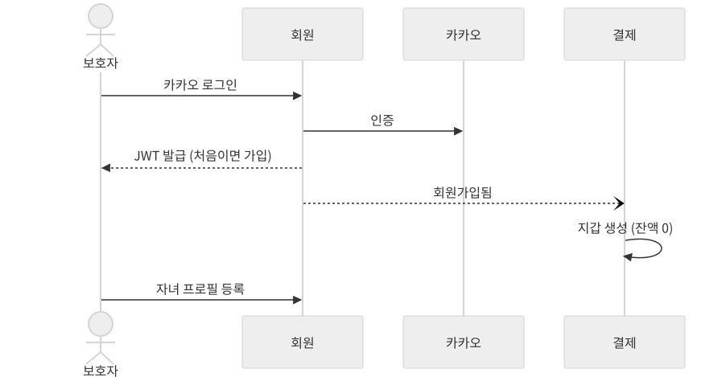


| 받는 것 | 넘기는 것 |
|---|---|
| - (첫 단계) | ③ 추천 · ④ 주문: **자녀 정보 변경됨** (키 · 몸무게 · 체형 · 선호 핏) · 결제 · 알림: **회원가입됨** · 화면: 배송지 목록에서 고른 배송지 (주문 요청에 담김) · 모든 단계: JWT의 `memberId` · `roles` |

| 만들 API |  |
|---|---|
| `POST /api/v1/auth/login/kakao` | 카카오 로그인 (본문: 인가 코드) |
| `GET /api/v1/members/me` | 내 정보 |
| `POST /api/v1/children` | 자녀 등록 |
| `GET /api/v1/children` | 내 자녀 목록 |
| `POST /api/v1/auth/reissue` | 토큰 재발급 |
| `POST /api/v1/auth/logout` | 로그아웃 |
| `POST · GET /api/v1/members/me/addresses` | 배송지 등록 · 목록 |
| `PATCH · DELETE /api/v1/members/me/addresses/{addressId}` | 배송지 수정 · 삭제 |
| `PATCH /api/v1/members/me/addresses/{addressId}/default` | 기본 배송지 변경 |

- **완료 기준** 카카오로 로그인하면 회원과 지갑이 생기고, 자녀를 등록해 목록에서 볼 수 있다. 배송지를 등록하고 기본 배송지를 바꿀 수 있고, Refresh Token으로 재발급 · 로그아웃할 수 있다.
- **최종** 결제가 `member.withdrawn`을 받아 지갑을 동결한다(잔액은 운영자가 환급). 로그인 회원 확인은 Gateway가 하고, 판매자 자격을 잃으면 `member.tokens-revoked`로 토큰이 무효화된다.
- **최종(2순위) 기준 옷** 넘기는 것에 「③ 추천: 기준 옷 변경됨」. 만들 API `POST · GET /api/v1/children/{childId}/reference-garments` · `PATCH · DELETE .../reference-garments/{garmentId}`(자녀 프로필 서비스). 완료 기준: 자녀마다 상의 · 하의 기준 옷을 등록하고 고칠 수 있다.

## ② 상품 등록

> **담당** maruhxn(판매자 승인) · heojungseok(상품) **목적** 판매자가 되어 옵션별 재고와 사이즈별 권장 키를 넣은 상품을 판매 시작한다.

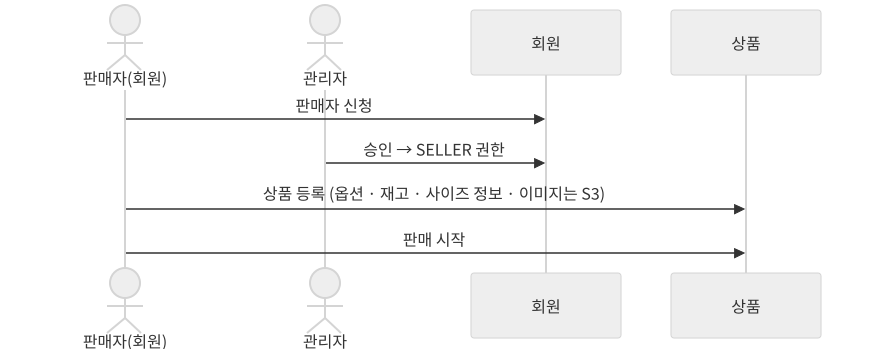


| 받는 것 | 넘기는 것 |
|---|---|
| ① JWT의 `SELLER` 권한 · ④ **주문 생성됨**(재고 차감) · **주문 취소됨**(재고 복구) · 판매자: 판매자 정보 변경됨 | ③ 추천 · ④ 주문: **상품 정보 변경됨** (옵션 · 단가 · 사이즈별 권장 키 · 판매 상태 · 썸네일 · 품절 여부 · 옵션 이름 · 옵션 판매 상태 · 사이즈 무관 여부) · ④ 주문: **재고 차감됨** / 재고 부족함 |

| 만들 API |  |
|---|---|
| `POST /api/v1/members/me/seller-application` | 판매자 신청 |
| `POST /api/v1/admin/seller-applications/{applicationId}/approve` | 판매자 승인 |
| `POST /api/v1/seller/products` | 상품 등록 |
| `PUT /api/v1/seller/products/{productId}/sale-status` | 판매 시작 (`{"status":"ON_SALE"}`) |
| `GET /api/v1/categories` · `/{categoryId}/attributes` | 카테고리 · 등록 입력 항목 |
| `POST /api/v1/seller/product-images/upload-urls` | 이미지 업로드 주소 발급 |
| `GET /api/v1/products` · `/{productId}` | 상품 목록 · 상세 |

- **완료 기준** 승인받은 판매자가 상품을 등록하고 판매 시작하면, 상품 목록과 상세에 보인다.
- **판매 시작 조건** 옵션이 쓰는 사이즈마다 실측과 권장 키가 있어야 한다 (FREE는 권장 키 선택). 빠진 항목을 모아 한 번에 알려 준다.
- **최종** 넘기는 것에 「검색: 상품 정보 변경됨 · 판매자 정보 변경됨(색인)」. `GET /api/v1/products` 상품 목록은 담당이 검색(codes-gy, search-service)으로 바뀌고, 상세는 상품 그대로다.

## ③ 사이즈 · 상품 추천 (최종: AI 추천)

> **담당** heojungseok(추천) **목적** 상품 상세에서 자녀를 고르면 추천 사이즈 · 적합도 · 근거를 보여 주고, 홈의 자녀 맞춤 상품과 상품 상세의 함께 사면 좋은 상품을 자녀 · 장바구니 · 활동 내역으로 추천한다.

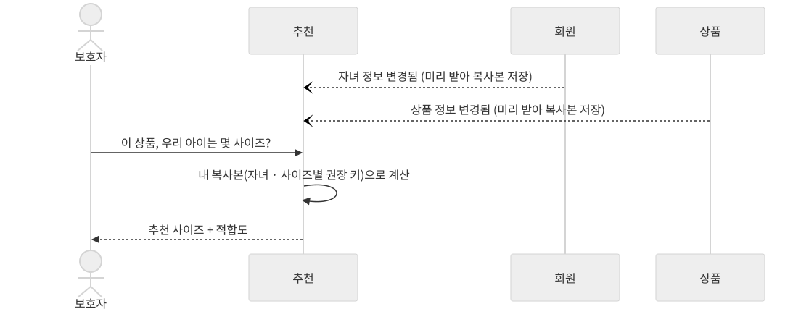


카드 그림은 세미의 규칙 추천 기준입니다. 받는 것 · API · 완료 기준은 아래 표가 기준입니다(경로가 `/api/v1/recommendations/...`로 바뀜).

| 받는 것 | 넘기는 것 |
|---|---|
| ① **자녀 정보 변경됨** · ② **상품 정보 변경됨**(브랜드 · 설명 · 사이즈별 실측 포함) · ⑥ **구매확정됨**(구매 기록) · 판매자: 판매자 정보 변경됨 · ④ 주문: **장바구니 담김 · 빠짐**, 주문 취소됨(구매자 취소) · 검색: **검색어 기록됨** · 회원: 회원탈퇴됨 · 화면: **상품 상세 진입 기록** · ①(2순위) 기준 옷 변경됨 | ④ 주문: 보호자가 고른 **상품 · 옵션 · 자녀** (화면을 거쳐 장바구니로) |

| 만들 API |  |
|---|---|
| `GET /api/v1/recommendations/size?productId=&childId=` | 사이즈 추천(기존 7칸 + `reasons` + `source`) |
| `GET /api/v1/recommendations/products?childId=&categoryId=&page=&size=&asOf=` | 자녀 맞춤 상품 목록(기존 6칸 + `reason` + `source`). 홈 맛보기 4개는 AI, 더보기는 선호 점수 순 |
| `GET /api/v1/recommendations/companions?productId=&childId=` | 함께 사면 좋은 상품 4개(새 API) |
| `POST /api/v1/recommendations/product-views` | 상품 상세 진입 기록(화면이 호출, 본문: productId) |

- **완료 기준** 자녀를 고르면 상품 상세에 추천 사이즈 · 적합도 · 근거가 나오고 아래에 함께 사면 좋은 상품 4개가 나온다. 홈 자녀 맞춤 상품 4개는 장바구니 · 최근 활동이 반영된 AI 선택과 이유로 나오고, 더보기 목록은 활동 선호 순서로 나오며 넘기는 동안 순서가 바뀌지 않는다. 추천 서비스를 멈춰도 상품 상세 · 장바구니 담기 · 주문이 된다. 기준 옷이 있으면 기준 옷과의 cm 차이가 함께 나온다(2순위).
- **응답** 사이즈 추천: 추천 사이즈 · 적합도 · 안내(code · message) · 후보 사이즈 목록 · 지난번 산 사이즈 · 근거 목록(`reasons`) · 출처(`source`). 상품 추천 한 줄: productId · name · thumbnailUrl · businessName · minPrice · recommendedSize · 이유(`reason`) · 출처(`source`). 맞춤 목록 1쪽 응답에 기준 시각(`asOf`).

## ④ 주문과 결제

> **담당** L2J92(주문) · codes-gy(결제) **목적** 장바구니에 담은 상품을 주문하고 예치금으로 결제한다.

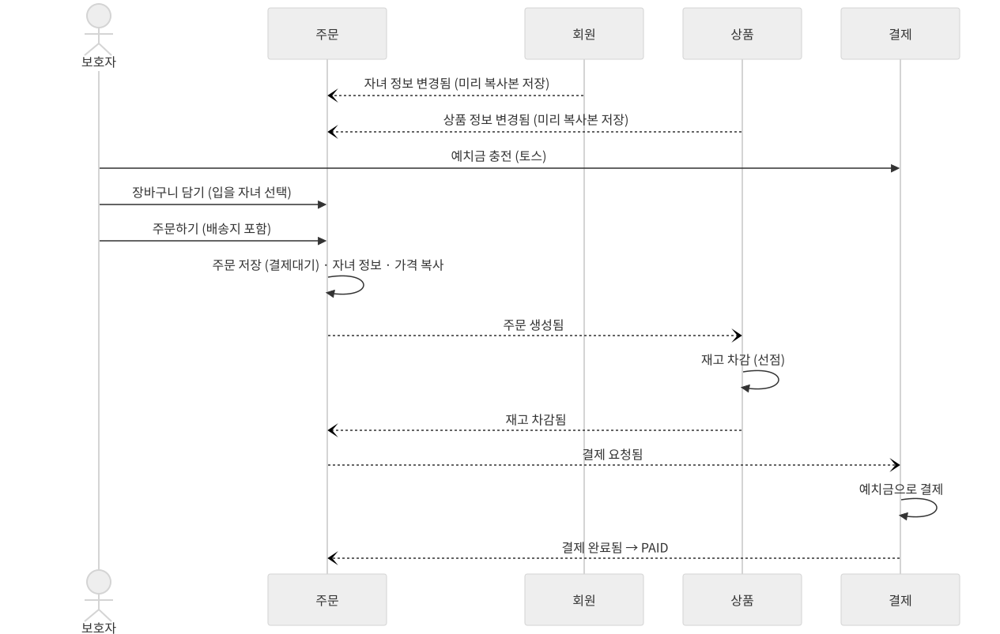


| 받는 것 | 넘기는 것 |
|---|---|
| ① **자녀 정보 변경됨** · ② **상품 정보 변경됨** · **재고 차감됨** · ③ 고른 상품 · 옵션 · 자녀 · 화면: 배송지 · 결제: **결제 완료됨** · 판매자: 판매자 정보 변경됨 | ⑤ 배송: **결제완료된 판매자별 주문** |

| 만들 API |  |
|---|---|
| `POST /api/v1/wallets/me/charges` · `/confirm` | 충전 요청 · 승인 |
| `GET /api/v1/wallets/me` | 잔액 |
| `POST /api/v1/cart/items` · `GET /api/v1/cart` | 장바구니 담기 · 조회 |
| `POST /api/v1/orders` | 주문하기 |
| `GET /api/v1/orders/{orderId}` | 주문 상세 |
| `POST /api/v1/orders/{orderId}/cancel` · `GET .../timeline` | 주문 취소 (발송 전) · 처리 타임라인 |

- **완료 기준** 충전하고 주문하면 재고가 줄고, 지갑 잔액이 줄고, 주문이 `PAID`가 된다. 주문상품에 당시 자녀 정보와 사이즈가 남는다.
- **처리 순서** 가격 확인 → 주문 저장(결제대기) → 재고 차감 → 결제. 화면이 본 단가를 주문 요청에 담아 보내고, 주문 복사본의 현재 단가와 다르면 저장 전에 거절(409)한다. 주문하기 응답은 201 + 주문 상세(결제대기)이고, 결과(`PAID` · `CANCELLED`)는 주문 상세나 타임라인으로 확인한다 (P5). 같은 주문을 두 번 만들지 않게 `Idempotency-Key` 헤더를 보낼 수 있다.
- **최종 · 받는 것 · 넘기는 것** 결제가 주고받는 이벤트는 Kafka(`kidly.order.events` → 결제 → `kidly.payment.events`). 판매자 주문상품 취소됨(`order-item.cancelled`) → 결제: 주문상품 금액만큼 부분 환불 · 상품: 재고 복구. 장바구니 담김(`cart.item-added`) → (추천 예정)
- **최종 · 만들 API** 공용 장바구니 `/api/v1/wishes` · 조르기 `/api/v1/wish-requests`(보내기 · 승인 · 거절, 주문) · 충전 취소 `POST /api/v1/wallets/me/charges/{chargeId}/cancel` · 입출금 내역 `GET /api/v1/wallets/me/ledgers`(결제)
- **최종 · 완료 기준** 결제 서비스를 멈췄다 다시 띄워도 그동안 쌓인 결제 요청이 처리되고 주문이 `PAID`가 된다(Kafka가 메시지를 보관). 자녀가 조르기를 보내면 부모가 승인해 바로 결제할 수 있다.

## ⑤ 배송

> **담당** L2J92(주문) **목적** 판매자가 자기 몫의 주문에 송장을 등록하고, 배송 완료로 바꾼다.

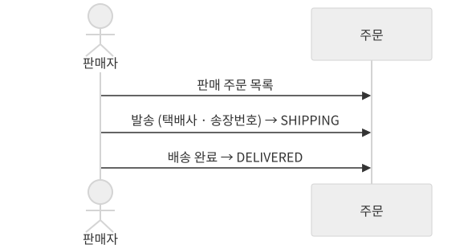


| 받는 것 | 넘기는 것 |
|---|---|
| ④ 결제완료된 판매자별 주문 | ⑥ 구매확정: **배송완료된 주문상품** |

| 만들 API |  |
|---|---|
| `GET /api/v1/seller/orders` | 판매 주문 목록 |
| `POST /api/v1/seller/orders/{sellerOrderId}/ship` | 발송 (송장 등록) |
| `POST /api/v1/seller/orders/{sellerOrderId}/deliver` | 배송 완료 |

- **완료 기준** 판매자가 송장을 넣고 배송 완료를 누르면, 구매자 주문 상세에 배송완료로 보인다.
- **최종** 판매자가 발송 전에 자기 몫을 취소한다(`POST /api/v1/seller/orders/{sellerOrderId}/cancel`, 결제 · 상품 배포 뒤 스위치를 켬). 발송한 배송은 택배 조회(Delivery Tracker)로 자동 배송 완료되고, 판매자가 직접 완료할 수도 있다.

## ⑥ 구매확정

> **담당** L2J92(주문) **목적** 구매자가 직접, 또는 배송 완료 후 정해진 기간이 지나면 자동으로 구매확정한다. 이때부터 정산 대상이 된다.

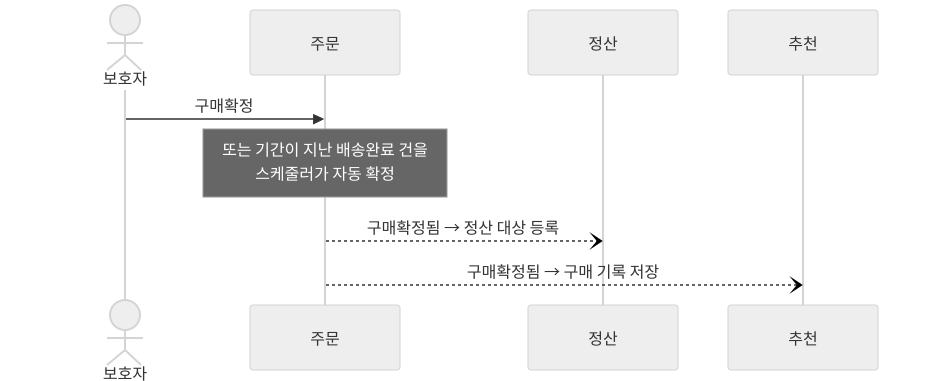


| 받는 것 | 넘기는 것 |
|---|---|
| ⑤ 배송완료된 주문상품 | ⑦ 정산 · ③ 추천: **구매확정됨** (주문상품 · 판매자 · 금액 · 상품 · 옵션 · 사이즈 · 자녀 · 확정 시각) |

| 만들 API |  |
|---|---|
| `POST /api/v1/orders/{orderId}/items/{orderItemId}/confirm` | 구매확정 |

- **완료 기준** 구매확정하면 주문상품이 `CONFIRMED`가 되고, 정산 대상에 나타난다. 자동 확정은 설정값을 짧게 해 시연한다.
- **최종** 구매확정됨은 정산 · 추천에 더해 커뮤니티도 받아 리뷰 작성 자격을 만든다(⑧).

## ⑦ 정산

> **담당** baiees(정산) · codes-gy(결제: 지갑 적립) **목적** 구매확정된 금액을 판매자별 정산서로 묶어 수수료를 빼고, 결제에 지급을 요청해 판매자 지갑에 적립한다.

v2.0: 정산 담당 보강본으로 바꿨습니다. 월 정산 → **영업일 일정산**(Spring Batch · 공휴일 API), 지급 요청은 아웃박스로 Kafka에 보냅니다. 아래 ⑦ 상세 1 ~ 10이 정산 설계의 기준입니다.

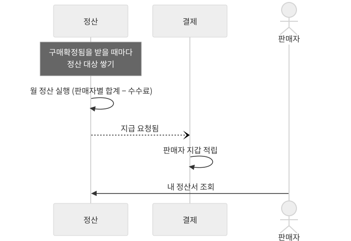


| 받는 것 | 넘기는 것 |
|---|---|
| ⑥ **구매확정됨** · 결제: **지급 완료됨** · **지급 실패됨** | 결제: **지급 요청됨** → 판매자 지갑 적립 |

| 만들 API |  |
|---|---|
| `GET /api/v1/seller/settlement-targets` | 정산 대상 |
| `GET /api/v1/seller/settlements` · `/{settlementId}` | 내 정산서 목록 · 상세 |
| `POST /api/v1/admin/settlements/run` | 정산 수동 실행 (시연용) |

- **완료 기준** 정산을 실행하면 판매자 정산서가 생기고(`COMPLETED`), 판매자 지갑 잔액이 늘고, 정산서가 `PAID`가 된다. 같은 기준일로 다시 실행해도 정산서가 늘지 않는다.
- **처리 순서** 구매확정 수신 → 정산 대상 저장(`PENDING`, 같은 주문상품은 건너뜀) → 정산 실행(`settlementJob`) → 판매자별 합계 → 정산서 저장(`COMPLETED`) · 대상 `SETTLED` · 지급 요청 발행 → 결제 적립 → 지급 결과 반영(`PAID` · `FAILED`). 규칙은 2.1 ⑦과 아래 상세.

카드 그림은 세미 때 그림입니다. 이벤트 이름 · 필드는 8장 표와 아래 상세가 기준입니다.

### ⑦ 상세 1. 한눈에 (Rough)

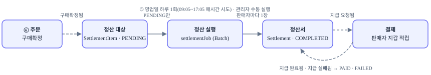

1. 주문상품이 구매확정되면 정산 대상 1건이 쌓입니다 (`PENDING`). 같은 주문상품은 한 번만.
2. 정산 실행(자동은 영업일 하루 1회 · 수동)이 종료 기준일(자동 = 실행일 0시) 전에 확정된 대상을 판매자별로 묶어 정산서를 1장씩 만듭니다. 대상이 없는 판매자는 정산서를 만들지 않습니다. 수수료는 합계 × 수수료율, 원 미만 버림.
3. 정산서를 만든 트랜잭션에서 지급 요청을 아웃박스에 저장해 Kafka로 보내고, 결제가 판매자 지갑에 적립한 뒤 결과를 보냅니다. 정산은 결과를 정산서에 반영합니다 (`PAID` · `FAILED`).

### ⑦ 상세 2. 용어 · 데이터

| 용어 | 코드 | 뜻 |
|---|---|---|
| 정산 대상 | `SettlementItem` | 구매확정된 주문상품 1건. 판매금액 = 이벤트의 amount(단가 × 수량), 다시 계산하지 않음. 정산서에 들어가면 그 정산서의 항목이 됨 (정산서는 ID로만 가리킴) |
| 정산서 | `Settlement` | 판매자 1명 · 정산 실행 1회(종료일)의 정산 결과. 판매 합계 · 적용 수수료율 · 수수료 · 지급액 · 지급 상태 |
| 종료 기준일 | `cutoffAt` | 이 시각 전에 구매확정된 대상만 정산. 자동 = 실행일(영업일) 0시, 수동 = 관리자가 지정한 날 0시 (Asia/Seoul) |
| 정산 기간 | `periodStartOn` · `periodEndOn` | 종료일 = 종료 기준일 − 1일(실행일 전날), 시작일 = 포함된 대상 중 가장 이른 구매확정일. 대상 선정에는 시작일 조건이 없음 (지난번에 빠진 건 · 늦게 도착한 확정도 포함) |
| 수수료율 | `feeRate` | 설정값 (지금 10%). 정산서를 만들 때의 값을 정산서에 저장, 바뀐 율은 다음 정산부터 |
| 정산 실행 | `settlementJob` 실행 | 정산 작업 1회. 기록은 Spring Batch 메타데이터(작업 실행 · 단계 실행 · 작업 파라미터): 기준일 · 자동/수동 · 실행한 관리자 · 상태 · 성공/건너뛴 판매자 수. 기간은 기준일에서 계산(`SettlementPeriod`) |
| 지급 요청 | `payout` | 정산서 금액을 판매자 지갑에 적립해 달라는 요청. 적립은 결제가 하고 정산은 결과만 반영 |

### ⑦ 상세 3. 규칙 · 불변식 (Detail)

| 대상 | 규칙 (어기면 저장 · 변경하지 않음) |
|---|---|
| 정산 대상 | 주문상품 1건 = 정산 대상 1건 (`order_item_id` 유니크, 이미 있으면 건너뜀) · 판매금액 ≥ 0 · ID는 0보다 큼 · 구매확정 후 기다리는 기간 없음 (⑥ 자동 구매확정 설정값이 맡음) |
| 정산 기준 | `PENDING`이고 `confirmedAt < cutoffAt`인 대상 전체. 실행 도중 들어온 확정분은 다음 정산 |
| 정산 기간 | 시작일 ≤ 종료일 · 판매자 · 종료일이 같은 정산서는 1장 (`(seller_id, period_end_on)` 유니크) |
| 수수료 | 수수료 = ⌊판매 합계 × 수수료율⌋ (원 미만 버림) · 지급액 = 판매 합계 − 수수료 · 수수료 + 지급액 = 판매 합계 · 0 ≤ 수수료율 ≤ 1, 소수 넷째 자리까지 (저장도 넷째 자리) · 주문상품별 수수료는 계산하지 않음 · 판매 합계를 더할 때 넘침이면 그 판매자는 실패 |
| 정산 대상 상태 | `PENDING` → `SETTLED`(정산서 ID 필수) 또는 `EXCLUDED`. `SETTLED`는 되돌리지 않음 · 같은 제외가 다시 와도 그대로 |
| 정산서 상태 | `COMPLETED` → `PAID`(지급 시각 필수) 또는 `FAILED`(사유 필수, 50자 이하). 같은 결과를 다시 받으면 처음 값 유지, 엇갈린 결과(`PAID` 뒤 실패 등)는 거부 |
| 지급 대조 | 결과 이벤트의 settlementId · sellerId · amount가 정산서와 같을 때만 반영. 다르면 반영하지 않고 ERROR 로그 |
| 동시성 | 정산 대상 · 정산서는 `@Version`으로 동시에 바꾸지 못함 (충돌한 쪽 실패) · 실행 중인 정산 작업이 있으면 새 실행 409 (Batch 실행 중 작업 조회) |
| 구매확정 뒤 환불 | 4장에 따라 없음. `EXCLUDED`는 부분 취소 · 반품이 생길 때를 위해 상태만 둠 |

### ⑦ 상세 4. 상태 전이

| 대상 | 전이 | 언제 |
|---|---|---|
| 정산 대상 | `PENDING` → `SETTLED` | 정산 실행이 판매자의 정산서를 만들 때 |
| 정산 대상 | `PENDING` → `EXCLUDED` | 부분 취소 · 반품 (세미 없음) |
| 정산서 | (생성) → `COMPLETED` | 계산 완료 = 지급 요청. `completedAt` 저장 |
| 정산서 | `COMPLETED` → `PAID` | `payment.payout-completed` 수신. `paidAt` = 결제가 지급 완료로 처리한 시각 (0원 포함) |
| 정산서 | `COMPLETED` → `FAILED` | `payment.payout-failed` 수신. `failReason` = reasonCode (예: `WALLET_NOT_FOUND`) |
| 정산 실행 (응답 상태) | `RUNNING` → `COMPLETED` · `PARTIAL_FAILED` · `FAILED` | Batch 작업 실행 상태로 계산: 실행 중 → `RUNNING`, 완료 + 건너뛴 판매자 없음 → `COMPLETED`, 완료 + 있음 → `PARTIAL_FAILED`, 실패 · 중지 → `FAILED` |

### ⑦ 상세 5. 테이블 (`settlement` 스키마)

| 테이블 | 컬럼 · 제약 |
|---|---|
| `settlement_item` | id · order_id · order_item_id(**유니크**) · seller_id · sales_amount · confirmed_at · status · settlement_id(정산서 ID, FK 없음) · version · created_at · updated_at · 인덱스 (seller_id, status, confirmed_at) · (settlement_id) — #78 · #81에서 추가 |
| `settlement` | id · seller_id · period_start_on · period_end_on (**seller_id · period_end_on 유니크**) · total_sales_amount · fee_rate NUMERIC(5,4) · fee_amount · settlement_amount · status · completed_at · paid_at · fail_reason(50) · version · created_at · updated_at |
| `BATCH_*` | Spring Batch 메타데이터 = 정산 실행 기록 (작업 · 실행 · 단계 · 파라미터). `settlement` 스키마에 접두어 `BATCH_`로 둠. 기준일 · 실행 방식 · 실행한 관리자는 작업 파라미터, 성공 · 건너뛴 수는 단계 실행 |

### ⑦ 상세 6. 일괄 정산 — Spring Batch

**Rough** 스케줄러 · 관리자 API → `settlementJob`(종료 기준일) → `settleSellerStep`: 판매자 ID 읽기 → 판매자마다 정산서 계산 · 저장 · 대상 정산 · 지급 요청 → 결과는 Batch 실행 기록

**왜 Spring Batch** 판매자 단위로 나눠 처리하고, 한 판매자의 실패를 건너뛰고, 끝난 작업의 재실행을 막고, 실패한 작업을 이어서 다시 돌리는 기능을 직접 만들지 않고 씁니다. 실행 기록도 Batch 메타데이터에 남습니다.

| 구성 | 내용 (Detail) |
|---|---|
| 작업 파라미터 | `cutoffAt` — 작업을 구분하는 값 (같은 기준일 = 같은 작업) · `triggerType` · `requestedBy`(자동 실행은 없음) — 구분에 쓰지 않는 값 |
| 읽기 (Reader) | 정산할 판매자 ID: `status = 'PENDING' AND confirmed_at < :cutoffAt`인 대상의 판매자를 판매자 ID 순으로 페이지 읽기 (`seller_id > 마지막 ID` 방식이라 처리 중 상태가 바뀌어도 페이지가 밀리지 않음) |
| 쓰기 (Writer) | 판매자마다: `PENDING` · 기준일 이전 대상을 읽어 판매금액을 더함(넘침 검사) → `Settlement` 계산 · 저장 → 대상마다 `settle(정산서 ID)` → `settlement.payout-requested`를 아웃박스에 저장. 대상이 없으면 건너뜀. 한 묶음이 한 트랜잭션이고, 커밋된 뒤 릴레이가 Kafka로 보내 결제가 받음 |
| Processor 없음 | Batch 6은 쓰기에 실패한 묶음을 판매자 1명씩 다시 처리할 때 Processor를 다시 부르지 않고 롤백된 결과를 다시 씀. 그래서 읽기 · 계산을 Writer 안에서 매번 새로 함 (정상 판매자가 함께 건너뛰지 않게) |
| 묶음 크기 | 설정값 (지금 판매자 100명) |
| 실패 처리 | 업무 오류(검증 실패 · 넘침 · 버전 충돌 · 유니크 위반)는 건너뜀(skip). 묶음이 실패하면 Batch가 판매자 1명씩 다시 처리해 실패한 판매자만 건너뜀. 건너뛴 판매자는 ERROR 로그 + 실행 기록 `fail_count`, 다음 실행에서 다시 대상이 됨 (`PENDING` 그대로) |
| 중복 실행 | 같은 `cutoffAt` 작업이 이미 끝났으면 409 (이미 정산한 기준일) · 실행 중이면 409 · 실행 시작 전에 Batch의 실행 중 작업을 조회해 409. 동시에 온 두 요청이 같이 통과해도 정산 대상 `@Version` · 정산서 유니크가 중복 정산을 막음 |
| 다시 실행 | 작업 자체가 실패(`FAILED`)하면 같은 기준일로 다시 실행. 건너뛴 판매자가 있어도 작업은 완료라 같은 기준일 재실행은 409이고, 남은 대상은 다음 기준일에 정산. 읽기가 `PENDING`만 고르므로 이미 정산한 판매자는 다시 처리하지 않음 (읽기 위치를 저장하지 않음) |
| 실행 기록 | 따로 저장하지 않음. 실행 결과 · 조회 API는 Batch 작업 실행(ID · 파라미터 · 상태 · 단계 쓰기/건너뛴 수)으로 만듦 |
| 자동 실행 | `@Scheduled(cron = 설정값, zone = "Asia/Seoul")` (지금 평일 09:05~17:05 매시간) → 영업일인지 확인(주말 · 공휴일이면 건너뜀, 공휴일 조회 실패면 다음 시간 재시도) → 종료 기준일 = 실행일 0시 → 작업 실행 (그날 이미 정산했으면 409로 건너뜀) |
| 수동 실행 | `POST /api/v1/admin/settlements/run` → 같은 작업을 끝날 때까지 기다려 실행 (시연용) → 201 + 실행 결과 |
| 설정값 | `settlement.fee-rate`(0.1) · `settlement.run-cron`(`0 5 9-17 * * MON-FRI`) · `settlement.payout-retry-cron`(`0 */10 * * * *`) · `settlement.chunk-size`(100) · `spring.batch.job.enabled=false`(기동 때 자동 실행 안 함) · `spring.batch.jdbc.table-prefix=settlement.BATCH_` · `spring.batch.jdbc.initialize-schema`: local `always`, 그 외 `never`(배포 전 DDL) |
| 의존성 | `build.gradle.kts`: `implementation("org.springframework.boot:spring-boot-starter-batch-jdbc")` · `testImplementation("org.springframework.boot:spring-boot-starter-batch-jdbc-test")`. 버전은 Spring Boot 4.1.1이 맞춤. DB에 실행 기록을 남겨야 재실행 방지 · 이어서 실행이 되므로 `-jdbc` 스타터를 씀 |

### ⑦ 상세 7. API

| 단계 | API | 요청 → 응답 |
|---|---|---|
| ⑦ | `POST /admin/settlements/run` | `{ "cutoffOn": "2026-11-01" }` (필수, 오늘 이후 불가) → 201 + `Location: /api/v1/admin/settlement-runs/{runId}` · runId · cutoffAt · periodStartOn · periodEndOn · triggerType · status · successCount · failCount · startedAt · finishedAt |
| ⑦ | `GET /seller/settlement-targets` | 내 `PENDING` 대상, 구매확정 시각 역순, 페이지 → `PageResponse` (orderItemId · orderId · salesAmount · confirmedAt) |
| ⑦ | `GET /seller/settlements` | 내 정산서, 기간 · 상태 필터, 페이지 → `PageResponse` (settlementId · periodStartOn · periodEndOn · totalSalesAmount · feeRate · feeAmount · settlementAmount · status · completedAt · paidAt) |
| ⑦ | `GET /seller/settlements/{settlementId}` | 정산서 + 포함된 주문상품 목록. 없거나 다른 판매자 것이면 404 |
| 보완 | `GET /admin/settlements` | 판매자 · 기간 · 상태 필터 → `PageResponse` |
| ⑦ | `GET /admin/settlement-runs/{runId}` | 정산 실행 1건 (runId = Batch 작업 실행 ID, 수동 실행 응답의 Location). 없거나 정산 작업이 아니면 404 |
| 보완 | `POST /admin/settlements/{settlementId}/retry` | 지급 결과 복구: 결과를 못 받은 `COMPLETED`만, 같은 settlementId로 지급 요청 재발행 → 결제가 저장된 결과를 다시 보냄. `PAID` · `FAILED`는 409 |

역할은 경로로 정해집니다: `/seller/**` = SELLER, `/admin/**` = ADMIN (아니면 403). 목록이 비면 `[]`.

### ⑦ 상세 8. 오류

| 코드 (`SettlementErrorCode`) | 상태 | 언제 |
|---|---|---|
| `INVALID_SETTLEMENT_CUTOFF` | 400 | 수동 실행의 종료 기준일이 없거나 오늘 이후 |
| `SETTLEMENT_RUN_IN_PROGRESS` | 409 | 실행 중인 정산이 있음 |
| `SETTLEMENT_ALREADY_RUN` | 409 | 같은 종료 기준일의 정산이 이미 끝남 |
| `SETTLEMENT_NOT_RETRYABLE` | 409 | (보완) `COMPLETED`가 아닌 정산서 재처리 |
| `NOT_FOUND` (공통) | 404 | 없거나 다른 판매자의 정산서 · 없는 실행 기록 |

이벤트 수신은 오류 응답이 없습니다: 같은 구매확정 · 같은 지급 결과는 조용히 건너뛰고, 대조가 맞지 않으면 ERROR 로그만 남깁니다.

### ⑦ 상세 9. 구현 순서 (이슈)

| 이슈 | 범위 | 완료 기준 | 상태 |
|---|---|---|---|
| #75 · #77 | 정산 모델 · 수수료 | #76에서 기획서 기준으로 다시 맞춤 | 완료 |
| #76 | 모델 정합 · 구매확정 적재 | 같은 구매확정 2번 → 대상 1건, 수수료 버림 · 지급 결과 멱등 | 완료 |
| #78 | 정산 실행 (Spring Batch) · 실행 기록 · 수동 실행 API · 설정값 | 같은 기준일 재실행 → 정산서 추가 없음 · 대상 0건 → 정산서 없음 · 한 판매자 실패 → `PARTIAL_FAILED` · 시연 데이터 1건(25,000원)으로 정산서 생성 | 진행 |
| #79 | 지급 요청 발행 · 결과 반영 | 요청 → 결제 적립 → `PAID` 통합 테스트 · 같은 결과 2번 → 변경 1번 · 대조 불일치 무시 | 예정 |
| #81 | 판매자 조회 API 3개 | 남의 정산서 404 · 빈 목록 `[]` · 페이징 기능 테스트 | 예정 |
| 보완 | 관리자 조회 · 실행 기록 조회 · 지급 결과 복구 | `COMPLETED`만 재처리 · 재처리 2번 → 입금 1번 | 예정 |
| 최종 | Kafka · 서비스 분리 | 이벤트 유실 대비(Outbox) · 여러 서버에서 작업 1번만 실행 (Batch 메타데이터 + 실행 중 1건 제약) | - |

### ⑦ 상세 10. 설계 판단 기록

| 항목 | 고른 것 | 이유 (다른 선택지) |
|---|---|---|
| 정산 대상 · 항목 테이블 | `SettlementItem` 하나 | 대상과 항목이 1:1이라 나누면 같은 값을 두 번 저장 (ERD의 target · item 분리) |
| 대상 → 정산서 참조 | `settlement_id` 값 참조 | 애그리거트 결합을 끊음. 정산서는 지우지 않아 FK 없음의 위험이 낮음 (`@ManyToOne`) |
| 수수료 계산 위치 | 정산서 합계 기준, `Settlement`가 계산 | 2.1 ⑦ 문장과 일치. 항목별 버림의 합은 최대 (항목 수 − 1)원 차이 (항목별 배분) |
| 지급 표현 | 정산서 상태 `COMPLETED` → `PAID` · `FAILED` | ERD가 상태 · 실패 사유를 정산서에 둠. 지급 시도 이력이 필요해지면 그때 분리 (별도 `Payout` 엔티티) |
| 실패 사유 타입 | 문자열(reasonCode 이름) | 정산이 결제의 enum에 묶이지 않게 (결제 `PayoutFailureCode`) |
| 재처리 의미 | 결과 유실 복구 (`COMPLETED`만) | 결제는 실패를 다시 시도하지 않고 저장된 결과만 재발행 (`FAILED` 재시도) |
| 실행 방식 | Spring Batch `settlementJob` | 판매자 단위 처리 · 건너뛰기 · 재실행 방지 · 이어서 실행을 직접 만들지 않음 (`@Scheduled` + 판매자마다 별도 트랜잭션 빈) |
| 실행 기록 | Spring Batch 메타데이터만 (`settlement_run` 없음) | 상태 · 시각 · 건수 · 파라미터가 Batch에 이미 있어 두 곳에 두면 어긋나고, 서버가 죽으면 정리할 곳이 둘이 됨 (ERD의 `settlement_run` 엔티티) |
| 동시 실행 막기 | Batch 실행 중 작업 조회 → 409 | 동시에 온 두 요청은 같이 통과할 수 있으나 정산 대상 `@Version` · 정산서 유니크가 중복 정산을 막음 (실행 기록 테이블 + 유니크 제약) |
| 수동 실행 요청 | `cutoffOn`(날짜) → 그날 0시 이전 확정분 | 기간 대신 기준일 하나만 받아 2.1 ⑦의 "종료 기준일 직접 지정"과 맞춤 |
| 스케줄러 · 설정값 위치 | `app`의 `@Component` + `@Scheduled` · `SettlementProperties` | 회원 도메인 방식(`RefreshTokenCleaner` · `RefreshTokenProperties`) |
| Spring Batch 의존성 (B1) | 정산 담당이 `build.gradle.kts`에 추가 | 배포 전 `BATCH_*` 메타데이터 DDL 공유 필요 |
| 의존성이 늦을 때 (B2) | 도메인 코드(`SettlementRun` · 판매자 1명 정산 계산) 먼저, Job · Step 조립은 의존성 뒤 | 도메인 코드는 Batch가 있든 없든 그대로 쓰임 |

## ⑧ 리뷰 · 찜 (최종)

> **담당** L2J92(커뮤니티) **목적** 구매확정한 주문상품에 리뷰를 쓰고, 상품을 찜해 두고, 상품 상세에서 평균 별점 · 리뷰 · 찜 수를 본다.

| 받는 것 | 넘기는 것 |
|---|---|
| ⑥ **구매확정됨** → 리뷰 작성 자격 · ② **상품 정보 변경됨** → 상품 복사본(이름 · 썸네일 · 표시 상태) · 회원: 회원탈퇴됨(예정, #663) | 없음 (리뷰 작성됨 `review.created`는 받을 도메인이 정해지면, K28) |

| 만들 API |  |
|---|---|
| `GET /api/v1/reviews/eligible` | 작성할 수 있는 주문상품 (로그인, 커서 목록). 400 `INVALID_PAGE_SIZE` · `INVALID_CURSOR` |
| `POST /api/v1/reviews` | 리뷰 작성 `{orderItemId, rating, content}` → 201 + Location. 400 `INVALID_RATING` · `INVALID_CONTENT` / 403 `REVIEW_NOT_ELIGIBLE` / 409 `REVIEW_ALREADY_WRITTEN` |
| `PATCH /api/v1/reviews/{reviewId}` | 리뷰 수정 (보낸 필드만, 작성자만). 400 `NO_FIELDS_TO_UPDATE` / 403 `REVIEW_FORBIDDEN` / 404 `REVIEW_NOT_FOUND` |
| `DELETE /api/v1/reviews/{reviewId}` | 리뷰 삭제 (작성자만) → 204. 403 · 404 |
| `GET /api/v1/reviews?productId=` | 상품별 리뷰 목록 (로그인 없이, 최신순). 400 `INVALID_PRODUCT_ID` |
| `GET /api/v1/reviews/me` | 내 리뷰 |
| `GET /api/v1/reviews/summary?productId=` | 리뷰 요약 `{productId, reviewCount, averageRating}` (로그인 없이) |
| `PUT /api/v1/favorites/{productId}` | 찜 (다시 해도 1건, 판매 종료 · 없는 상품 거절) — 진행 중 |
| `DELETE /api/v1/favorites/{productId}` | 찜 취소 (없어도 204) — 진행 중 |
| `GET /api/v1/favorites?productIds=` | 내 찜 목록. productIds를 주면 그중 내가 찜한 것만 (목록 하트 표시) — 진행 중 |
| `GET /api/v1/favorites/summary?productId=` | 찜 요약 `{productId, favoriteCount}` (로그인 없이) — 진행 중 |

- **완료 기준** 구매확정한 주문상품이 작성 가능 목록에 나오고, 리뷰를 쓰면 상품 상세의 리뷰 수 · 평균 별점이 바뀐다. 상품을 찜하면 찜 수가 늘고 내 찜 목록에 보인다.
- **화면** 상품 상세는 상품 API와 커뮤니티 API(리뷰 요약 · 목록 · 찜 요약 · 내 찜)를 각각 불러 합친다. 목록 화면의 하트는 `GET /favorites?productIds=`로 한 번에 확인한다.
- **운영** 처음 배포한 뒤 환경마다 한 번 상품 전체 재발행(`POST /api/v1/admin/products/changed-events`, 상품 기능)으로 복사본을 채운다(주문 · 추천 · 검색도 같은 이벤트를 다시 받으므로 팀에 알림). 배포 전에 구매확정된 주문상품은 작성 자격이 없어, 시연은 배포 뒤 구매확정한 주문으로 한다.
- **추가 예정** 리뷰 댓글(판매자 답글 포함) · AI 욕설 검사 · `review.created` · 상품 문의 · 좋아요 · 사진 리뷰 · 사이즈 핏 리뷰 · 공지 · FAQ · 챗봇(별도 모듈 검토) 순서.

# 8. 도메인별 만들 것 — API · 이벤트

**지금 있는 API는 [API 목록](../api/README.md)에 도메인별로 있습니다.** 아래 표에는 아직 만들지 않았거나 만들지 않기로 한 API와 이벤트만 남깁니다 (앞의 `/api/v1` 생략). `단계` 열: ①~⑦ = 정상 흐름에 필요한 카드 · **보완** = 정상 흐름 다음 · **최종** = 최종 프로젝트(완료 · 진행 중 · 예정을 설명에 적음) · "만들지 않음" · "세미 제외" · "최종" 줄을 빼면 이 장의 API는 모두 구현되어 있습니다

v2.0: 이벤트는 모두 Kafka로 갑니다. 토픽은 `kidly.{보내는 도메인}.events`이고(3.3), 받는 쪽은 구독 그룹 `kidly.{받는 도메인}`으로 받습니다.

### 이벤트 한눈에 보기

| 이벤트 | 보내는 쪽 → 받는 쪽 | 받는 쪽이 하는 일 | `data` 핵심 필드 | 단계 |
|---|---|---|---|---|
| `member.registered` 회원가입됨 | 회원 → 결제 · 알림 | 지갑 생성 · 환영 메일 | memberId · email | ① |
| `member.changed` 회원 정보 변경됨 | 회원 → 판매자 | 신청자 닉네임 반영 | memberId · nickname | 보완 |
| `member.withdrawn` 회원탈퇴됨 | 회원 → 회원(배송지) · 자녀 프로필 · **결제** (추천 · 커뮤니티 예정) | 배송지 · 자녀 프로필 삭제 · **지갑 동결** / 활동 기록 · AI 응답 삭제(추천, P16) · 찜 삭제 · 리뷰 작성자 표시(커뮤니티, #663) | memberId | 보완 · 최종 |
| `child.changed` 자녀 정보 변경됨 | 자녀 프로필 → 추천 · 주문 | 복사본 저장 (삭제면 삭제 직전 값 + deleted) | childId · memberId · heightCm · weightKg · gender · birthDate · bodyType(없으면 null) · preferredFit(없으면 null) · deleted | ① |
| `seller.changed` 판매자 정보 변경됨 | 판매자 → 회원 · 상품 · 주문 · 추천 · **검색** | 복사본 저장 (승인 · 정지 때 발행) · 상호명 색인(검색) | sellerId · businessName · status(ACTIVE · SUSPENDED) | ② · 최종 |
| `product.changed` 상품 정보 변경됨 | 상품 → 추천 · 주문 · **검색 · 커뮤니티** · 상품(검색용 표, 되돌리기용) | 복사본 저장 (판매 상태 변경 · 수정 · 품절 변경 때 발행) · 색인(검색) · 임베딩 다시 생성(추천) | productId · sellerId · name · categoryId · status · thumbnailUrl · createdAt · sizeFree · infoValues · options(optionId · optionName · size · price · minHeightCm · maxHeightCm · soldOut · saleStatus · values) · **brand · description · sizeSpecs**(#610) | ② · 최종 |
| `order.created` 주문 생성됨 | 주문 → 상품 | 재고 차감 (선점) | orderId · memberId · items(orderItemId · optionId · quantity) | ④ |
| `stock.deducted` 재고 차감됨 | 상품 → 주문 | 결제 요청 (결제대기일 때만) | orderId | ④ |
| `order.payment-requested` 결제 요청됨 | 주문 → 결제 | 예치금으로 결제 | orderId · memberId · amount · items(orderItemId · amount) | ④ |
| `payment.completed` 결제 완료됨 | 결제 → 주문 | 주문 PAID · 판매자별 배송 생성 | paymentId · orderId · amount · memberId · items(orderItemId · amount) · paidAt | ④ |
| `order-item.purchase-confirmed` 구매확정됨 | 주문 → 정산 · 추천 · **커뮤니티** | 정산 대상 등록 / 구매 기록 저장 (자녀 · 사이즈가 있을 때만) / 리뷰 작성 자격 | orderItemId · orderId · memberId · sellerId · childId · productId · optionId · size(사이즈 없는 상품은 null) · quantity · amount(단가 × 수량) · confirmedAt | ⑥ · 최종 |
| `settlement.payout-requested` 정산 지급 요청됨 | 정산 → 결제 | 판매자 지갑 입금 (계산 완료 = 지급 요청) | settlementId · sellerId · amount · periodStartOn · periodEndOn | ⑦ |
| `payment.payout-completed` 지급 완료됨 | 결제 → 정산 | 정산서 PAID | settlementId · sellerId · amount · ledgerId(0원이면 null) · paidAt | ⑦ |
| `payment.payout-failed` 지급 실패함 | 결제 → 정산 | 정산서 FAILED | settlementId · sellerId · amount · reasonCode · failedAt | 보완 |
| `stock.deduction-failed` 재고 부족함 | 상품 → 주문 | 주문 취소 | orderId · reason · failures(orderItemId · reason) — reason: OUT_OF_STOCK · PRODUCT_NOT_ON_SALE · OPTION_NOT_ON_SALE | 보완 |
| `payment.failed` 결제 실패됨 | 결제 → 주문 | 주문 취소 | paymentId(금액 불일치면 null) · orderId · memberId · requestedAmount · reasonCode(INSUFFICIENT_BALANCE · AMOUNT_MISMATCH) · failedAt | 보완 |
| `order.cancelled` 주문 취소됨 | 주문 → 상품 · 결제 (추천 예정) | 재고 복구 / 결제됐으면 남은 금액 환불, 아직이면 이후 결제 요청 거절 / 구매자 취소면 활동 기록(추천) | orderId · memberId · reason(OUT_OF_STOCK · PAYMENT_FAILED · PAYMENT_EXPIRED · BUYER_CANCELLED) · items(orderItemId · optionId · quantity) | 보완 |
| order-item.cancelled 판매자 주문상품 취소됨 | 주문 → 결제 · 상품 | 주문상품 금액만큼 환불 / 재고 복구 | orderId · memberId · sellerId · cancellationId · reason(OUT_OF_STOCK · WRONG_PRODUCT_INFO · OTHER) · items(orderItemId · optionId · quantity · amount) | 최종 |
| payment.refunded 환불 완료됨 (계약만) | 결제 → 주문 · 정산 | 취소 완료 / 미정산 대상 제외 (K18) | refundId · paymentId · orderId · cancellationId · items(orderItemId · amount) · amount · refundedAt | 최종 |
| cart.item-added 장바구니 담김(발행은 이미 있음) | 주문 → 추천 | 활동 기록 저장, 선호 점수 갱신 | cartItemId · memberId · childId · productId · optionId · quantity · cartQuantity | 최종 |
| cart.item-removed 장바구니 빠짐(발행 요청) | 주문 → 추천 | 활동 기록 저장, 선호 점수 갱신 | cartItemId · memberId · childId · productId · optionId · quantity · cartQuantity | 최종 |
| search.performed 검색어 기록됨(발행은 이미 있음) | 검색 → 추천 | 활동 기록 저장 | memberId · keyword · categoryId · attributeValueIds · resultCount | 최종 |
| child.reference-garment.changed 기준 옷 변경됨 | 자녀 프로필 → 추천 | 기준 옷 복사본 저장 | childId · part(TOP · BOTTOM) · lengthCm · widthCm · sourceOrderItemId | 최종(2순위) |
| `member.tokens-revoked` 토큰 무효화됨 | 회원 → API Gateway | 무효화 목록에 넣어 그 회원의 기존 토큰 거절 (도메인 아님) | memberId · 무효화 시각 | 최종 |
| `wish.item-added` · `wish.sent` · `wish.approved` · `wish.rejected` 조르기 | 주문 → (추천 · 알림 예정) | 활동 신호 · 인앱 알림 | 키 = 자녀 프로필 ID | 최종(예정) |
| `review.created` 리뷰 작성됨 | 커뮤니티 → (미정) | 추천 · 검색 신호 (K28) | 리뷰 ID · 상품 ID · 주문상품 ID · 회원 ID · 별점 · 작성 시각(본문 · 닉네임 제외) | 최종(보류) |

이벤트 형식 · 보내고 받는 법은 6.2.

## 회원 · maruhxn

코드는 member(회원 · 배송지 · 인증) · childprofile(자녀 프로필) · seller(판매자) · notification(알림) 모듈로 나뉩니다.

| 단계 | API | 설명 |
|---|---|---|
| 보완 | `POST /admin/members/{memberId}/grant-admin` · `/revoke-admin` | 관리자 권한 부여 · 회수 |
| 만들지 않음 | `PUT /seller/payout-account` | 정산계좌 등록 · 변경 — 정산계좌 없음 (4장) |

| 구분 | 내용 |
|---|---|
| 보내는 이벤트 | member.registered (①) · member.changed (보완) · member.withdrawn (보완) · child.changed (①, 자녀 프로필) · seller.changed (②, 판매자) |
| 받는 이벤트 | member.withdrawn → 배송지 · 자녀 프로필 삭제 · seller.changed → 판매자 상태 복사본(토큰 역할 계산) · member.changed → 신청자 닉네임 · member.registered → 환영 메일(알림) |
| 시간 작업 | 만료된 Refresh Token 정리 · 실패한 알림 메일 재발송 (1분마다) |

자녀 API(등록 · 목록 · 상세 · 수정 · 삭제)는 회원 담당입니다. 명세 v2의 추천 도메인 표시와 다르며, 이 문서를 따릅니다.

최종: 보내는 이벤트에 `member.tokens-revoked`(→ Gateway)가 더해졌고, 받는 이벤트는 모두 Kafka입니다. 인증은 auth 도메인으로 분리 중이며(#686, PR #717), 머지되면 무효화 이벤트가 `auth.tokens-revoked`(`kidly.auth.events`)로 바뀝니다. 기준 옷 API(2순위)는 ① 카드에 있습니다.

## 상품 · heojungseok

| 구분 | 내용 |
|---|---|
| 보내는 이벤트 | product.changed (②) · stock.deducted (④) · stock.deduction-failed (보완) |
| 받는 이벤트 | order.created 재고 차감 (선점) (④) · order.cancelled 재고 복구 · 이후 차감 거절 (보완) · seller.changed 판매자 복사본 · product.changed 검색용 표 갱신 (되돌리기용) |
| 최종 | 판매자 · 주문 이벤트를 Kafka로 받음(그룹 `kidly.product`, #692) · `order-item.cancelled` 재고 복구(#716) · `product.changed`에 brand · description · sizeSpecs 추가(#610) · 보내는 이벤트는 아웃박스 |

## 검색 · codes-gy (새 표)

| 구분 | 내용 |
|---|---|
| 보내는 이벤트 | search.performed (최종, `kidly.search.events`, 키 회원 ID) |
| 받는 이벤트 | product.changed 상품 문서 색인 · seller.changed 상호명 색인 (최종) |
| 구독 그룹 · DLT | `kidly.search`. `kidly.product.events.search.dlt` · `kidly.seller.events.search.dlt`. 읽기 시작 위치는 latest라 기존 상품은 처음 채우기로 넣음 |
| 실행 | apps/search-service. dev만 켜짐: 검색 서비스는 t3.large compose(프로필 `search`), Elasticsearch는 t3.medium k3s(3.1). 모니터링은 앱과 나눈 job `kidly-search` · 로그 `service_name=kidly-search` |

## 추천 · heojungseok

| 단계 | API | 설명 |
|---|---|---|
| 최종 | `GET /recommendations/companions?productId=&childId=` | 함께 사면 좋은 상품 4개(카테고리 짝 규칙 → 벡터 후보 20개 → AI 선택) |
| 최종 | `POST /recommendations/product-views` | 상품 상세 진입 기록 |
| 최종 | `/missions` · `/purchase-requests` … | 미션 쇼핑(v1.1 그대로, Kids Mode에서 정함) |

| 구분 | 내용 |
|---|---|
| 보내는 이벤트 | 없음 |
| 받는 이벤트 | child.changed · product.changed(보강 칸 포함) 복사본 저장과 임베딩 갱신 · seller.changed 판매자 복사본 · order-item.purchase-confirmed 구매 기록(자녀 · 사이즈가 있을 때만) · cart.item-added · cart.item-removed(발행 요청) · order.cancelled(reason이 `BUYER_CANCELLED`일 때만) 활동 기록과 선호 점수 갱신 · search.performed 활동 기록 · member.withdrawn 활동 기록 · AI 응답 삭제 · child.reference-garment.changed 기준 옷 복사본(2순위) |
| 구독 그룹 · DLT | `kidly.recommend`, 토픽마다 `{토픽}.recommend.dlt`, `occurredAt` 비교로 늦게 온 옛 이벤트 무시 |

## 주문 · L2J92

| 단계 | API | 설명 |
|---|---|---|
| 만들지 않음 | `POST /orders/{orderId}/items/{orderItemId}/cancel` | 구매자 주문상품 취소 (구매자 부분 취소 없음. 판매자 취소는 아래) |

| 구분 | 내용 |
|---|---|
| 보내는 이벤트 | order.created (④) · order.payment-requested (④) · order-item.purchase-confirmed (⑥) · order.cancelled (보완, 구매자 취소 포함) |
| 받는 이벤트 | child.changed · product.changed 복사본 저장 (④) · stock.deducted (④) · payment.completed (④) · stock.deduction-failed · payment.failed · seller.changed 판매자 복사본 (보완) |
| 시간 작업 | 자동 구매확정 (⑥, 10분마다) · 결제 제한 시간 만료 (보완, 1분마다) |
| 보내는 이벤트 (최종) | `cart.item-added` · `order-item.cancelled`(스위치) — 모두 아웃박스로 `kidly.order.events`. 예정: `cart.item-removed` · `wish.item-added` · `wish.sent` · `wish.approved` · `wish.rejected` |
| 받는 이벤트 (최종) | 상품 · 판매자 · 자녀 프로필 · 결제 토픽을 모두 Kafka로(그룹 `kidly.order`). 실패는 `{토픽}.order.dlt`, 관리자가 DLT를 확인 · 재처리 · 종료 |
| 시간 작업 (최종) | 택배 조회 자동 배송 완료 · 아웃박스 릴레이. 주기 작업은 한 서버에서만(advisory lock) |
| 외부 연동 (최종) | Delivery Tracker (인증값이 없으면 기능만 꺼짐). 서킷브레이커(Resilience4j)는 예정(#708) |

## 결제 · codes-gy

| 구분 | 내용 |
|---|---|
| 보내는 이벤트 | payment.completed (④) · payment.failed (보완) · payment.payout-completed (⑦) · payment.payout-failed (보완) — 모두 아웃박스로 `kidly.payment.events`에. payment.refunded는 계약만 있음(K18) |
| 받는 이벤트 | member.registered 지갑 생성 (①) · **member.withdrawn 지갑 동결 (최종)** · order.payment-requested 예치금 결제 (④) · order.cancelled 환불 · 이후 결제 요청 거절 (보완) · settlement.payout-requested 판매자 입금 (⑦) · **order-item.cancelled 부분 환불 (최종, #711 · Kafka만)** |
| 구독 그룹 · DLT | `kidly.payment`. `kidly.member.events.payment.dlt` · `kidly.order.events.payment.dlt` · `kidly.settlement.events.payment.dlt`. 받는 종류는 헤더 eventType으로 고르고 그 밖의 종류는 건너뜀 |
| 시간 작업 | 충전 정리 (1분마다) · 주문 취소 환불 재처리 (1분마다) · **아웃박스 릴레이 (1초마다)** · **보낸 아웃박스 정리 (매일 4시)** |
| 외부 연동 | 토스페이먼츠 (충전 승인 · 취소 · 조회 · 웹훅). 연결 3초 · 읽기 30초 제한 |

## 정산 · baiees

| 구분 | 내용 |
|---|---|
| 보내는 이벤트 | `settlement.payout-requested` (⑦) |
| 받는 이벤트 | `order-item.purchase-confirmed` 정산 대상 등록 (⑥) · `payment.payout-completed` · `payment.payout-failed` 지급 결과 반영 (⑦) |
| 시간 작업 | 영업일 일정산 — Spring Batch `settlementJob`, 영업일 09:05~17:05 매시간 시도 · 하루 1회 (⑦) |

## 공통 · 팀

| 단계 | API | 설명 |
|---|---|---|
| 운영 | `/actuator/health` · `/actuator/prometheus` | 상태 확인 · 메트릭 수집 (밖에서는 Nginx가 막음) |
| 최종 | `apps/gateway` | 서비스 API가 아님. 경로별 라우팅 · 토큰 검증 · 역할 검사 · CORS · 보안 응답 헤더, 정규화되지 않은 경로는 400 |

## 커뮤니티 · L2J92

세미의 「리뷰 · 최종 프로젝트」를 대신합니다. 커뮤니티는 회원이 상품에 남기는 반응을 저장하고 보여 줍니다. 모듈 `domains/community`(컨텍스트 review · favorite), DB 스키마 `community`.

| ID | 기능 | 이슈 | 상태(11/2) |
|---|---|---|---|
| CM-01 | 커뮤니티 모듈 · 스키마 기본 구성 | #657 | 머지 |
| CM-02 | 상품 복사본 · 판매 상태 표시 | #658 | 머지 |
| CM-03 | 리뷰 작성 자격(구매확정 수신) · 작성 가능 목록 | #659 | 머지 |
| CM-04 | 리뷰 작성 · 수정 · 삭제, 상품별 집계 | #660 | 머지 |
| CM-05 | 상품별 리뷰 목록 · 내 리뷰 · 리뷰 요약 | #661 | 머지 |
| CM-06 | 찜 추가 · 취소 · 내 찜 목록 · 찜 수 | #662 | 진행 중 |
| CM-07 | 회원 탈퇴 반영 | #663 | 예정 |

| 맡지 않는 일 | 담당 도메인 |
|---|---|
| 구매확정 판단 | 주문 |
| 상품 원본 정보 · 상세 설명 · 이미지 | 상품 |
| 알림 발송 | 알림 |
| 리뷰 · 찜을 추천 신호로 쓸지 | 추천 |
| 검색 정렬(별점순 등) | 검색 |
| FAQ 자동 응답(챗봇) | 미정 (별도 모듈 검토) |

| 구분 | 내용 |
|---|---|
| 보내는 이벤트 | 없음. `review.created`(`kidly.community.events`)는 받을 도메인이 정해지면 아웃박스로 (K28) |
| 받는 이벤트 | `product.changed` 상품 복사본(더 늦게 발생한 것만) · `order-item.purchase-confirmed` 리뷰 작성 자격(주문상품마다 1건) · `member.withdrawn` 찜 삭제 · 리뷰 작성자 표시(예정) |
| 구독 그룹 · DLT | `kidly.community`, 실패는 1초 간격 3번 뒤 `{토픽}.community.dlt`(관리자 재처리 화면 없음). 수신 스위치 `kidly.community.kafka.consumer.enabled`(기본 켬) |

# 9. 용어

| 한글 | 코드 이름 (안) | 뜻 |
|---|---|---|
| 자녀 프로필 | `ChildProfile` | 보호자 계정 안의 자녀 정보 |
| 성장 이력 | `GrowthRecord` | 자녀의 키 · 체형이 바뀔 때마다 쌓는 기록 |
| 배송지 | `ShippingAddress` | 회원이 등록한 주소 · 수령인, 배송지가 있으면 기본 배송지는 1개 |
| 판매자 | `Seller` | 승인된 판매자 정보 (상호명 · 상태), 판매자 ID = 회원 ID |
| 옵션 | `ProductOption` | 옵션 항목 값(예: 색상 × 사이즈) 한 조합, 재고 단위 |
| 재고 차감 (선점) | `deduct` | 주문 저장 때 판매 가능 수량을 바로 줄임 (나중에 확정하는 단계 없음), 주문 취소 때 복구 |
| 결제대기 | `PENDING_PAYMENT` | 주문 저장 직후 상태 |
| 판매자별 주문 | `SellerOrder` (코드: `Delivery`, API는 sellerOrderId) | 한 주문을 판매자별로 나눈 것, 배송 단위 |
| 주문상품 | `OrderItem` | 주문 안의 상품 한 줄, 취소 · 구매확정 · 정산 단위 |
| 구매확정 | `confirm` | 이후 취소 · 환불 없음, 정산 대상이 됨 |
| 예치금 · 지갑 | `Wallet` | 충전해 두고 결제에 쓰는 돈 |
| 정산 대상 | `SettlementItem` (상태 PENDING · SETTLED · EXCLUDED) | 구매확정된 주문상품 1건. 정산서에 들어가면 그 정산서의 정산 항목 |
| 정산서 | Settlement | 판매자 · 정산 실행(종료일)별 정산 결과 (수수료 · 지급액 · 상태 COMPLETED = 지급 요청 · PAID · FAILED) |
| 결제 복구 | `PaymentRecovery` | 결제 완료를 주문에 반영하지 못한 건. 관리자가 재처리 · 취소하는 처리 대기 목록 |
| 이벤트 처리 실패 | `OrderEventFailure` | 주문이 받은 이벤트(재고 차감됨 · 재고 부족함 · 결제 실패됨) 처리에 실패한 건. 처리 대기 목록 |
| 상태 이력 | `OrderStatusHistory` | 주문 · 주문상품 · 배송 · 결제 복구의 상태 변경 기록 (누가 · 언제) |
| 멈춘 주문 | `StuckOrderKind` | 기준 시간을 넘겨 다음 단계로 가지 않은 주문의 종류 (조회만) |
| 정산 실행 | settlementJob | 정산 작업 1회 (자동 · 수동). 기록은 Spring Batch 메타데이터, 응답 상태 RUNNING · COMPLETED · PARTIAL_FAILED · FAILED |
| 알림 | `Notification` | 보낼 메일 한 건 (지금은 가입 환영 메일만) |
| 상품 유형 | `ProductType` | 상품 등록 입력 양식 (의류 · 모자 · 양말). 말단 카테고리마다 하나 |
| 항목 | `Attribute` | 상품 유형이 쓰는 입력 칸. 옵션 항목(색상 · 사이즈)과 정보 항목(주요소재 · 혼용률) |
| 항목 값 | `AttributeValue` | 항목에서 고르는 값 (예: 네이비, 110) |
| 묶음 · 말단 카테고리 | `Category` | 묶음 카테고리(의류 · 잡화) 아래 말단 카테고리(상의 · 하의 등). 상품은 말단에만 등록 |
| 사이즈 역할 | `SIZE` | 사이즈 항목. 권장 키 · 실측을 사이즈 값마다 받음 |
| 사이즈 무관 | `sizeFree` | 사이즈 구분이 없는 상품 (추천은 SIZE_FREE 안내) |
| 옵션 이름 | `optionName` | 옵션 항목 값을 이은 이름 (예: 색상: 네이비 / 사이즈: 110) |
| 실측 항목 | `MeasurementItem` | 총장 · 어깨너비 등 사이즈별로 재는 칸, 카테고리가 필수 항목을 정함 |
| 차감 기록 | `InventoryDeduction` | 주문상품마다 재고 차감 결과 (DEDUCTED · RESTORED · FAILED) |
| 재고 조정 기록 | `InventoryAdjustmentRecord` | 판매자 재고 조정 1건 (고치지 않음) |
| 검색용 표 | ProductSearchDocument | 상품의 되돌리기용 검색 표 (목록 검색은 검색 서비스로 옮김) |
| 적합도 | `Fit` | ROOMY(여유 있음) · PROPER(적정) · TIGHT(작을 가능성 있음) |
| 안내 코드 | `SizeNotice` | SIZE_FREE · NO_MATCHING_SIZE · BODY_TYPE_ADJUSTED · PREFERRED_FIT_NOT_APPLIED · HEIGHT_ONLY |
| 후보 사이즈 | `candidateSizes` | 추천 규칙의 후보가 된 사이즈 목록 |
| 지급 요청 | payout | 정산서 금액을 판매자 지갑에 적립해 달라는 요청, 결제가 처리 |
| 영업일 일정산 | - | 주말 · 공휴일을 뺀 날마다 하루 한 번 정산. 공휴일은 특일 정보 API로 판단 |
| 원장 | WalletLedger | 지갑 잔액이 바뀔 때마다 남기는 기록. 종류 CHARGE · CHARGE_CANCEL · CHARGE_CANCEL_REVERT · PAYMENT · REFUND · SETTLEMENT |
| 지갑 동결 | Wallet.frozenAt | 탈퇴한 회원의 지갑에서 돈이 나가는 요청을 막은 상태. 잔액 · 입금은 그대로 |
| 충전 | Charge | 토스로 예치금을 넣는 요청. 상태 PENDING · CONFIRMING(승인 중) · DONE · CANCELLING · CANCELLED · FAILED · EXPIRED |
| 결제 | Payment | 주문 한 건의 예치금 결제. 상태 COMPLETED · FAILED · PARTIALLY_REFUNDED · REFUNDED |
| 환불 | Refund · RefundItem | 주문 전체 취소(결제당 한 번) 또는 판매자 부분 취소(취소당 한 번)의 예치금 환불과 주문상품별 금액 |
| 지급 | Payout | 정산서 한 건의 판매자 지갑 입금 결과(COMPLETED · FAILED). 정산서 ID당 하나 |
| 취소된 주문 기록 | CancelledOrder | 결제 전에 취소된 주문. 뒤늦게 온 결제 요청을 차감하지 않으려고 남김 |
| 아웃박스 | PaymentOutboxMessage | 보낼 이벤트를 업무와 같은 트랜잭션에 저장한 표. 릴레이가 Kafka로 보내고 보낸 시각을 남김 |
| DLT | {토픽}.{받는도메인}.dlt | 받는 쪽이 여러 번 시도해도 처리하지 못한 메시지를 모아 두는 토픽 |
| 수신 스위치 | kidly.{도메인}.kafka.consumer.enabled | Kafka로 받을지 Spring 이벤트로 받을지 고르는 설정값. 장애 때 되돌리는 데 씀 |
| 검색 문서 | SearchProduct | product.changed 하나로 만든 Elasticsearch 상품 문서(표시 가격 · 품절 · 항목 값) |
| 검색 판매자 | SearchSeller | 상호명만 담은 판매자 문서. 판매자가 바뀌어도 상품 문서를 고치지 않으려고 따로 둠 |
| 처음 채우기 | - | 새로 만든 색인이 비어 있어, 상품 · 판매자가 전체를 이벤트로 다시 보내 채우는 것 |
| 형태소 분석 | nori | 한글 검색어를 뜻 단위로 나눠, 띄어쓰기 · 조사 · 어순이 달라도 찾게 하는 Elasticsearch 분석기 |
| 활동 기록 | ActivityRecord | 추천이 받는 사용자 행동 4종(상세 진입 · 검색어 · 장바구니 담기와 빼기 · 구매자 취소)의 저장 단위 |
| 선호 점수 | ChildPreference | 활동 기록으로 자녀마다 카테고리 · 브랜드에 매긴 점수. 더보기 목록 정렬과 AI 후보 선정에 씀 |
| 후보 | candidates | AI에게 주는 고를 수 있는 목록. 사이즈는 상품의 실제 사이즈, 상품은 규칙과 벡터로 거른 20개 |
| 출처 | source | 응답을 AI가 만들었는지(AI) 규칙으로 대신했는지(RULE) |
| 임베딩 | embedding | 상품 글을 숫자 벡터로 바꾼 값. 뜻이 비슷한 상품끼리 가까운 값이 됨 |
| 벡터 저장소 | vector store | 임베딩을 저장하고 가까운 순으로 찾는 저장소 |
| AI 응답 저장 | RecommendationResponse | 입력 해시를 키로 AI 응답을 저장한 표. 같은 입력이면 재사용하고, 입력 스냅샷 로그를 겸함 |
| 기준 옷 | ReferenceGarment | 자녀가 지금 잘 맞게 입는 옷. 자녀마다 상의 · 하의 한 벌씩, 실측을 cm로 저장(2순위) |
| 기준 핏 | - | 기준 옷의 실측과 상품 실측의 차이(예: 가슴 +2cm)(2순위) |
| 상품 실측 | SizeSpec.measurements | 판매자가 사이즈마다 적은 옷 치수(세미에 이미 있음) |
| 공용 장바구니 | Wish (주문 wish 컨텍스트) | 부모 · 자녀가 같이 보는 자녀별 장바구니. 개인 장바구니와 별도 |
| 조르기 | WishRequest | 자녀가 공용 장바구니 상품을 보내 부모의 승인 · 거절을 받는 요청 |
| 판매자 부분 취소 | order-item.cancelled · cancellationId | 판매자가 발송 전 자기 몫(배송 한 건)을 취소한 것. 취소마다 ID가 있어 환불 · 재고 복구가 한 번만 일어남 |
| 리뷰 | Review | 구매확정한 주문상품에 남기는 별점(1~5)과 본문. 주문상품마다 1개 |
| 작성 자격 | ReviewEligibility | 리뷰를 쓸 수 있는 주문상품. 구매확정 이벤트로 만든다 |
| 찜 | favorite | 회원이 관심 상품을 표시해 둔 것. 회원 × 상품마다 1개 (조르기와 다름) |
| 표시 상태 | displayStatus | ON_SALE(판매 중) · SOLD_OUT(품절) · SALE_ENDED(판매 종료). 커뮤니티 화면용 |

# 10. 운영 · 모니터링

앱이 도는 EC2 한 대(dev · prod 공통) 안에 Prometheus · Loki · Alloy · Grafana 네 컨테이너가 함께 돕니다. 모두 127.0.0.1에만 열려 있고, 밖에서 볼 수 있는 모니터링 화면은 Nginx를 거친 Grafana(`grafana.kidly.kro.kr`) 하나입니다 (앱 API도 같은 Nginx를 거침). 장애는 `#4팀-운영이슈`, 배포 결과는 `#4팀-알림`으로 갑니다.

최종: 모니터링(Prometheus · Loki · Alloy · Grafana)은 Elasticsearch와 함께 t3.medium의 k3s로 옮겼습니다. 아래 그림과 10.1의 서버 배치는 세미 기준이고 인프라 담당(maruhxn)이 갱신합니다. 받는 쪽이 이벤트를 DLT로 보낼 때도 ERROR 로그를 남겨 ERROR 알림으로 알 수 있습니다.

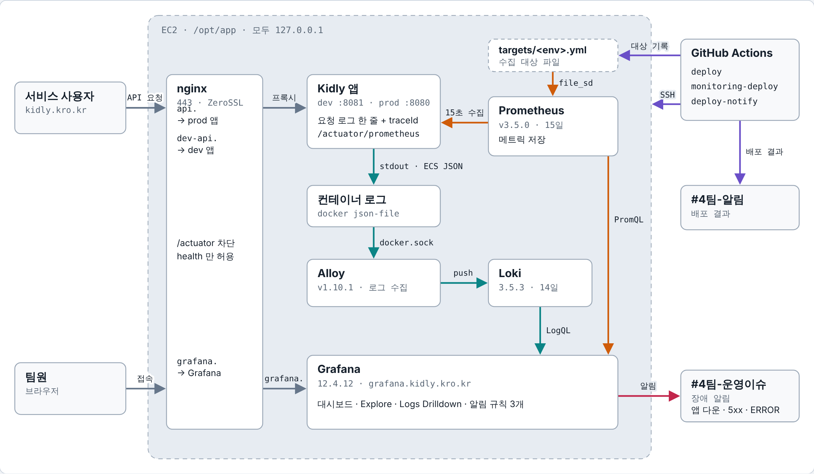

실선 색 = 흐름 (회색 요청 · 주황 메트릭 · 청록 로그 · 빨강 알림 · 보라 배포). nginx는 서버에 직접 설치하고, 밖에서 `/actuator`는 막고 `/actuator/health`만 엽니다.

## 10.1 흐름 네 가지

| 흐름 | 내용 |
|---|---|
| 메트릭 | 앱이 `/actuator/prometheus`에 JVM · HikariCP · HTTP 요청 · 로그 건수를 내놓고, Prometheus가 15초마다 가져가 15일 보관. 앱 배포가 성공하면 수집 대상 주소를 갱신. Grafana의 JVM · Spring Boot 대시보드와 알림 규칙이 씀 |
| 로그 | 앱은 콘솔(stdout)에 ECS JSON을 한 줄씩 쓰고, 요청마다 끝에 한 줄을 남김. Alloy가 docker에서 dev · prod 앱 로그를 읽어 env · level · service_name 라벨과 traceId · memberId를 붙이고, Loki가 14일 보관. Grafana Explore · Logs Drilldown에서 찾음 |
| 알림 | Grafana가 알림 규칙 3개를 1분마다 확인. 걸리면 30초 동안 모아 보내고, 계속되면 4시간마다 다시 보냄. 풀리면 해결 메시지. 메시지에 규칙 보기 · 일시정지 링크, 5xx · ERROR에는 로그 보기 링크 |
| 배포 | develop에 머지되면 앱은 `deploy`, `deploy/monitoring/**` 변경은 `monitoring-deploy` 워크플로가 돎. 앱 배포는 CI와 이미지 빌드가 모두 성공해야 서버에 올리고, 앱과 무관한 변경은 건너뜀. 둘 다 SSH로 서버의 `deploy.sh`를 실행하고, 비밀값은 Environment `dev` Secret에서 매번 새로 씀. `deploy-notify`가 결과를 `#4팀-알림`으로 보내고, 앱이 못 뜨면 로그에서 원인(Flyway 등)을 뽑아 붙임 |

## 10.2 오는 알림

| 알림 | 언제 | 채널 |
|---|---|---|
| 앱 다운 | 앱 메트릭을 2분 넘게 못 읽음 | `#4팀-운영이슈` |
| 5xx 증가 | 최근 5분 5xx 비율이 5% 넘음 (actuator 제외) | `#4팀-운영이슈` |
| ERROR 로그 | 최근 5분 ERROR 로그가 1건 이상 | `#4팀-운영이슈` |
| 배포 결과 | 앱 · 모니터링 배포가 끝날 때 (실패면 원인 로그 포함, GitHub Actions가 보냄) | `#4팀-알림` |

## 10.3 이럴 땐 여기서

| 알고 싶은 것 | 볼 곳 (모두 Grafana 안) |
|---|---|
| 메모리 · GC · 스레드 | 대시보드 → Kidly → JVM |
| DB 커넥션 풀 · HTTP 처리량 | 대시보드 → Kidly → Spring Boot (HikariCP) |
| 특정 URL · 상태 · 회원의 요청 | Drilldown → Logs → kidly → Fields 칸에서 거르고 Table |
| 한 요청의 로그 전부 | 표의 traceId → 같은 요청 로그 보기 (프론트는 응답 헤더 `X-Request-Id`로 찾음) |
| 알림이 왜 왔나 | Slack 메시지의 로그 보기 |
| 배포가 왜 실패했나 | `#4팀-알림` 메시지의 원인, 없으면 Actions 로그 |
| 검색 서비스 메트릭 · 로그 | Grafana에서 job `kidly-search`, 로그 `service_name=kidly-search`. 앱 대시보드 · 알림(job `kidly`)과 섞이지 않음 |
| Elasticsearch 상태 | t3.medium에서 `kubectl -n search get pods`, `/_cluster/health`(yellow · green), `/_cat/indices`(`dev-products` · `dev-sellers`) |
| 색인이 비었을 때 | Elasticsearch를 새로 만들었거나 데이터를 지운 경우. 상품 · 판매자 전체 다시 보내기 API로 채움(#577) |
| 검색이 503일 때 | Elasticsearch 연결 · 과부하 · 색인 없음. 검색 서비스를 복구 |
| 이벤트가 처리되지 않을 때 | Slack ERROR 알림 · 로그에서 `eventType` · `eventId` · 키로 찾기 → `{토픽}.{받는도메인}.dlt` 확인. 주문은 관리자 화면에서 DLT 재처리, 나머지는 K23 |

## 10.4 운영 규칙 · 아직 볼 수 없는 것

- **운영 규칙**: 대시보드 · 알림 규칙은 레포(`deploy/monitoring`)에서만 고칩니다. Grafana 화면에서 고친 대시보드 · 알림 · 기본 열은 다음 배포 때 레포 파일 내용으로 돌아갑니다.
- **로컬**: 로컬 compose에도 Prometheus · Grafana가 있어 bootRun 앱 메트릭을 `env=local`로 봅니다 (대시보드는 운영과 같은 파일).
- **아직 볼 수 없는 것**: 로컬 앱 로그(텍스트 콘솔이라 Loki로 가지 않음), 스케줄러 · 비동기 작업의 traceId(요청이 아닌 작업에는 아직 없음), 14일보다 오래된 로그 · 15일보다 오래된 메트릭.

# 11. 변경 내역

## 11.1 v1.1 예비판 → v2.0 (최종)

기준: develop `ef9028c5` (2026-11-02). 팀 확인이 필요한 항목은 앞의 "팀 확인 필요" 표(K1 ~ K31)에 있습니다.

| 장 | 항목 | v1.1 | v2.0 |
|---|---|---|---|
| 표지 · 앞 | 버전 · 안내 | 세미 v1.1 예비판 · 10/19 · develop 8a312dd | 최종 v2.0 · 11/2 · develop ef9028c5, 최종에서 바뀐 것 · K1 ~ K31 |
| 1.3 · 1.6 | 개요 · 목표 | - | AI 추천 · 조르기 · 리뷰 문단, 새 절 1.6 최종 프로젝트 목표(서비스 분리 · AI 추천 · 장애 격리 · 유실 없음) |
| 1.5 | 주요 기능 (주문 · 공통 · 커뮤니티 · 정산) | 최종 4줄(자녀 계정 · 미션 쇼핑 · 체형 리뷰 · 서비스 분리) | + API Gateway · 공용 장바구니 · 조르기 · 판매자 부분 취소 · 택배 조회 · 활동 이벤트 · 리뷰 · 찜, 월 정산 → 일정산 |
| 2.1 | 주문 · 인증 · 정산 · 커뮤니티 · 공통 | - | + 인증(Gateway) · 판매자 부분 취소 · 공용 장바구니 · 조르기 · 멱등 · 택배 조회 사용, ⑦ 정산 9줄(정산 보강본) · Kafka 공통 규칙 · 주기 작업 · 커뮤니티 4줄, 범위 표 갱신 |
| 3.1 ~ 3.4 | 구성 · 모듈 · 연결 | 앱 1개 · EC2 1대 · Spring 이벤트 | 새 구성도(Gateway · 서비스 · Kafka · EC2 2대), 모듈 표에 검색 · 커뮤니티 · 컨텍스트, 3.3 Kafka 토픽 표(세미 그림은 참고로 남김) |
| 5.1 · 5.3 | 기술 스택 · 데이터 모델 | - | 백엔드 · 데이터 · 인증 · 외부 API · 인프라 줄 고침, 새 절 5.3 데이터 모델 변경 |
| 6.1 · 6.2 · 6.3 | API · 이벤트 규약 · 복사본 | Spring 이벤트, JSON은 옮길 때 모양 | Gateway 헤더 인증, Kafka 메시지 · 순서 · 독립 배포 · 침범 금지, 예시의 ID는 숫자, 복사본 표에 검색 · 커뮤니티 · 추천 활동 · 결제 · Gateway |
| 7 | 카드 | ①~⑦ | ③ AI 추천으로 교체, ⑦ 정산 보강본(상세 1 ~ 10), 새 카드 ⑧ 리뷰 · 찜, ① · ④ · ⑤ · ⑥에 최종 항목 |
| 8 | 주문 · 상품 · 정산 · 공통 · 커뮤니티 | 리뷰는 최종 범위 한 줄 | 주문 판매자 취소 · 조르기 API와 이벤트, 상품 재발행 API · Kafka 수신, 정산 표 교체(일정산), Gateway 줄, 커뮤니티 새 표, 이벤트 표에 tokens-revoked · wish.* · review.created |
| 9 · 10 | 용어 · 운영 | - | 정산 · 주문 · 커뮤니티 용어, 모니터링 위치 · DLT 확인 방법 |
| 1.5 | 주요 기능 | 추천 2줄(사이즈 추천 · 자녀 맞춤 목록, 세미) | + AI 사이즈 추천 · AI 상품 추천 · 함께 사면 좋은 상품 · AI가 멈춰도 구매 가능(최종, 명세) · 기준 옷 등록 · Fit Passport(최종, 2순위) |
| 2.1 | 추천 | 규칙 추천 값 | + AI 추천 입력 · 활동 이벤트 · 순위 계산 · 더보기 · 홈 맛보기 · 함께 사면 · 고르는 범위 · 규칙의 역할 · 근거 · 이유 문장 · 상한 · timeout · 취소 상품 · 비로그인 · 탈퇴 |
| 2.1 | 제안 | P8까지 | + P9 ~ P22 |
| 3 | 전체 그림 | 3.5까지 | + 3.6 추천 서비스 데이터 흐름 |
| 4 | 주요 정책 | - | + 추천 미호출 · 목록 안에서만 · 근거와 출처 · 이유 문장 · 개인정보 · cm 비교 · 복사본 원칙 |
| 5.1 | 기술 스택 | - | + AI 호출(Spring AI · OpenAI) · chat 모델 · 임베딩 · 벡터 저장소 · RAG 자료 · 추천 저장소 · 실패 대비 · 배포 |
| 7 ③ | 사이즈 추천 카드 | 규칙 추천, 옛 경로 | 받는 것 · API(새 경로) · 완료 기준 · 응답을 AI 추천 기준으로 |
| 8 | 추천 | API 2개(옛 경로) · 받는 이벤트 4종 | API 경로 변경 + 2개 추가, 받는 이벤트 6종 추가, 구독 그룹 · DLT |
| 8 | 이벤트 한눈에 보기 | - | + 행 6개 |
| 9 | 용어 | - | + 10행 |
| K | 아직 정하지 않은 것 | K1 ~ K9(K1: 추천은 탈퇴 안 받음) | + K10 ~ K17, K1 수정(추천도 받음) |
| 앞 K | K1 · K6 · K9 | 탈퇴해도 지갑 열림 · Spring 이벤트 · 환불 이벤트 미정 | 지갑 동결 · 결제 Kafka(아웃박스 · DLT) · payment.refunded가 부분 취소용 계약으로 |
| 1.5 | 주요 기능 | 결제 1줄(예치금) | + 충전 취소 · 입출금 내역(세미), 지갑 동결 · 부분 취소 환불 · 결제 Kafka · 상품 검색 · 검색어 이벤트(최종), 서비스 분리 줄 교체 |
| 2.1 | 결제 · 검색 | - | + 충전 금액 · 실패 사유 · 동시 도착 · 지급 입금 · 탈퇴 지갑 · 이벤트 보내기 · 받기, 검색 조건 · 가격 · 페이지 · 색인 · 장애 · 검색어 이벤트 |
| 2.1 제안 | - | P22까지 | + P23 ~ P27 |
| 3.1 | 검색 서버 | 앱 1개 · EC2 1대 | 검색 서비스(t3.large compose) · Elasticsearch(t3.medium k3s) 문단 추가 |
| 3.2 | 모듈 | 상품이 목록 · 검색 | 검색 모듈 추가(codes-gy), 결제 줄에 동결 · 분리 |
| 3.5 | 그림 | 옛 이벤트 이름 · 결제 → 상품 화살표 | 주문 → 재고 차감 → 결제 → 주문, 정산 → 결제 → 정산 시퀀스로 다시 그림 |
| 3 | 새 절 | - | + 3.7 결제 서비스 이벤트 흐름 · 3.8 검색 서비스 흐름 |
| 4 | 주요 정책 | - | + 지갑 락 · 원장, 멱등 단위, 아웃박스, 탈퇴 지갑 동결, 부분 취소 환불, 검색 색인 · 장애, 검색어 이벤트 |
| 5.1 | 기술 스택 | Spring 이벤트 · PostgreSQL 검색 | Kafka(토픽 · 그룹 · DLT · 스위치) · Elasticsearch + nori |
| ERD | 결제 | - | + payment_outbox 표 · wallet.frozen_at 칸, 검색 색인 |
| 7 | ① · ② · ④ · ⑦ | - | 탈퇴 → 결제, 목록 담당 검색, 충전 취소 · 내역 API, Kafka 경로, 부분 환불 |
| 8 | 결제 | 받는 이벤트 4종 | + member.withdrawn · order-item.cancelled(부분 환불), 관리자 지갑 조회, 구독 그룹 · DLT, 아웃박스 시간 작업 |
| 8 | 검색 | - | 새 표 (GET /products, 받는 · 보내는 이벤트, 그룹 · DLT, 실행) |
| 8 | 이벤트 표 | - | member.withdrawn · product.changed · seller.changed 받는 쪽 고침, order-item.cancelled · payment.refunded 추가 |
| 9 | 용어 | - | + 14행, 검색용 표 줄 고침 |
| 10 | 운영 | - | + 검색 서비스 · Elasticsearch 볼 곳과 대응 |
| 앞 K | 아직 정하지 않은 것 | K17까지 | + K18 ~ K24 |

## 11.2 v1.0 → v1.1 예비판

기준: develop `8a312dd` (2026-10-19). 팀 확인이 필요한 항목은 앞의 "팀 확인 필요" 표(K1~K9)에 있습니다.

| 장 | 항목 | v1.0 | v1.1 예비판 |
|---|---|---|---|
| 표지 | 버전 | v1.0 · 10/12 · 개발 기준본 | v1.1 예비판 · 10/19 · develop 8a312dd 기준 |
| 앞 | v1.1 안내 | - | 주요 변경 · 팀 확인 필요(K1~K9) 추가 |
| 1.5 | 주요 기능 | 상품 옵션 색상 × 소재 × 사이즈 | 상품 유형이 정한 옵션 항목. 구매자 취소 · 환영 메일 · 관리자 운영 · 시연 설정 추가 |
| 2.1 | 취소 범위 | 재고 부족 · 결제 실패 · 결제 제한 시간 초과 | + 구매자 취소(발송 전) |
| 2.1 | 토큰 | 업무 정보 memberId · roles | + nickname, roles는 발급할 때 계산 |
| 2.1 | 로그인 · 닉네임 | - | 인가 코드 로그인 · 개발용 토큰 · 닉네임 수정 줄 추가 |
| 2.1 | 탈퇴 · 정지 · 알림 | 조건은 그때 결정, 알림 없음 | 즉시 탈퇴(K1) · 정지 · 관리자 권한 · 환영 메일 |
| 2.1 | 추천 규칙 | 범위 안 · 밖 2cm 이내가 모두 후보, 둘 중 큰 · 작은 쪽 | 범위 안이 우선, 없을 때만 2cm 이내. 기준 사이즈에서 한 단계, REGULAR, FREE 상품 |
| 2.1 | 적합도 | 한글 이름 | + ROOMY · PROPER · TIGHT |
| 2.1 | 자녀 정보 입력 | 선호 핏 SLIM · LOOSE, 입력 범위 미정 | 체형 SLIM · NORMAL · CHUNKY, 선호 핏 SLIM · REGULAR · LOOSE, 범위 확정 |
| 2.1 | 체형 판정 | - | 판정할 수 없으면 입력값, 안내 코드 |
| 2.1 | 암호화 대상 | 미정 | 토스 paymentKey만 (K3) |
| 2.1 | 장바구니 합치기 | 미정 | (회원 · 옵션 · 자녀)가 같으면 합침 |
| 2.1 | 중복 주문 방지 | - | Idempotency-Key |
| 2.1 | 결제 후 취소 | 기능 없음 · 범위 미정 | 발송 전 구매자 취소 |
| 2.1 | 삭제된 자녀 장바구니 | 미정 | 담기 404 · 주문 409 |
| 2.1 | 토스 승인 뒤 저장 실패 | 미정 | 승인 중 저장 + 정리 작업 |
| 2.1 | 외부 택배 추적 | Delivery Tracker 검토 중 | 쓰지 않음, 택배사 5곳 |
| 2.1 | 멈춘 주문 · 상태 이력 | - | 추가 |
| 2.1 | 정산 실행 | 일정은 설정값, 수동 시연 | 매월 1일 0시, Spring Batch, 실패 판매자 건너뛰기 |
| 2.1 | 지급 구분 | settlement.completed · wallet.credited | settlement.payout-requested · payment.payout-completed · payment.payout-failed |
| 2.1 제안 | P4 · P5 · P6 · P7 · P10 | 합의 전 | P4~P7 반영, P10 값 변경(THIN · CHUBBY → SLIM · CHUNKY, preferredFit에 REGULAR) |
| 3.1 | 이미지 업로드 · 모니터링 | - | Presigned URL 업로드, Prometheus · Loki · Grafana, Slack 알림 |
| 3.2 | 모듈 | 회원 · 상품 · 추천 · 주문 · 결제 · 정산 · 공통 | 회원 영역이 4개 모듈로 나뉨, 설정 모듈 |
| 3.3 | 시간 작업 | 주문 · 정산 | + 결제 · 알림 · 회원 |
| 4 | 주요 정책 | - | 구매자 취소, 취소 사유 · 배송 상태 |
| 5.1 | 데이터 | Flyway 없이 JPA가 테이블 생성, 개인정보 항목별 암호화 | Flyway, 모듈별 스키마, paymentKey만 암호화 |
| 5.1 | 백엔드 · 인프라 | - | Spring Batch, 메일 |
| 5.1 · 10 | 모니터링 | - | 5.1에 한 줄, 10장 운영 · 모니터링 추가 (구성도 · 흐름 4가지 · 알림 4종 · 볼 곳 · 운영 규칙 · 아직 안 되는 것) |
| 3.1 | 환경 | - | dev · prod 공통 EC2 한 대 |
| 6.1 | 주소 · 인증 · 실패 | /oauth2 예외 | 예외 없음, 공개 API · 권한, 오류 코드 이름 비노출 |
| 6.2 | 받기 · 처리 | processed_event 미확정 | @DomainEventListener, 도메인마다 중복 방지 |
| 6.2 | 값 · 클래스 위치 | ID 문자열, aggregateId 미확정 | 이벤트 ID는 Long(K8), DomainEvent 규칙 |
| 6.2 | 예시 2 | birthMonth · producer member | birthDate · producer childprofile |
| 6.3 | 복사본 | 생년월, 판매자 복사본 (보완) | 생년월일, 판매자 복사본 구현, 회원 · 판매자 · 알림 줄 추가 |
| 7.1 | 초기 데이터 | 잔액 100,000원, 카테고리 1 · 2, 네이비/면/110 | 잔액 0원(K7), 상품 기준 데이터, 색상 × 사이즈, 회원 4~6 |
| 7 ① | 로그인 API | GET /oauth2/authorization/kakao | POST /api/v1/auth/login/kakao |
| 7 ② | 판매 시작 | POST .../start-sale | PUT .../sale-status, 카테고리 · 이미지 API, 판매 시작 조건 |
| 7 ③ | 추천 응답 | - | 안내 · 후보 사이즈 · lastPurchasedSize |
| 7 ④ | 충전 · 잔액 | /charges · /wallet | /wallets/me/charges · /wallets/me, 주문 취소 · 타임라인, P5 확정 |
| 7 ⑦ | 넘기는 것 | 정산 완료됨 | 정산 지급 요청됨 → 지급 완료 · 실패 |
| 8 | 이벤트 표 | 13개 | 17개 (member.changed · 지급 3종 추가, 이름 변경, 필드 추가) |
| 8 | 회원 | GET /oauth2/..., 성장 이력 PATCH, 판매자 정보 PATCH | 로그인 · 개발용 토큰 · 관리자 권한 추가, 두 PATCH는 없음 |
| 8 | 상품 | start-sale · stop-sale · PATCH · .../stock | sale-status · PUT · inventory-adjustments, 기준 데이터 · 카테고리 · 이미지 추가 |
| 8 | 주문 | - | 취소 · 타임라인 · 관리자 점검 4종 |
| 8 | 결제 | /charges · /wallet · /wallet/transactions | /wallets/me/..., 충전 실패 반영 · 웹훅 · 결제 상세 |
| 8 | 정산 | - | 실행 결과 · 멈춘 실행 정리 |
| 8 | 공통 | - | FE 설정 · actuator |
| 9 | 용어 | Address · SettlementTarget | ShippingAddress · SettlementItem, Delivery, 새 용어 6개 |
| 1.2 | 판매하는 상품 | 아이 옷 | 최종에서 아기 용품까지 넓힐 가능성 |
| 2.1 | 상품 줄 | - | 판매 상태 · 품절 · 상품 수정 · 가격 · 재고 조정 · 기준 데이터 삭제 |
| 2.1 | 추천 줄 | - | 없는 상품 404 문구, 자녀 맞춤 목록, 사이즈 추천과 판매 상태 |
| 4 · 6.3 | 주문의 옵션 이름 | - | 주문상품에 옵션 이름 저장, 주문용 상품 정보에 옵션 판매 상태 |
| 3.2 · 7.1 · 8 | 용어 통일 | 속성 | 항목 (옵션 항목 · 정보 항목), 7.1 기준 데이터 구성 |
| 7 ② | 넘기는 것 | - | 옵션 이름 · 옵션 판매 상태 · 사이즈 무관 여부 |
| 7 | ERD 기준 | - | 상품 표 18개 · 추천 표 4개(+2) |
| 9 | 용어 | - | 상품 · 추천 용어 14개 |
| 앞 K5 | 취소 뒤 늦은 재고 차감 | 누가 복구하는지 | 상품이 두 순서 모두 처리, 남는 것은 리스너 실패 |
| 2.1 | 적용값 표 정렬 | 카드 순서 섞임 | ① → ⑦ → 보완 → 공통 순 |
| 2.1 제안 | 반영된 제안 | P4 ~ P8 · P10이 제안 표에 | P4 ~ P7 · P10을 적용값 표로 옮기고 P8만 남김 |
| 7 · 7.1 | 혼자 시작하기 · 카드별 추가 데이터 | 카드마다 칸, 7.1에 표 | 뺌 (단계 연결 완료) |
| 1.5 · 2.1 · 3.1 · 4 · 7 · 8 | 중복 줄임 | 같은 내용이 여러 곳 | 구매자 취소 · 관리자 판매 중지 · 모니터링 · 이벤트 이름 변경 안내를 한 곳(2.1 · 10장 · 앞쪽)에 두고 나머지는 참조만 |
| 5 · 6 · 7 · 10 | 표현 바로잡기 | - | 5~10장 안내, 개발용 토큰 범위(local · test · dev), 이벤트 예시의 ID 표기, ⑦ 카드 지급 결과 위치, 10장 Nginx 문장 |
| 그림 | 글자만 고침 | 정산 완료됨 → 지급 요청됨, INVENTORY_RESERVATION → INVENTORY_DEDUCTION, 색상 × 소재 × 사이즈 → 옵션 항목 값 조합, SETTLEMENT_TARGET → SETTLEMENT_ITEM, SHIPMENT → DELIVERY | 나머지 그림은 v1.0 그대로 |
